# Diseño, Modelado Formal e Implementación Web de un Sistema Operativo Modular bajo Arquitectura Microkernel/Minikernel

**Autores:** Grupo de Trabajo — Ingeniería de Sistemas  
**Institución:** Universidad Distrital Francisco José de Caldas, Facultad de Ingeniería, Proyecto Curricular de Ingeniería de Sistemas, Bogotá D.C., Colombia (2026)  
**Asignatura:** Sistemas Operativos — Evaluación Práctica Integradora (30%)  
**Estándar de Documentación:** Norma Técnica IEEE (*Institute of Electrical and Electronics Engineers*)

---

## *Abstract*
This technical paper presents the formal software engineering specification, object-oriented architectural modeling, and interactive web simulation of a modular Operating System built strictly upon a **Microkernel / Minikernel** architecture. Unlike monolithic kernels where process scheduling, memory allocation, file systems, I/O device drivers, and security policies share a single privileged address space, the proposed Minikernel isolates the core (`Kernel`) to three primitive responsibilities: master clock tick generation with explicit Context Switch overhead ($T_{cs}$), prioritized hardware/software interrupt dispatching (`InterruptController`), and an Inter-Process Communication message bus (`IPCBus` / `IPCMessage`). All five operating system subsystems—Process Server (`ProcessManager` & `PCB`), Memory Server (`MemoryManager`), File System Server (`FileManager`), I/O & Network Server (`DeviceDriver` & `DMAController`), and Security Reference Monitor (`SecurityController`)—execute as decoupled user-space servers communicating exclusively through immutable IPC transactions. This document integrates the complete matrix of 30 Functional Requirements (`RF-01` to `RF-30`) and 12 Non-Functional Requirements (`RNF-01` to `RNF-12`), 10 formal Use Case specifications (`CU-01` to `CU-10`) with their corresponding 10 UML Activity Diagrams, the unified UML Class Architecture, the UX/UI Web Navigation Map, the Relational/NoSQL Persistence Schema (`LocalStorage`/`IndexedDB`), and a Cross-Verification Matrix designed to guarantee zero conceptual or implementation discrepancies (*Zero Kernel Faults*).

**Palabras Clave (*Index Terms*)—** *Microkernel, Minikernel, Inter-Process Communication (IPC), Process Control Block (PCB), Banker's Algorithm, Memory Fragmentation, FAT, Inodes, Disk Arm Scheduling, Direct Memory Access (DMA), Access Control List (ACL).*

---

## I. INTRODUCCIÓN Y ARQUITECTURA MANDATORIA MICROKERNEL

El diseño de sistemas operativos contemporáneos enfrenta el compromiso fundamental entre rendimiento, aislamiento de fallos y verificabilidad formal [1], [2]. En una arquitectura **Microkernel / Minikernel**, el núcleo privilegiado se reduce al mínimo indispensable (*Mecanismo*), delegando las políticas de gestión de recursos a servidores independientes en espacio de usuario (*Política*) [3].

### A. Principio de Aislamiento Estricto e Intercambio de Mensajes (IPC)
En cumplimiento estricto de la Guía de Proyecto (Sección 1), el sistema implementado prohíbe cualquier invocación o referencia directa acoplada entre los módulos servidores. Toda operación inter-módulos se materializa mediante una estructura transaccional `IPCMessage`:

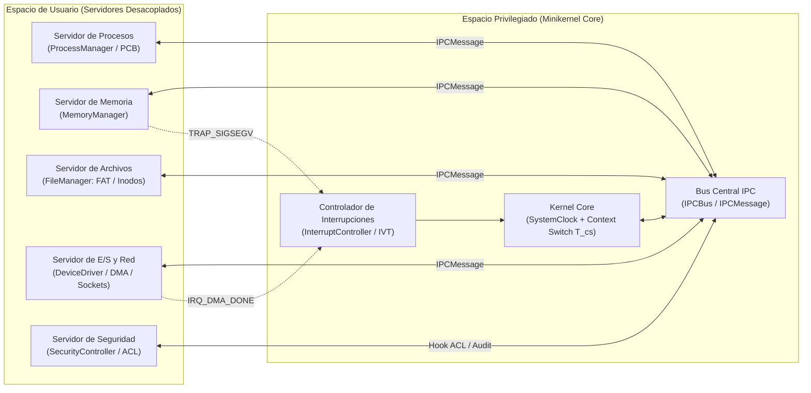

---

## II. INGENIERÍA DE REQUERIMIENTOS (FUNCIONALES Y NO FUNCIONALES)

La Tabla I especifica los **30 Requerimientos Funcionales (`RF-01` a `RF-30`)** codificados en términos de **Entrada, Procesamiento, Salida y Restricciones de Arquitectura Minikernel**, cubriendo el núcleo y los 5 módulos técnicos.

### A. Matriz de Requerimientos Funcionales (`RF-01` a `RF-30`)

| Código | Módulo | Nombre del Requerimiento | Entrada | Procesamiento | Salida | Restricción de Arquitectura Minikernel |
| :--- | :--- | :--- | :--- | :--- | :--- | :--- |
| **RF-01** | Core / IPC | Reloj Maestro del Sistema (`SystemClock`) | Frecuencia $\Delta t \in [80, 3000]\text{ ms}$, comandos `START`, `PAUSE`, `STEP`, `RESET`. | Incrementa atómicamente `currentTick`, dispara el ciclo maestro del núcleo y sincroniza los servidores vía IPC. | Pulso `currentTick` actualizado y telemetría emitida a la UI. | El reloj maestro reside exclusivamente en `Kernel`; los servidores no poseen temporizadores propios. |
| **RF-02** | Core / IPC | Overhead de Cambio de Contexto ($T_{cs}$) | Parámetro configurable $T_{cs} \in [0, 10]$ ticks, `PCB` saliente y `PCB` entrante. | Durante $T_{cs}$ ticks coloca la CPU en estado `CONTEXT_SWITCHING`, guarda registros (`PC`, `SP`, `Acc`) del proceso saliente y restaura los del entrante. | Contabilización exacta de ticks de overhead y restauración de registros en CPU. | El núcleo solo conmuta registros físicos; la decisión de qué proceso elegir proviene de `PROCESS_SERVER`. |
| **RF-03** | Core / IPC | Enrutamiento en el Bus IPC (`IPCBus`) | Instancia `IPCMessage` (`id`, `tick`, `sender`, `receiver`, `action`, `payload`, `status`, `authContext`). | Valida el endpoint receptor, ejecuta el hook de seguridad ACL, entrega el mensaje al buzón destino y registra la respuesta en el historial circular. | `IPCMessage` con estado `SUCCESS` o `REJECTED` y traza en vivo en el monitor IPC. | Prohibido el acoplamiento directo entre clases de servidores; 100% del tráfico pasa por `IPCBus`. |
| **RF-04** | Core / IPC | Despacho de Llamadas al Sistema (`SyscallDispatcher`) | Código de syscall (`SYS_FORK`, `SYS_ALLOC`, `SYS_FREE`, `SYS_READ_FILE`, `SYS_WRITE_FILE`, `SYS_IO_DISK_REQ`, etc.). | Conmuta a modo privilegiado y traduce la petición en un `IPCMessage` dirigido al servidor competente. | Resultado de la operación o código de excepción devuelto al emisor. | El despachador en el núcleo no implementa lógica de archivos, memoria ni E/S. |
| **RF-05** | Core / IPC | Vectorización de Interrupciones (`InterruptController`) | Solicitud `InterruptRequest` (`irqCode`, `type`, `priority`, `targetPid`). | Encola por prioridad estricta (`0=TRAP_SIGSEGV`, `1=IRQ_DMA_DONE`, `2=IRQ_TIMER`) y ejecuta la rutina ISR registrada en la tabla `ivt`. | Despacho de ISR y notificación IPC al servidor correspondiente. | Las rutinas ISR en el núcleo son mínimas (*Top-Half*) y delegan el manejo a los servidores vía IPC. |
| **RF-06** | Core / IPC | Mediación Pre-Despacho ACL en Bus IPC | `IPCMessage` en tránsito con `authContext` (`userId`, `username`, `role`). | Antes de entregar el mensaje al servidor destino, consulta el validador del `SecurityController` (`SECURITY_SERVER`). | Autorización (`ACCEPTED`) o rechazo inmediato (`REJECTED`) con log de auditoría. | Implementa el patrón *Reference Monitor* desacoplado entre `IPCBus` y `SecurityController`. |
| **RF-07** | 2.1 Procesos | Creación de Aplicaciones y Procesos (`SYS_FORK`) | Nombre de app, tipo (`COMPILED` / `INTERPRETED`), prioridad, ráfaga CPU ($T_{burst}$), memoria requerida ($M_{req}$ KB). | Solicita reserva de RAM a `MEMORY_SERVER` vía IPC; si tiene éxito, instancia `PCB` con `PID` único en estado `READY`. | Objeto `PCB` insertado en `Ready Queue` y vinculado a su partición RAM. | Si `MEMORY_SERVER` rechaza la reserva, `PROCESS_SERVER` aborta la admisión sin corromper las colas. |
| **RF-08** | 2.1 Procesos | Estructura Dinámica del `PCB` y Registros CPU | Pulso de ejecución de CPU sobre el proceso activo. | Actualiza dinámicamente `PID`, `state`, registros simulados (`PC`, `SP`, `Acc`), `priority`, `cpuTimeUsed`, `remainingTime`, `waitingTime` y punteros a memoria (`baseAddress`, `limitAddress`). | Tarjeta e inspector de `PCB` actualizados en tiempo real en cada tick. | El `PCB` almacena los punteros `baseAddress` y `limitAddress` otorgados por `MemoryManager`. |
| **RF-09** | 2.1 Procesos | Planificación de CPU Parametrizable (`RR`, `Prioridades`, `SJF/SRTF`) | Algoritmo seleccionado (`RR` con Quantum $Q$, `PRIORITY_PREEMPTIVE`, `SRTF`) y cola de listos. | Evalúa en cada tick: en `RR` rota por expiración de Quantum $Q$; en `PRIORITY_PREEMPTIVE` expropia si llega menor valor numérico de prioridad; en `SRTF` expropia si llega menor ráfaga restante ($T_r$). | Decisión de despacho o expropiación (`contextSwitchRequired`) enviada al `Kernel`. | La política algorítmica reside en `ProcessManager` y el mecanismo de cambio de contexto en `Kernel`. |
| **RF-10** | 2.1 Procesos | Transiciones y Visualización de Colas en Tiempo Real | Eventos de admisión, despacho, bloqueo por E/S o semáforo, despertar por IRQ y terminación. | Mueve dinámicamente cada `PCB` entre `Ready Queue`, `Running (CPU)`, `Blocked Queue` y `Terminated`. | Representación gráfica instantánea de las colas y sus procesos en la UI. | Al terminar (`remainingTime == 0`), emite automáticamente `SYS_FREE` al `MEMORY_SERVER` vía IPC. |
| **RF-11** | 2.1 Procesos | Sincronización mediante Semáforos y Mutex | Operación `WAIT` ($P$) o `SIGNAL` ($V$) sobre un `Semaphore` (`MUTEX_PRINTER`, `SEM_DB_POOL`) y `PID`. | En `WAIT` decrementa contador y bloquea al proceso si es $<0$; en `SIGNAL` incrementa y despierta en orden FIFO al primer proceso en espera. | Estado del semáforo (`value`, `holderPid`, `waitingPids`) y transición de cola del proceso. | Canalizado como llamada `SYS_SEM_OP` a través del bus IPC del Microkernel. |
| **RF-12** | 2.1 Procesos | Prevención de Interbloqueos con Algoritmo del Banquero | Matrices `Allocation`, `Max`, vector `Available`, solicitud `Request` de un proceso $P_i$. | Calcula $Need = Max - Allocation$, valida $Request \le Need$ y $Request \le Available$, simula asignación provisoria y ejecuta el algoritmo de seguridad buscando secuencia $\langle P_{s_1}, \dots, P_{s_n} \rangle$. | Veredicto `SAFE` (con secuencia segura y actualización de matrices) o `UNSAFE` (rollback preventivo de deadlock). | Impide interbloqueos antes de comprometer recursos compartidos entre procesos. |
| **RF-13** | 2.1 Procesos | Métricas de Rendimiento y Overhead de Conmutación | Historial de ticks ejecutados, ticks en `CONTEXT_SWITCHING` y tiempos de espera ($W_t$). | Calcula el tiempo de espera acumulado por proceso y los ticks invertidos en cambios de contexto ($T_{cs}$). | Indicadores en tiempo real de conmutaciones de CPU y ticks de penalización. | Coherencia exacta entre el parámetro $T_{cs}$ del `Kernel` y las pausas de conmutación en CPU. |
| **RF-14** | 2.2 Memoria | Esquema de Memoria Estática (Particiones Fijas) | Selección de modo `STATIC_FIXED` y solicitud $(PID, M_{req})$. | Administra particiones fijas preconfiguradas (`128, 256, 128, 256, 128 KB` + `128 KB` Kernel) y adjudica una partición libre $\ge M_{req}$. | Partición fija asignada y cálculo de su fragmentación interna ($S_{part} - M_{req}$). | Gestionado exclusivamente por `MemoryManager` tras recibir `SYS_ALLOC` vía IPC. |
| **RF-15** | 2.2 Memoria | Esquema de Memoria Dinámica (`First-Fit`, `Best-Fit`, `Worst-Fit`) | Selección de modo `DYNAMIC_VARIABLE`, algoritmo (`FIRST_FIT`, `BEST_FIT`, `WORST_FIT`) y solicitud $(PID, M_{req})$. | Selecciona el hueco libre según la política activa, divide el bloque (*Splitting*) ajustándolo exactamente a $M_{req}$, y al liberar (`SYS_FREE`) fusiona huecos libres adyacentes (*Coalescing*). | Mapa dinámico de bloques RAM actualizado y punteros `base`/`limit` retornados por IPC. | En modo dinámico las particiones se crean del tamaño exacto solicitado (`FI = 0 KB`). |
| **RF-16** | 2.2 Memoria | Análisis Matemático y Gráfico de Fragmentación Interna y Externa | Mapa actual de particiones ocupadas y libres en `MemoryManager`. | Calcula en cada operación: $FI = \sum (S_i - M_{req,i})$ en bloques ocupados y $FE = M_{free} - M_{max\_hole}$ en bloques libres no contiguos. | Objeto `FragmentationReport` y mapa gráfico proporcional de bloques en la UI. | Distingue rigurosamente entre Fragmentación Interna (particiones fijas) y Externa (particiones variables). |
| **RF-17** | 2.3 Archivos | Estructura Jerárquica de Directorios y Metadatos (`FSNode`) | Ruta (`/` , `/bin`, `/etc`, `/home`, `/pub`), propietario, permisos `rwx` y contenido. | Mantiene el árbol jerárquico de nodos `FSNode` con atributos `id`, `name`, `path`, `type`, `sizeBytes`, `owner`, `permissions`, `createdAt`, `updatedAt`. | Árbol interactivo de directorios y panel de metadatos en la interfaz web. | Ningún proceso muta nodos directamente; toda operación se solicita a `FS_SERVER` vía IPC. |
| **RF-18** | 2.3 Archivos | Formateo Parametrizable del Sistema de Archivos (`FAT` vs. `Inodos`) | Tipo de formato (`FAT` o `INODES`) y tamaño de bloque/cluster (`512 B`, `1024 B`, `4096 B`). | Reinicializa la tabla de bloques/clusters (`fatTable` con enlaces `nextBlock`/`EOF` o `inodeTable` con punteros directos e indirecto) y recrea el árbol base. | Volumen formateado y visualización inmediata de la tabla FAT o tabla de Inodos. | Requiere rol `ROOT` validado por `SecurityController` antes de permitir `SYS_FORMAT_FS`. |
| **RF-19** | 2.3 Archivos | Operaciones CRUD de Archivos y Directorios | Operaciones Crear (`SYS_CREATE_NODE`), Leer (`SYS_READ_FILE`), Modificar (`SYS_WRITE_FILE`), Renombrar (`SYS_RENAME_NODE`) y Eliminar (`SYS_DELETE_NODE`). | Asigna o libera bloques según el tamaño en bytes del archivo, actualiza enlaces en `FAT` o `Inodos` y emite peticiones de lectura/escritura física al `IO_SERVER` vía IPC. | Actualización en vivo del explorador de archivos, visor de contenido y mapa de bloques. | Cada lectura/escritura de archivo genera automáticamente una solicitud `SYS_IO_DISK_REQ` hacia `DeviceDriver`. |
| **RF-20** | 2.4 E/S | Parametrización Geométrica de Disco Magnético/SSD (`DiskGeometry`) | Número de cilindros, pistas por cilindro, sectores por pista y velocidad de rotación (RPM). | Modela la geometría física del disco y valida que toda petición apunte a un cilindro válido $[0, C_{max}-1]$. | Configuración geométrica activa en `DeviceDriver`. | Encapsulado en `IO_SERVER`; el resto del sistema opera con rutas o bloques lógicos. |
| **RF-21** | 2.4 E/S | Planificación de Brazo de Disco (`FCFS`, `SSTF`, `SCAN`, `C-SCAN`) | Cola de peticiones de cilindros (`pendingDiskQueue`), cilindro actual del cabezal y algoritmo elegido. | Ordena y atiende las peticiones según **FCFS** (orden de llegada), **SSTF** (menor distancia al cabezal actual), **SCAN** (elevador ida y vuelta) o **C-SCAN** (barrido circular ascendente). | Gráfica cartesiana en tiempo real del recorrido del cabezal y distancia total (`totalSeekDistance`). | Permite tanto avance tick a tick como ejecución comparativa de lote completo. |
| **RF-22** | 2.4 E/S | Canal DMA (`DMAController`) e Interrupciones de Hardware (`IRQ_DMA_DONE`) | Solicitud de transferencia de bloque entre disco y memoria RAM. | El `DMAController` transfiere datos hacia la RAM en ticks de reloj **sin ocupar la CPU** (que sigue ejecutando otros procesos listos). Al terminar, dispara `IRQ_DMA_DONE` al `Kernel`. | Monitor de estado DMA (`IDLE`, `TRANSFERRING`, `IRQ_ASSERTED`) y despertar automático del proceso (`BLOCKED -> READY`). | Demuestra concurrencia real entre transferencia física DMA y ejecución de instrucciones en CPU. |
| **RF-23** | 2.4 E/S | Interfaces de Red Simuladas mediante Sockets (`TX` / `RX`) | Socket origen, puerto destino y payload del paquete de red (`SYS_NET_SEND`). | Encola el paquete con cabeceras simuladas en el buffer de salida (`txBuffer`) y lo transfiere en el ciclo de E/S al buffer de entrada (`rxBuffer`) del socket receptor. | Visualización de paquetes en tránsito y entregados en los buffers `TX` y `RX` de los sockets. | Gestionado por `DeviceDriver` mediante llamadas IPC de red entre procesos. |
| **RF-24** | Persistencia | Persistencia Relacional/NoSQL en `LocalStorage` e `IndexedDB` | Estado actual de usuarios, configuración, árbol FS, tablas FAT/Inodos, disco y logs de seguridad. | `PersistenceStore` serializa y guarda instantáneas automáticas en `LocalStorage` e `IndexedDB`, permitiendo restaurar al recargar o exportar/importar JSON. | Estado persistente entre sesiones del navegador y descarga de snapshot JSON. | Segrega el almacenamiento de auditoría para garantizar su preservación tras recargas. |
| **RF-25** | 2.5 Seguridad | Autenticación y Gestión de Perfiles (`ROOT`, `STANDARD`, `GUEST`) | Selección o login de usuario (`root`, `std_user`, `guest`) con contraseña (`SYS_AUTH_LOGIN`). | Verifica credenciales en el catálogo `UserAccount`, actualiza la sesión activa y asigna rol, `UID` y cuota de memoria. | Cambio de perfil activo en la barra global y registro `AUTH_LOGIN_SUCCESS` / `FAILED`. | Cada `IPCMessage` emitido por la UI o procesos lleva adjunto el `authContext` del perfil activo. |
| **RF-26** | 2.5 Seguridad | Control de Acceso sobre Procesos y Cuotas (`ACL`) | Solicitudes `SYS_FORK` y `SYS_KILL` evaluadas según el rol del emisor. | Impide que `GUEST` mate procesos (`SYS_KILL`) o cree procesos mayores a su cuota (`128 KB`). | Autorización o rechazo IPC inmediato con causa detallada. | Validado en el hook pre-despacho del `IPCBus` antes de tocar `ProcessManager`. |
| **RF-27** | 2.5 Seguridad | Protección de Fronteras de Memoria (`Base/Límite` y Espacio de Kernel) | Solicitud de acceso a dirección de memoria (`SYS_MEM_ACCESS`) o prueba de intrusión. | Verifica que ningún proceso acceda a la región del Microkernel (`< 128 KB`) ni fuera de su intervalo `[baseAddress, limitAddress)`. Si infringe, emite `TRAP_SIGSEGV`. | Terminación inmediata del proceso infractor y alerta crítica en la consola de seguridad. | Simula la protección hardware MMU/Base+Límite coordinada entre `MemoryManager`, `SecurityController` y `Kernel`. |
| **RF-28** | 2.5 Seguridad | Evaluación de Matriz ACL y Permisos `rwx` en el Sistema de Archivos | Operaciones de lectura, escritura, creación, renombrado o borrado sobre rutas del FS. | Verifica la matriz ACL: `ROOT` posee control total; `STANDARD` tiene `rwx` en `/home` y solo lectura en `/etc`; `GUEST` está restringido a lectura (`r-x`) en `/pub` y `/home`, bloqueando toda escritura o lectura de `/etc`. | Rechazo `REJECTED` en el bus IPC ante violaciones `rwx` y preservación intacta del nodo. | Ninguna mutación llega a `FileManager` si `SecurityController` deniega el permiso. |
| **RF-29** | 2.5 Seguridad | Detección de Escalamiento de Privilegios Fallido | Intento de un usuario no-Root de formatear el FS (`SYS_FORMAT_FS`), reprogramar el disco o ejecutar `setuid(0)`. | Intercepta la llamada privilegiada, la bloquea antes de su ejecución y la clasifica como `PRIVILEGE_ESCALATION_FAILED` con severidad `CRITICAL`. | Bloqueo de la operación y alerta roja en la consola de auditoría. | Protege las operaciones críticas de administración del Minikernel. |
| **RF-30** | 2.5 Seguridad | Registro Inmutable de Auditoría Forense (`SecurityAuditLog`) | Todo evento de autenticación, acceso denegado, violación de memoria o escalamiento fallido. | Crea objetos congelados (`Object.freeze`) con número de secuencia, tick de reloj, severidad (`INFO`, `WARNING`, `CRITICAL`) y hash encadenado FNV/SHA (`prevHash -> hash`). | Bitácora forense en tiempo real en la Consola de Seguridad y Terminal Web. | Los registros de `SecurityAuditLog` son inmutables (*Append-Only*) durante la simulación. |

---

### B. Matriz de Requerimientos No Funcionales (`RNF-01` a `RNF-12`)

| Código | Nombre | Especificación Técnica y Restricción de Arquitectura Minikernel |
| :--- | :--- | :--- |
| **RNF-01** | Desacoplamiento Microkernel Estricto | Cero referencias directas entre servidores (`ProcessManager`, `MemoryManager`, `FileManager`, `DeviceDriver`, `SecurityController`); 100% de comunicación vía `Kernel.sendIPC(IPCMessage)`. |
| **RNF-02** | Determinismo Secuencial por Tick | Ejecución determinista del ciclo de reloj: `1. Arbitraje IRQ` $\rightarrow$ `2. Avance DMA/Disco` $\rightarrow$ `3. Overhead Context Switch` $\rightarrow$ `4. Planificación y Ejecución CPU`. |
| **RNF-03** | Observabilidad Reactiva en Tiempo Real | Actualización sincrónica de los 5 paneles interactivos y del monitor del Bus IPC en cada tick o syscall sin recargar la página. |
| **RNF-04** | Fidelidad Matemática de Algoritmos | Cálculo exacto de espera/retorno en planificación, estado seguro en el Algoritmo del Banquero ($Need = Max - Allocation$), fragmentación interna/externa y distancia de cabezal de disco. |
| **RNF-05** | Aislamiento de Espacio de Direcciones | Reserva estricta de los primeros `128 KB` de RAM física para el Microkernel y validación de límites por partición de proceso. |
| **RNF-06** | Integridad de Invariantes de Recursos | La suma de particiones y huecos libres en modo dinámico siempre iguala la memoria de usuario (`896 KB`) más el espacio de Kernel (`128 KB` = `1024 KB`). |
| **RNF-07** | Coherencia entre Árbol FS y Tablas de Bloques | Toda creación, modificación o eliminación de un archivo actualiza atómicamente tanto el nodo `FSNode` como la tabla `FAT` o de `Inodos`. |
| **RNF-08** | Concurrencia Asíncrona de Canal DMA | El controlador DMA transfiere sectores a RAM mientras la CPU principal continúa ejecutando otros procesos de la `Ready Queue`. |
| **RNF-09** | Persistencia Resiliente Multi-Motor | Almacenamiento automático en `LocalStorage` e `IndexedDB` con soporte de exportación de instantáneas JSON y restauración a estado de fábrica. |
| **RNF-10** | Mediación Completa Zero-Trust (ACL) | Toda llamada al sistema originada por un usuario o proceso atraviesa el validador ACL del `SecurityController` antes de llegar al servidor destino. |
| **RNF-11** | Inmutabilidad Criptográfica de Auditoría | Cada entrada `SecurityAuditLog` se sella con `Object.freeze()` y encadena el hash hexadecimal del registro previo (`prevHash`). |
| **RNF-12** | Verificación Cruzada Cero Inconsistencias | Correspondencia 1:1 entre los requerimientos, los 10 Casos de Uso, los 10 Diagramas de Actividad, el Diagrama de Clases UML y el código fuente JavaScript/ES6. |

---

## III. ESPECIFICACIÓN DE LOS 10 CASOS DE USO Y DIAGRAMAS DE ACTIVIDAD UML

En cumplimiento de la Sección 3 de la Guía de Proyecto, a continuación se documentan formalmente los **10 Casos de Uso principales (`CU-01` a `CU-10`)** cubriendo el núcleo y los 5 módulos, seguidos inmediatamente por su respectivo **Diagrama de Actividad UML** formal.

---

### A. `CU-01`: Despachar Mensaje IPC y Syscall entre Módulos Desacoplados

| Campo | Especificación |
| :--- | :--- |
| **ID / Nombre** | `CU-01`: Despachar Mensaje IPC y Syscall entre Módulos Desacoplados |
| **Actores** | Proceso de Usuario / Módulo Emisor, `Kernel`, `IPCBus`, `SecurityController`, Servidor Receptor. |
| **Módulo** | Núcleo Mínimo (Minikernel) e IPC (`RF-03`, `RF-04`, `RF-06`). |
| **Precondiciones** | El `Kernel` está inicializado y los 5 servidores han registrado sus endpoints en `IPCBus`. |
| **Postcondiciones** | El `IPCMessage` es validado por ACL, procesado por el servidor destino y registrado en el historial con estado `SUCCESS` o `REJECTED`. |
| **Flujo Principal** | 1. El emisor invoca `Kernel.sendIPC({ sender, receiver, action, payload })`. 2. El `Kernel` instancia un `IPCMessage` con `id` único, `tick` actual y `authContext` de la sesión activa. 3. El `IPCBus` intercepta el mensaje y ejecuta el hook `securityGuard(message)` ante el `SecurityController`. 4. El `SecurityController` autoriza la operación según la Matriz ACL. 5. El `IPCBus` marca el mensaje como `ACCEPTED` y ejecuta el handler registrado del `receiver`. 6. El servidor destino procesa el `payload` de forma desacoplada y retorna la respuesta. 7. El `IPCBus` marca el mensaje como `SUCCESS`, lo inserta en el historial y notifica a la UI. |
| **Flujos Alternos / Excepciones** | **EX-01 (Rechazo ACL):** Si `SecurityController` deniega el permiso, `IPCBus` marca el mensaje `REJECTED`, registra un `SecurityAuditLog` y aborta el envío. **EX-02 (Excepción en Servidor):** Si el servidor lanza un error (ej. disco lleno o sin memoria), el mensaje pasa a `REJECTED` con la causa exacta en `errorReason`. |

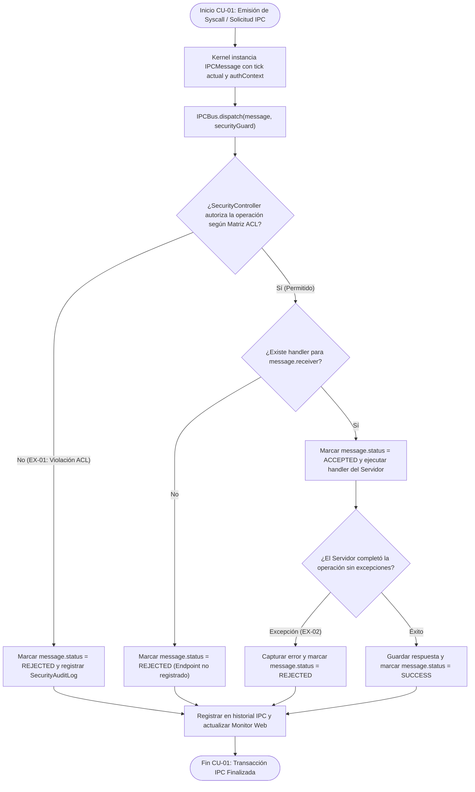

---

### B. `CU-02`: Ejecutar Ciclo de Reloj, Interrupción y Cambio de Contexto ($T_{cs}$)

| Campo | Especificación |
| :--- | :--- |
| **ID / Nombre** | `CU-02`: Ejecutar Ciclo de Reloj, Interrupción y Cambio de Contexto ($T_{cs}$) |
| **Actores** | `SystemClock`, `Kernel`, `InterruptController`, `ProcessManager`, `DeviceDriver`. |
| **Módulo** | Núcleo Mínimo y Módulo 2.1 Procesos (`RF-01`, `RF-02`, `RF-05`, `RF-13`). |
| **Precondiciones** | Reloj configurado con intervalo $\Delta t$ y penalización de cambio de contexto $T_{cs} \ge 0$ ticks. |
| **Postcondiciones** | Se atienden las IRQs pendientes, se descuenta el overhead $T_{cs}$ si hay conmutación de proceso, o el proceso activo ejecuta 1 tick de instrucción. |
| **Flujo Principal** | 1. `SystemClock.step()` incrementa `currentTick` y dispara `Kernel.executeClockCycle(tick)`. 2. El `Kernel` revisa `InterruptController.hasPendingIRQs()` y ejecuta las rutinas ISR por orden de prioridad. 3. El `Kernel` envía `IO_CLOCK_TICK` vía IPC al `IO_SERVER` para avanzar transferencias DMA y disco. 4. El `Kernel` verifica si `remainingContextSwitchTicks > 0`; si no, envía `PROC_CLOCK_TICK` al `PROCESS_SERVER`. 5. Si `PROCESS_SERVER` reporta `contextSwitchRequired: true`, el `Kernel` incrementa `totalContextSwitches`, conmuta a modo `CONTEXT_SWITCHING` durante $T_{cs}$ ticks y al finalizar restaura los registros (`PC`, `SP`, `Acc`) del nuevo `PCB`. |
| **Flujos Alternos / Excepciones** | **FA-01 (Continúa el mismo proceso):** Si `contextSwitchRequired == false`, el `Kernel` actualiza los registros visibles (`PC`, `SP`, `Acc`) en modo `USER_RUNNING` sin penalización. **FA-02 (Cola de listos vacía):** Si no hay procesos listos ni en ejecución, la CPU permanece en estado `IDLE`. |

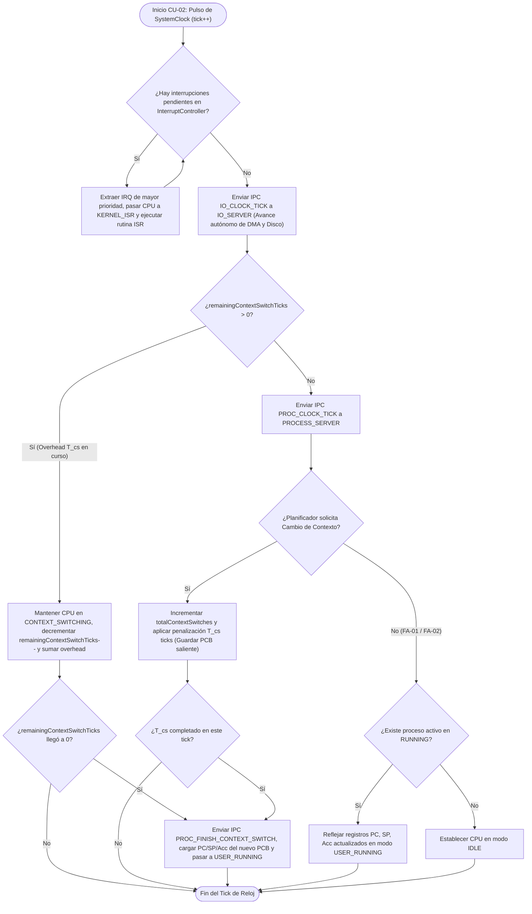

---

### C. `CU-03`: Crear Proceso, Asignar PCB y Planificar CPU (`RR`, `Prioridades`, `SJF/SRTF`)

| Campo | Especificación |
| :--- | :--- |
| **ID / Nombre** | `CU-03`: Crear Proceso, Asignar PCB y Planificar CPU (`RR`, `Prioridades`, `SJF/SRTF`) |
| **Actores** | Usuario Operador, `ProcessManager`, `MemoryManager`, `SecurityController`. |
| **Módulo** | Módulo 2.1 Administración de Procesos (`RF-07`, `RF-08`, `RF-09`, `RF-10`). |
| **Precondiciones** | Servidor de Procesos y Servidor de Memoria operativos; sesión de usuario activa. |
| **Postcondiciones** | Se crea el `PCB` con memoria asignada y el proceso es planificado en CPU según el algoritmo seleccionado hasta su terminación. |
| **Flujo Principal** | 1. El usuario solicita crear un proceso especificando `name`, `appType`, `priority`, `burstTime` y `memorySizeKB`. 2. `ProcessManager` recibe `SYS_FORK`, instancia el `PCB` en estado `NEW` y solicita memoria enviando `SYS_ALLOC` a `MEMORY_SERVER` vía IPC. 3. `MemoryManager` adjudica una partición y retorna `baseAddress`, `sizeKB` e `id`. 4. `ProcessManager` enlaza los punteros en `pcb.memory`, cambia el estado a `READY` y lo registra en `pcbTable` y en el Banquero. 5. En cada tick, `ProcessManager.onClockTick()` evalúa la política activa (`RR`, `PRIORITY_PREEMPTIVE` o `SRTF`), actualiza `waitingTime`, ejecuta `stepExecution()` (`PC += 4`, `SP -= 2`, `Acc`, `remainingTime--`) y libera la memoria vía `SYS_FREE` cuando `remainingTime == 0`. |
| **Flujos Alternos / Excepciones** | **FA-01 (Expropiación por Quantum / Prioridad / SRTF):** Si se agota el Quantum en `RR` o llega un proceso con mejor prioridad o menor ráfaga restante en `SRTF`, el proceso actual vuelve a `READY` y se solicita cambio de contexto. **EX-01 (Fallo de Memoria / Cuota):** Si no hay memoria disponible o `GUEST` supera `128 KB`, la creación se rechaza y el proceso pasa a `TERMINATED`. |

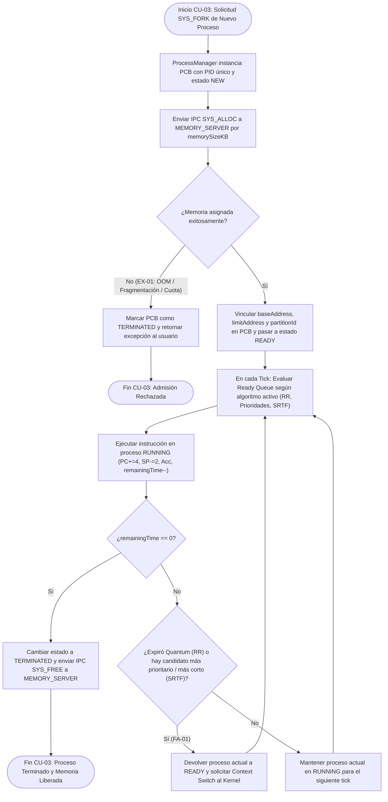

---

### D. `CU-04`: Evaluar Estado Seguro y Prevenir Interbloqueo mediante el Algoritmo del Banquero

| Campo | Especificación |
| :--- | :--- |
| **ID / Nombre** | `CU-04`: Evaluar Estado Seguro y Prevenir Interbloqueo mediante el Algoritmo del Banquero |
| **Actores** | Usuario / Proceso solicitante, `ProcessManager` (`BankerAlgorithm`). |
| **Módulo** | Módulo 2.1 Administración de Procesos — Sincronización e Interbloqueos (`RF-11`, `RF-12`). |
| **Precondiciones** | Matrices `Allocation`, `Max`, `Need` y vector `Available` inicializados en estado seguro. |
| **Postcondiciones** | Si el estado resultante es seguro, se asignan los recursos y se muestra la secuencia segura; si es inseguro, se revierte la operación evitando el *deadlock*. |
| **Flujo Principal** | 1. Se envía `SYS_BANKER_REQ` con el `pid` y el vector `requestVector = [r1, r2, r3]`. 2. `BankerAlgorithm` calcula $Need = Max - Allocation$ y verifica $Request \le Need$ y $Request \le Available$. 3. Simula provisoriamente $Available' = Available - Request$, $Allocation' = Allocation + Request$, $Need' = Need - Request$. 4. Ejecuta `evaluateSafety()` buscando iterativamente procesos con $Need'_i \le Work$ y acumulando $Work \leftarrow Work + Allocation'_i$. 5. Si todos los procesos logran terminar (`isSafe == true`), confirma la asignación y retorna la secuencia segura. |
| **Flujos Alternos / Excepciones** | **EX-01 (`ERR_MAX_CLAIM_EXCEEDED`):** Si $Request > Need$, se rechaza por exceder la demanda máxima declarada. **EX-02 (Estado Inseguro / Prevención de Deadlock):** Si ningún proceso puede satisfacer $Need'_i \le Work$, se ejecuta *rollback* inmediato y se alerta el bloqueo preventivo. |

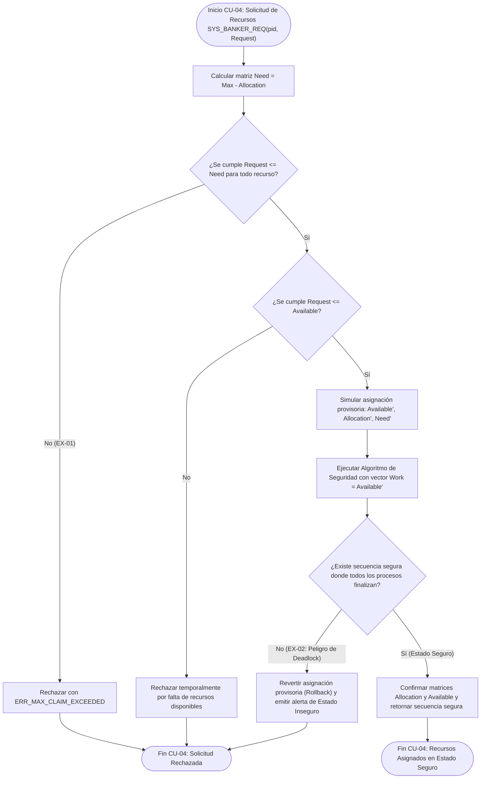

---

### E. `CU-05`: Asignar y Liberar Memoria RAM (`Estática`/`Dinámica`) y Calcular Fragmentación

| Campo | Especificación |
| :--- | :--- |
| **ID / Nombre** | `CU-05`: Asignar y Liberar Memoria RAM (`First-Fit`, `Best-Fit`, `Worst-Fit`) y Calcular Fragmentación |
| **Actores** | `ProcessManager` / Usuario, `MemoryManager`. |
| **Módulo** | Módulo 2.2 Administración de Memoria (`RF-14`, `RF-15`, `RF-16`). |
| **Precondiciones** | `MemoryManager` inicializado con `1024 KB` totales (`128 KB` reservados para el Kernel y `896 KB` para procesos de usuario). |
| **Postcondiciones** | Se adjudica o libera la partición solicitada, ejecutando división (*Splitting*) o fusión de huecos (*Coalescing*) en modo dinámico, y se actualiza `FragmentationReport`. |
| **Flujo Principal** | 1. `MemoryManager` recibe `SYS_ALLOC(pid, processName, sizeKB)`. 2. Filtra las particiones libres con `sizeKB >= reqKB`. 3. Selecciona la partición según `FIRST_FIT` (primer hueco), `BEST_FIT` (menor residuo) o `WORST_FIT` (mayor residuo). 4. En `STATIC_FIXED` ocupa la partición fija completa y reporta fragmentación interna ($S_{part} - M_{req}$). En `DYNAMIC_VARIABLE` divide el bloque al tamaño exacto $M_{req}$ y crea un hueco libre con el remanente. 5. Recalcula la Fragmentación Interna y Externa en `calculateFragmentation()`. |
| **Flujos Alternos / Excepciones** | **FA-01 (Liberación y Coalescing):** Al recibir `SYS_FREE(pid)`, libera el bloque y fusiona bloques libres contiguos en modo dinámico. **EX-01 (`ERR_EXTERNAL_FRAGMENTATION`):** Si la memoria libre total es $\ge M_{req}$ pero ningún bloque contiguo alcanza $M_{req}$, reporta fallo por fragmentación externa. |

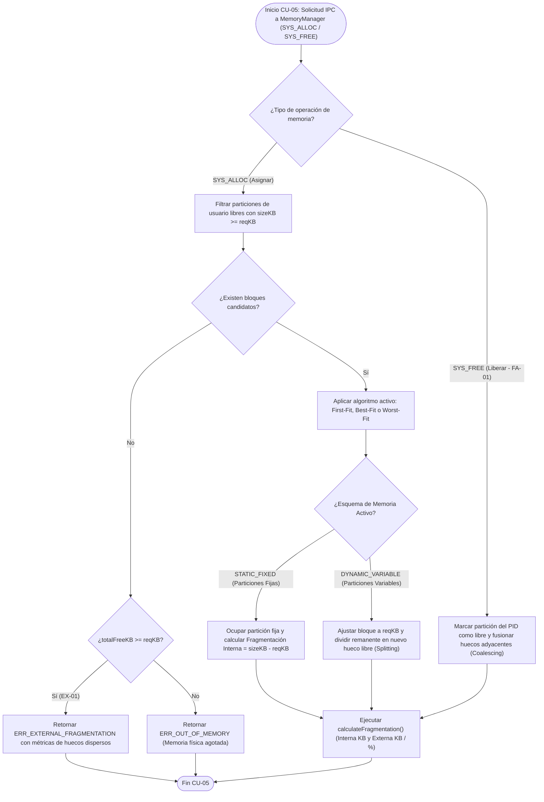

---

### F. `CU-06`: Formatear Sistema de Archivos (`FAT` / `Inodos`) y Ejecutar Operaciones CRUD

| Campo | Especificación |
| :--- | :--- |
| **ID / Nombre** | `CU-06`: Formatear Sistema de Archivos (`FAT` / `Inodos`) y Ejecutar Operaciones CRUD Jerárquicas |
| **Actores** | Usuario Operador, `FileManager`, `DeviceDriver`, `SecurityController`. |
| **Módulo** | Módulo 2.3 Administración de Archivos (`RF-17`, `RF-18`, `RF-19`). |
| **Precondiciones** | Usuario autenticado con permisos suficientes en la Matriz ACL. |
| **Postcondiciones** | Árbol de directorios y tabla de asignación (`FAT` o `Inodos`) actualizados y sincronizados con peticiones de E/S al disco. |
| **Flujo Principal** | 1. El usuario solicita formatear (`SYS_FORMAT_FS` con tipo `FAT`/`INODES` y tamaño de bloque) o realizar una operación CRUD (`SYS_CREATE_NODE`, `SYS_READ_FILE`, `SYS_WRITE_FILE`, `SYS_RENAME_NODE`, `SYS_DELETE_NODE`). 2. `SecurityController` valida los permisos `rwx` y rol del usuario en el bus IPC. 3. `FileManager` calcula los bloques requeridos ($\lceil \text{sizeBytes} / \text{blockSizeBytes} \rceil$), encadena los bloques en `fatTable` o crea la entrada en `inodeTable` y registra el `FSNode`. 4. `FileManager` envía `SYS_IO_DISK_REQ` vía IPC al `IO_SERVER` para reflejar el acceso físico en el brazo de disco. |
| **Flujos Alternos / Excepciones** | **EX-01 (`ENOSPC`):** Si no hay suficientes bloques libres en `fatTable`, aborta la creación. **EX-02 (`ENOTEMPTY` / `EPERM`):** Impide borrar directorios del sistema (`/`, `/etc`, `/home`, `/pub`) o directorios con hijos. |

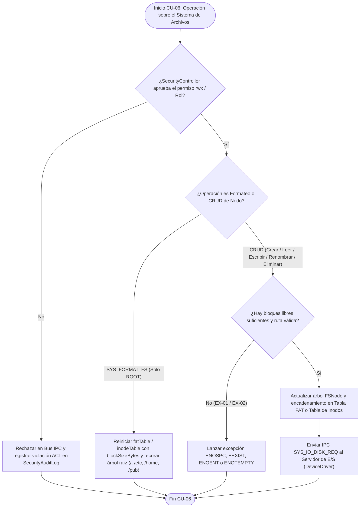

---

### G. `CU-07`: Planificar Brazo de Disco (`FCFS`, `SSTF`, `SCAN`, `C-SCAN`) y Transferir por Canal DMA

| Campo | Especificación |
| :--- | :--- |
| **ID / Nombre** | `CU-07`: Planificar Brazo de Disco (`FCFS`, `SSTF`, `SCAN`, `C-SCAN`) y Transferir Datos vía Canal DMA con Interrupción |
| **Actores** | `FileManager` / Usuario, `DeviceDriver`, `DMAController`, `Kernel`, `ProcessManager`. |
| **Módulo** | Módulo 2.4 Administración de Entrada/Salida (`RF-20`, `RF-21`, `RF-22`). |
| **Precondiciones** | Geometría de disco configurada y cola de solicitudes de cilindros (`pendingDiskQueue`) con peticiones pendientes. |
| **Postcondiciones** | El cabezal se desplaza según el algoritmo elegido, el canal DMA transfiere los datos a RAM sin bloquear la CPU y al finalizar emite `IRQ_DMA_DONE` para despertar al proceso. |
| **Flujo Principal** | 1. Se encola una petición `SYS_IO_DISK_REQ` indicando cilindro objetivo y opcionalmente bloqueando al proceso solicitante (`BLOCKED`). 2. `DeviceDriver.computeScheduleOrder()` ordena las peticiones según el algoritmo seleccionado (`FCFS`, `SSTF`, `SCAN` o `C-SCAN`). 3. El brazo se mueve al cilindro seleccionado acumulando la distancia de búsqueda (`totalSeekDistance += |target - current|`) y registrando el punto en `headHistory`. 4. Se inicia la transferencia en `DMAController` (`state = TRANSFERRING`) hacia la dirección RAM destino. 5. Al completarse los ticks de transferencia DMA, `DeviceDriver` dispara la interrupción `IRQ_DMA_DONE` al `Kernel`, cuya ISR despierta al proceso en `ProcessManager` (`BLOCKED -> READY`). |
| **Flujos Alternos / Excepciones** | **FA-01 (Ejecución de lote comparativo):** El usuario puede disparar `EXEC_DISK_BATCH` para procesar toda la cola de cilindros de inmediato y visualizar la curva completa del algoritmo. |

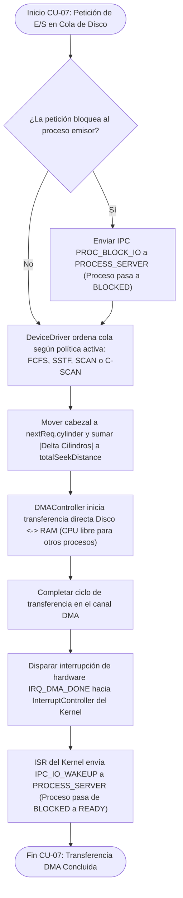

---

### H. `CU-08`: Transmitir Paquetes entre Procesos mediante Sockets de Red Simulados (`TX`/`RX`)

| Campo | Especificación |
| :--- | :--- |
| **ID / Nombre** | `CU-08`: Transmitir Paquetes entre Procesos mediante Sockets de Red Simulados (Buffers `TX`/`RX`) |
| **Actores** | Proceso Emisor, Proceso Receptor, `DeviceDriver` (`SimulatedSocket`). |
| **Módulo** | Módulo 2.4 Administración de Entrada/Salida — Interfaces de Red Simuladas (`RF-23`). |
| **Precondiciones** | Pares de sockets simulados (`SOCK-01 :8080 <-> SOCK-02 :9090`) inicializados con capacidad de buffer finita. |
| **Postcondiciones** | El paquete transita desde el buffer de salida (`txBuffer`) del socket emisor hasta el buffer de entrada (`rxBuffer`) del socket receptor. |
| **Flujo Principal** | 1. El usuario o proceso invoca `SYS_NET_SEND` indicando el socket origen y el `payload` del paquete. 2. `DeviceDriver.sendNetworkPacket()` verifica que `txBuffer.length < capacity` y encola el paquete con su cabecera (`id`, `fromPid`, `toPid`, `srcPort`, `dstPort`, `sizeBytes`, `tick`). 3. En el pulso de reloj o al invocar `SYS_NET_RECV`, `flushNetworkBuffers()` transfiere el paquete del `txBuffer` origen al `rxBuffer` del socket destino, cambiándolo a estado `DELIVERED_RX`. |
| **Flujos Alternos / Excepciones** | **EX-01 (`ENOBUFS`):** Si el buffer de salida `txBuffer` alcanzó su capacidad máxima, la transmisión se rechaza con excepción de saturación de buffer. |

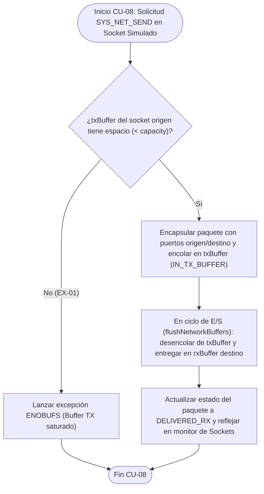

---

### I. `CU-09`: Autenticar Usuario y Gestionar Sesión de Perfil de Seguridad (`ROOT`, `STANDARD`, `GUEST`)

| Campo | Especificación |
| :--- | :--- |
| **ID / Nombre** | `CU-09`: Autenticar Usuario y Gestionar Sesión de Perfil de Seguridad (`ROOT`, `STANDARD`, `GUEST`) |
| **Actores** | Usuario Operador, `SecurityController`. |
| **Módulo** | Módulo 2.5 Administración de Seguridad (`RF-25`, `RF-30`). |
| **Precondiciones** | Catálogo de usuarios (`root`, `std_user`, `guest`) cargado en `SecurityController`. |
| **Postcondiciones** | Sesión activa actualizada al perfil autenticado y evento registrado en `SecurityAuditLog`. |
| **Flujo Principal** | 1. El usuario selecciona el perfil (`root`, `std_user` o `guest`) e ingresa sus credenciales enviando `SYS_AUTH_LOGIN`. 2. `SecurityController.authenticate()` busca la cuenta en `this.users` y verifica la contraseña. 3. Si es válida, establece `this.activeUser = account` y genera un registro inmutable `AUTH_LOGIN_SUCCESS` en `SecurityAuditLog`. |
| **Flujos Alternos / Excepciones** | **EX-01 (`AUTH_BAD_CREDENTIALS`):** Si la contraseña no coincide, rechaza el cambio de sesión y añade un registro `WARNING` en `SecurityAuditLog`. |

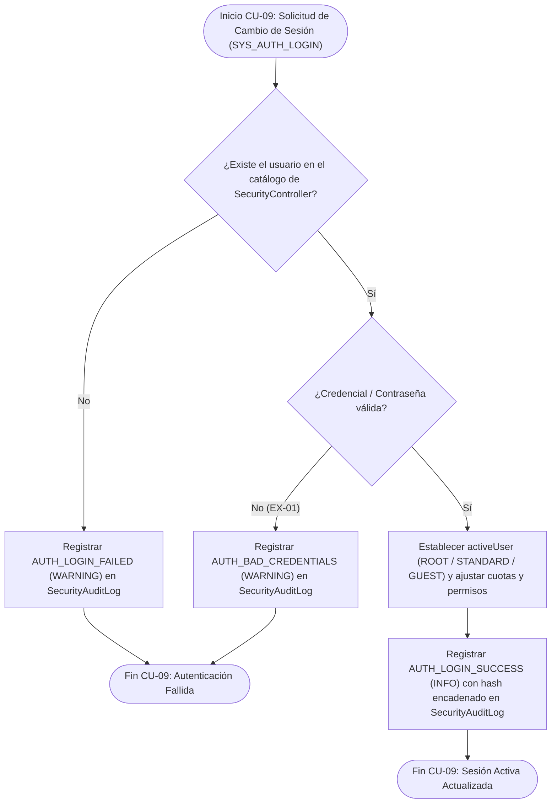

---

### J. `CU-10`: Validar Matriz de Control de Acceso (ACL) en Llamada IPC y Registrar Auditoría

| Campo | Especificación |
| :--- | :--- |
| **ID / Nombre** | `CU-10`: Validar Matriz de Control de Acceso (ACL) en Llamada IPC y Registrar Auditoría de Seguridad |
| **Actores** | Proceso / Usuario Emisor, `IPCBus`, `SecurityController`, `MemoryManager`. |
| **Módulo** | Módulo 2.5 Administración de Seguridad (`RF-26`, `RF-27`, `RF-28`, `RF-29`, `RF-30`). |
| **Precondiciones** | Reglas de la Matriz ACL y límites de memoria inicializados. |
| **Postcondiciones** | Toda operación no autorizada (violación `rwx`, acceso fuera de segmento de RAM o intento de escalamiento de privilegios) es bloqueada y registrada inmutablemente en `SecurityAuditLog`. |
| **Flujo Principal** | 1. Ante cualquier `IPCMessage` en el bus, `SecurityController.validateIPCMessage(msg)` inspecciona el `role`, la acción solicitada y el recurso objetivo. 2. Verifica las políticas de procesos (`SYS_FORK` cuota de RAM, `SYS_KILL`), archivos (`rwx` sobre `/etc`, `/home`, `/pub` y `SYS_FORMAT_FS`) y hardware (`SET_DISK_CONFIG`). 3. Si se solicita acceso a una dirección de memoria (`SYS_MEM_ACCESS`), verifica que no invada el espacio del Kernel (`< 128 KB`) ni salga del rango `[baseAddress, limitAddress)` del proceso. 4. Si alguna regla falla, retorna `{ allowed: false, reason }`, sella una entrada inmutable en `SecurityAuditLog` y, en caso de violación de memoria, dispara la interrupción `TRAP_SIGSEGV`. |
| **Flujos Alternos / Excepciones** | **EX-01 (`MEMORY_SEGMENTATION_FAULT`):** Dispara `TRAP_SIGSEGV` y termina el proceso infractor. **EX-02 (`PRIVILEGE_ESCALATION_FAILED` / `ACL_RWX_VIOLATION`):** Bloquea la syscall en el bus IPC sin alterar el servidor destino. |

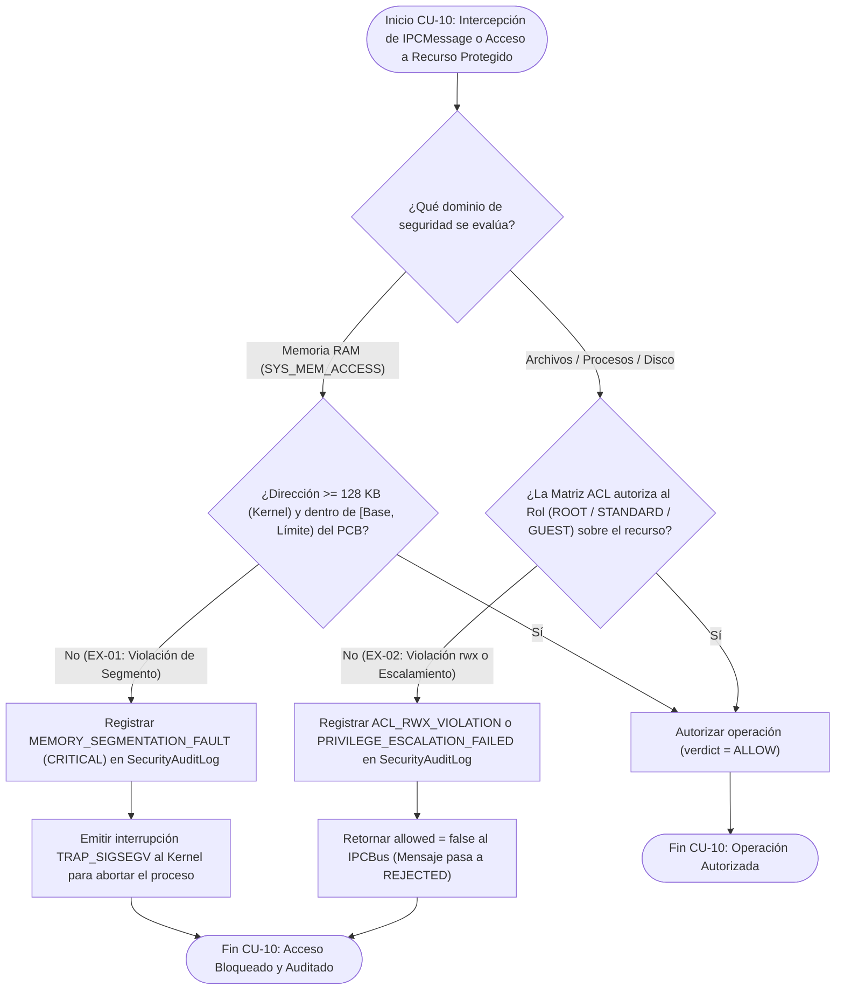

---

## IV. ARQUITECTURA ORIENTADA A OBJETOS Y DIAGRAMA DE CLASES UML

El siguiente Diagrama de Clases UML unificado modela la totalidad del sistema e incluye explícitamente las 7 clases mandatorias exigidas en la Sección 3 de la Guía de Proyecto (`Kernel`, `PCB`, `MemoryManager`, `FileManager`, `DeviceDriver`, `SecurityController`, `IPCMessage`) junto con sus clases auxiliares de soporte.

```mermaid
classDiagram
    direction TB

    class Kernel {
        +SystemClock clock
        +InterruptController interruptController
        +IPCBus ipcBus
        +string cpuMode
        +number contextSwitchCostTicks
        +number remainingContextSwitchTicks
        +number totalContextSwitchTicks
        +number totalContextSwitches
        +Object cpuRegisters
        +number activePid
        +registerServer(endpointName: string, handlerFn: Function) void
        +setSecurityGuard(guardFn: Function) void
        +sendIPC(params: Object) IPCMessage
        +raiseInterrupt(irqParams: Object) InterruptRequest
        +setContextSwitchOverhead(ticks: number) void
        +executeClockCycle(tick: number) void
    }

    class SystemClock {
        +number currentTick
        +number intervalMs
        +boolean isRunning
        +step() number
        +start() void
        +pause() void
        +setFrequency(intervalMs: number) void
        +reset() void
    }

    class InterruptController {
        +List~InterruptRequest~ irqQueue
        +List~InterruptRequest~ irqHistory
        +Map~string, Function~ ivt
        +registerISR(irqCode: string, handlerFn: Function) void
        +raiseIRQ(irq: InterruptRequest) void
        +hasPendingIRQs() boolean
        +dequeueNextIRQ() InterruptRequest
    }

    class IPCBus {
        +Map~string, Function~ handlers
        +List~IPCMessage~ messageQueue
        +List~IPCMessage~ history
        +registerEndpoint(endpointName: string, handlerFn: Function) void
        +dispatch(message: IPCMessage, securityGuard: Function) IPCMessage
    }

    class IPCMessage {
        +string id
        +number timestamp
        +number tick
        +string sender
        +string receiver
        +string action
        +Object payload
        +string status
        +Object authContext
        +Object response
        +string errorReason
        +markAccepted() IPCMessage
        +markSuccess(responsePayload: Object) IPCMessage
        +markRejected(reason: string) IPCMessage
    }

    class ProcessManager {
        +Kernel kernel
        +Map~number, PCB~ pcbTable
        +string algorithm
        +number quantum
        +BankerAlgorithm banker
        +Map~string, Semaphore~ semaphores
        +handleIPC(msg: IPCMessage) Object
        +createProcess(params: Object) PCB
        +killProcess(pid: number, reason: string) PCB
        +blockProcess(pid: number, reason: string) PCB
        +wakeupProcess(pid: number) PCB
        +setSchedulerConfig(algorithm: string, quantum: number) Object
        +getQueues() Object
        +onClockTick() Object
    }

    class PCB {
        +number pid
        +string name
        +string appType
        +string state
        +number priority
        +number burstTime
        +number remainingTime
        +number cpuTimeUsed
        +number waitingTime
        +Object registers
        +Object memory
        +Object owner
        +stepExecution() void
    }

    class BankerAlgorithm {
        +List~string~ resourceNames
        +List~number~ total
        +List~number~ available
        +List~Object~ processes
        +getNeedMatrix() List~Object~
        +evaluateSafety(customProcs: List, customAvail: List) Object
        +requestResources(pid: number, requestVector: List~number~) Object
    }

    class MemoryManager {
        +Kernel kernel
        +number totalMemoryKB
        +number kernelReservedKB
        +string scheme
        +string fitAlgorithm
        +List~MemoryPartition~ partitions
        +handleIPC(msg: IPCMessage) Object
        +reconfigureMemory(scheme: string, fitAlgorithm: string) Object
        +allocateMemory(pid: number, processName: string, sizeKB: number) Object
        +freeMemory(pid: number) Object
        +coalesceFreeBlocks() void
        +validateMemoryAccess(pid: number, targetAddressKB: number) Object
        +calculateFragmentation() FragmentationReport
    }

    class MemoryPartition {
        +string id
        +number baseAddress
        +number sizeKB
        +boolean isKernel
        +boolean isOccupied
        +number allocatedPid
        +number requestedSizeKB
        +internalFragmentationKB() number
    }

    class FileManager {
        +Kernel kernel
        +string formatType
        +number blockSizeBytes
        +number totalBlocks
        +Map~string, FSNode~ nodes
        +List~Object~ fatTable
        +List~Object~ inodeTable
        +handleIPC(msg: IPCMessage) Object
        +formatFileSystem(formatType: string, blockSizeBytes: number) Object
        +createNode(params: Object) FSNode
        +readFile(path: string) FSNode
        +writeFile(path: string, newContent: string, newPermissions: string) FSNode
        +renameNode(path: string, newName: string) FSNode
        +deleteNode(path: string) Object
    }

    class DeviceDriver {
        +Kernel kernel
        +DiskGeometry geometry
        +string diskAlgorithm
        +number currentHeadCylinder
        +List~Object~ pendingDiskQueue
        +List~Object~ headHistory
        +number totalSeekDistance
        +DMAController dma
        +List~SimulatedSocket~ sockets
        +handleIPC(msg: IPCMessage) Object
        +updateDiskConfig(params: Object) Object
        +enqueueDiskRequest(params: Object) Object
        +computeScheduleOrder() List~Object~
        +executeFullScheduleSimulation() Object
        +sendNetworkPacket(params: Object) Object
        +flushNetworkBuffers() List~SimulatedSocket~
    }

    class SecurityController {
        +Kernel kernel
        +List~UserAccount~ users
        +UserAccount activeUser
        +List~Object~ aclMatrix
        +List~SecurityAuditLog~ auditLogs
        +handleIPC(msg: IPCMessage) Object
        +authenticate(username: string, password: string) UserAccount
        +validateIPCMessage(msg: IPCMessage) Object
        +simulateSecurityAttack(attackType: string) Object
        +recordAudit(params: Object) SecurityAuditLog
    }

    class PersistenceStore {
        +string storageKey
        +saveSnapshot(modules: Object) Object
        +loadSnapshot() Object
        +clearSnapshot() void
    }

    Kernel *-- "1" SystemClock
    Kernel *-- "1" InterruptController
    Kernel *-- "1" IPCBus
    IPCBus o-- "0..*" IPCMessage
    ProcessManager *-- "0..*" PCB
    ProcessManager *-- "1" BankerAlgorithm
    MemoryManager *-- "1..*" MemoryPartition
    Kernel <.. ProcessManager : se comunica vía IPCBus
    Kernel <.. MemoryManager : se comunica vía IPCBus
    Kernel <.. FileManager : se comunica vía IPCBus
    Kernel <.. DeviceDriver : se comunica vía IPCBus
    Kernel <.. SecurityController : valida ACL y audita
```

---

## V. MAPA DE NAVEGACIÓN WEB (UX/UI)

El prototipo web interactivo organiza la experiencia de usuario en una consola de mando unificada con barra superior de reloj maestro y selector de sesión, cinco (5) pestañas modulares especializadas, y un dock lateral/inferior para el **Monitor en Vivo del Bus IPC y Verificador de Consistencia**.

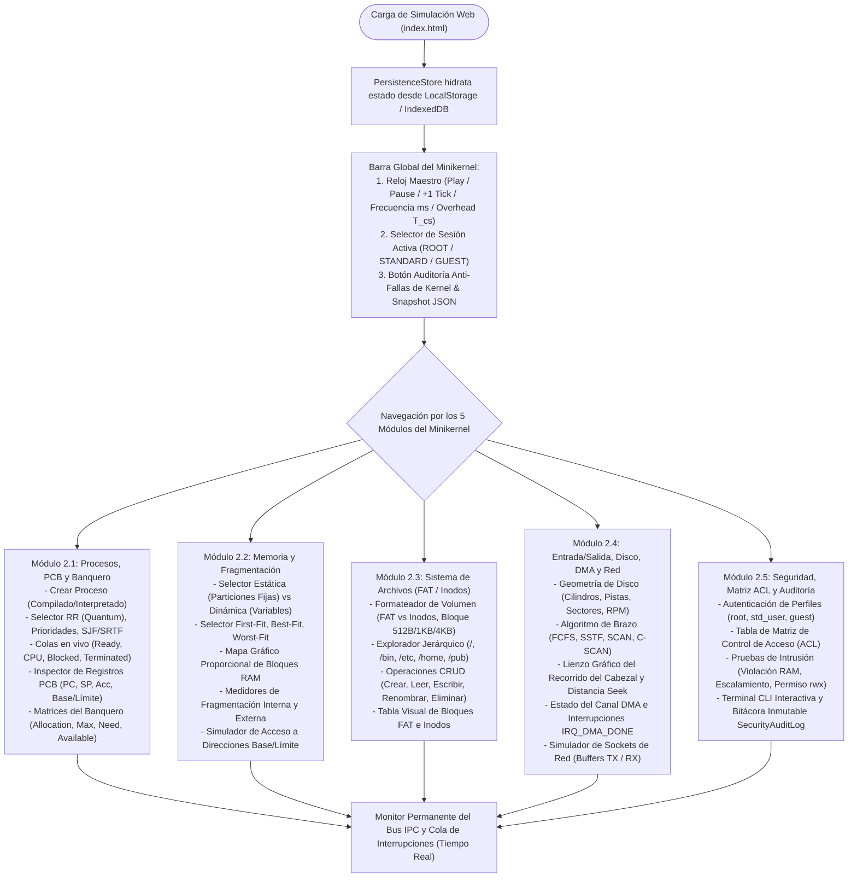

---

## VI. MODELO DEL ESQUEMA RELACIONAL Y PERSISTENCIA (`LocalStorage` / `IndexedDB`)

La persistencia del estado de la simulación se estructura bajo el siguiente modelo Entidad-Relación implementado en `PersistenceStore` (`LocalStorage` + almacén transaccional `IndexedDB`):

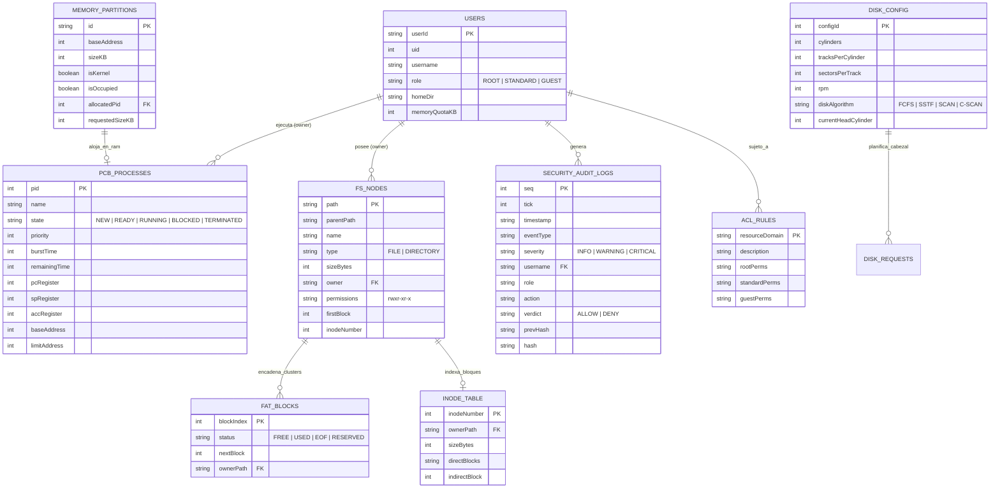

---

## VII. VERIFICACIÓN DE CONSISTENCIA ("ANTI-FALLAS DE KERNEL")

En cumplimiento de la Sección 4 de la Guía de Proyecto, la siguiente tabla certifica la coherencia cruzada entre la especificación documental, el modelo UML y los archivos de código fuente implementados:

| Módulo / Artefacto | Clase UML Nominal | Archivo Fuente Implementado | Casos de Uso Cubiertos | Requerimientos Verificados |
| :--- | :--- | :--- | :--- | :--- |
| **Protocolo y Bus IPC** | `IPCMessage`, `IPCBus`, `InterruptRequest` | `src/core/IPCMessage.js` | `CU-01`, `CU-02` | `RF-03`, `RF-05`, `RF-06`, `RNF-01` |
| **Núcleo Microkernel** | `Kernel`, `SystemClock`, `InterruptController` | `src/core/Kernel.js` | `CU-01`, `CU-02` | `RF-01`, `RF-02`, `RF-04`, `RNF-02` |
| **Módulo 2.1 Procesos** | `ProcessManager`, `PCB`, `BankerAlgorithm`, `Semaphore` | `src/servers/ProcessManager.js` | `CU-03`, `CU-04` | `RF-07` a `RF-13`, `RNF-04` |
| **Módulo 2.2 Memoria** | `MemoryManager`, `MemoryPartition`, `FragmentationReport` | `src/servers/MemoryManager.js` | `CU-05` | `RF-14` a `RF-16`, `RNF-05`, `RNF-06` |
| **Módulo 2.3 Archivos** | `FileManager`, `FSNode` | `src/servers/FileManager.js` | `CU-06` | `RF-17` a `RF-19`, `RNF-07` |
| **Módulo 2.4 E/S y Red** | `DeviceDriver`, `DiskGeometry`, `DMAController`, `SimulatedSocket` | `src/servers/DeviceDriver.js` | `CU-07`, `CU-08` | `RF-20` a `RF-23`, `RNF-08` |
| **Módulo 2.5 Seguridad** | `SecurityController`, `UserAccount`, `SecurityAuditLog` | `src/servers/SecurityController.js` | `CU-09`, `CU-10` | `RF-25` a `RF-30`, `RNF-10`, `RNF-11` |
| **Persistencia Local** | `PersistenceStore` | `src/persistence/PersistenceStore.js` | `CU-06`, `CU-09`, `CU-10` | `RF-24`, `RNF-09` |
| **Integración Web & QA** | `AppController` | `src/ui/AppController.js`, `index.html` | `CU-01` a `CU-10` | `RNF-03`, `RNF-12` |

---

## VIII. CONCLUSIONES

1. La adopción estricta del paradigma **Microkernel / Minikernel** permitió desacoplar por completo el mecanismo de bajo nivel (`Kernel`, `SystemClock`, `InterruptController`, `IPCBus`) de los cinco servidores de política en espacio de usuario (`ProcessManager`, `MemoryManager`, `FileManager`, `DeviceDriver`, `SecurityController`), garantizando que cualquier fallo en un módulo sea contenido y auditado sin comprometer la integridad del núcleo.
2. La simulación explícita del **Cambio de Contexto ($T_{cs}$)** y la concurrencia entre la ejecución de procesos en CPU y las transferencias autónomas por canal **DMA** permiten evidenciar experimentalmente el impacto del *overhead* de conmutación y la ventaja de las arquitecturas dirigidas por interrupciones frente a la espera activa (*busy waiting*).
3. El mecanismo de **Mediación Completa (ACL)** integrado en el bus IPC junto con el encadenamiento de hashes en `SecurityAuditLog` asegura que ningún proceso o perfil no autorizado (`GUEST` / `STANDARD`) pueda vulnerar las fronteras de memoria (`Base + Límite` y Espacio del Kernel) ni los permisos `rwx` del sistema de archivos jerárquico.

---

## REFERENCIAS (NORMA IEEE)

[1] A. S. Tanenbaum and H. Bos, *Modern Operating Systems*, 5th ed. Boston, MA, USA: Pearson, 2022.  
[2] A. Silberschatz, P. B. Galvin, and G. Gagne, *Operating System Concepts*, 10th ed. Hoboken, NJ, USA: Wiley, 2018.  
[3] J. Liedtke, "On micro-kernel construction," in *Proc. 15th ACM Symp. Operating Systems Principles (SOSP)*, Copper Mountain, CO, USA, 1995, pp. 237–250.  
[4] E. W. Dijkstra, "Cooperating sequential processes," in *Programming Languages*, F. Genuys, Ed. New York, NY, USA: Academic Press, 1968, pp. 43–112.  
[5] W. Stallings, *Operating Systems: Internals and Design Principles*, 9th ed. Harlow, U.K.: Pearson Education, 2018.
