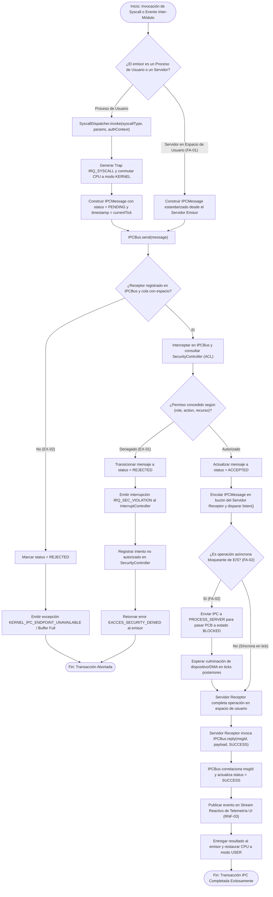

# Especificación Técnica de Especialidad 01: Núcleo Mínimo (Minikernel), Reloj Maestro, Interrupciones y Bus IPC

**Proyecto:** Diseño y Simulación Web de un Minikernel (SO 2026-2)  
**Institución:** Universidad Distrital Francisco José de Caldas - Facultad de Ingeniería  
**Especialidad:** Arquitectura del Núcleo Mínimo (Minikernel) y Comunicación Inter-Procesos (IPC)  
**Rol Responsable:** Arquitecto de Sistemas Operativos y Diseñador de IPC (`Minikernel-Core-Architect`)

---

## 1. Matriz de Requerimientos Funcionales y No Funcionales (Núcleo e IPC)

De acuerdo con el principio de aislamiento estricto de arquitectura Microkernel/Minikernel, el núcleo se limita exclusivamente al despacho de interrupciones, generación de pulsos de reloj maestro, penalización por cambio de contexto ($T_{cs}$) y transporte de mensajes mediante el bus IPC (`IPCBus`). Ningún módulo servidor (`PROCESS_SERVER`, `MEMORY_SERVER`, `FS_SERVER`, `IO_SERVER`, `SECURITY_SERVER`) mantiene referencias directas ni acoplamiento de objetos con otros servidores.

### 1.1 Requerimientos Funcionales (`RF-01` a `RF-06`)

| Código | Nombre | Entrada | Procesamiento | Salida | Restricciones de Arquitectura Minikernel |
| :--- | :--- | :--- | :--- | :--- | :--- |
| **RF-01** | Gestión del Reloj Maestro del Sistema (`SystemClock`) | Frecuencia configurada en milisegundos por tick ($\Delta t \in [10, 5000]\text{ ms}$), comando de control (`START`, `PAUSE`, `STEP`, `RESET`). | El motor de reloj incrementa atómicamente el contador global `currentTick`, emite la señal de pulso de hardware (`IRQ_TIMER`) hacia el `InterruptController` y sincroniza la ventana de ejecución del ciclo de instrucción actual. | Evento de pulso `TICK_EVENT` con estampa `currentTick` notificado al `Kernel` y al stream de telemetría UI. | El reloj maestro reside únicamente en el espacio de núcleo (`Kernel`). Los servidores de espacio de usuario no poseen temporizadores propios; dependen de mensajes o señales derivadas del tick maestro. |
| **RF-02** | Contabilización y Simulación de Overhead por Cambio de Contexto ($T_{cs}$) | Parámetro configurable de penalización $T_{cs} \ge 0$ (en ticks de reloj), `PCB` del proceso saliente ($P_{out}$) y `PCB` del proceso entrante ($P_{in}$). | Al conmutar la CPU entre $P_{out}$ y $P_{in}$, el núcleo bloquea la ejecución de instrucciones de usuario durante exactamente $T_{cs}$ ticks, respalda los registros simulados (`PC`, `SP`, `Acc`) en $P_{out}$ y restaura el contexto desde $P_{in}$. | CPU en estado `CONTEXT_SWITCHING` durante $T_{cs}$ ticks; `PCB` saliente actualizado en memoria del servidor de procesos y `PCB` entrante cargado en registros activos del núcleo. | El núcleo solo manipula los registros físicos simulados (`PC`, `SP`, `Acc`, `PSW`) y el puntero al `PCB` activo; la política de selección del siguiente proceso pertenece exclusivamente al `PROCESS_SERVER` vía IPC. |
| **RF-03** | Enrutamiento y Transporte de Mensajes en el Bus IPC (`IPCBus`) | Instancia estructurada de `IPCMessage<T>` con campos `id`, `timestamp`, `sender`, `receiver`, `action`, `payload`, `status` y `authContext`. | Valida la estructura formal del sobre IPC, registra el mensaje en el buffer de cola del receptor (`messageQueue`), invoca la verificación de políticas si el destino es privilegiado y despacha de forma síncrona o asíncrona mediante primitivas `send()`, `listen()` y `reply()`. | Mensaje entregado en el buzón del servidor destino con estado transicionado (`PENDING` $\rightarrow$ `ACCEPTED` $\rightarrow$ `SUCCESS` o `REJECTED`) y acuse en el log de auditoría del bus. | Prohibido el paso de referencias mutables directas entre servidores. Todo `payload` debe ser serializable e inmutable durante el tránsito por el `IPCBus`. |
| **RF-04** | Despacho de Llamadas al Sistema (`SyscallDispatcher`) | Código de syscall (`SYS_FORK`, `SYS_ALLOC`, `SYS_FREE`, `SYS_READ`, `SYS_WRITE`, `SYS_IO_REQ`), argumentos de llamada y contexto del proceso invocador (`PID`, `authContext`). | Eleva el nivel de privilegio de modo Usuario a modo Kernel (Trap `IRQ_SYSCALL`), encapsula la petición en un `IPCMessage` estandarizado y lo enruta a través del `IPCBus` hacia el servidor de espacio de usuario competente (`PROCESS_SERVER`, `MEMORY_SERVER`, `FS_SERVER` o `IO_SERVER`). | Promesa/respuesta de syscall resuelta con el resultado retornado por el servidor correspondiente vía `IPCBus.reply()`, o código de error estandarizado. | El `SyscallDispatcher` no ejecuta lógica de negocio de archivos, memoria ni E/S en el núcleo; actúa estrictamente como traductor Trap-a-IPC (Microkernel L4/Minix pattern). |
| **RF-05** | Vectorización y Arbitraje de Interrupciones Priorizadas (`InterruptController`) | Señal de interrupción `InterruptRequest` (`IRQ`) con nivel de prioridad, tipo (`TIMER`, `SYSCALL`, `DMA_COMPLETE`, `IO_DEVICE`, `MEM_FAULT`, `SEC_VIOLATION`) y `sourceId`. | Inserta la solicitud en la cola de prioridad (`irqQueue`) ordenada por criticidad: 1. Excepciones Críticas (`MEM_FAULT`, `SEC_VIOLATION`), 2. Reloj (`TIMER`), 3. Hardware/DMA (`DMA_COMPLETE`, `IO_DEVICE`), 4. Software (`SYSCALL`). Al finalizar el tick actual, enmascara interrupciones de menor prioridad y ejecuta la rutina ISR registrada en la tabla de vectores (`ivt`). | Ejecución de la rutina de servicio de interrupción (ISR) correspondiente y emisión del mensaje IPC de notificación al servidor encargado. | Las ISR dentro del núcleo son mínimas (*Top-Half*): únicamente capturan el evento de hardware/excepción y despachan un `IPCMessage` hacia el servidor de espacio de usuario (*Bottom-Half*). |
| **RF-06** | Mediación Obligatoria de Seguridad Pre-Despacho en el Bus IPC | `IPCMessage<T>` en tránsito con `authContext` (`userId`, `role`: `'ROOT' \| 'STANDARD' \| 'GUEST'`) dirigido a un servidor de recursos protegidos. | Antes de entregar el mensaje al buzón del receptor, el `IPCBus` intercepta la transacción y consulta al `SECURITY_SERVER` (o caché de capacidades validada por este) para verificar permisos en la Matriz de Control de Acceso (ACL) según el par `(sender, action, authContext)`. | Si es autorizado: estado `ACCEPTED` y entrega al servidor destino. Si es denegado: estado `REJECTED`, generación de `IRQ_SEC_VIOLATION` y registro de auditoría sin tocar el servidor destino. | El núcleo hace cumplir el mecanismo de intercepción en el `IPCBus` (*Reference Monitor Hook*), mientras que la política de decisión ACL reside desacoplada en el `SecurityController` (`SECURITY_SERVER`). |

### 1.2 Requerimientos No Funcionales (`RNF-01` a `RNF-03`)

| Código | Nombre | Entrada | Procesamiento | Salida | Restricciones de Arquitectura Minikernel |
| :--- | :--- | :--- | :--- | :--- | :--- |
| **RNF-01** | Desacoplamiento Total de Servidores en Espacio de Usuario (Zero Direct Coupling) | Código fuente y grafo de dependencias de los módulos `ProcessManager`, `MemoryManager`, `FileManager`, `DeviceDriver` y `SecurityController`. | Verificación arquitectónica estática y en tiempo de ejecución donde ninguna clase de servidor importa ni invoca métodos públicos de otro servidor; toda dependencia se restringe a la interfaz del `IPCBus` y tipos de `IPCMessage`. | Cero llamadas directas inter-módulos; 100% de las interacciones entre los 5 módulos trazables como paquetes en el `IPCBus`. | Cualquier invocación directa entre servidores se cataloga como **Falla de Kernel (Inconsistencia Arquitectónica)** según la sección 4 de la Guía del Proyecto. |
| **RNF-02** | Determinismo Secuencial por Tick y Trazabilidad de Estado | Secuencia de semillas de carga de procesos, eventos de E/S y frecuencia de reloj configurada. | Cada ciclo de reloj ejecuta una máquina de estados finita determinista en orden estricto: `FETCH_IRQ` $\rightarrow$ `HANDLE_ISR` $\rightarrow$ `DISPATCH_IPC` $\rightarrow$ `CONTEXT_SWITCH_CHECK` $\rightarrow$ `EXECUTE_CPU_CYCLE` $\rightarrow$ `EMIT_TELEMETRY`. | Estado reproducible bit a bit en cada tick (`currentTick`) permitiendo ejecución continua o paso a paso (`Single-Step Debugging`) sin condiciones de carrera en el hilo del navegador. | El bucle del `SystemClock` no debe bloquear el hilo principal de renderizado Web (uso de `requestAnimationFrame` o `setInterval` desacoplado con despacho por lotes acotados por tick). |
| **RNF-03** | Observabilidad Reactiva en Tiempo Real del Bus IPC y CPU | Flujo continuo de mensajes `IPCMessage`, interrupciones `InterruptRequest` y cambios de estado de CPU. | El `IPCBus` y el `Kernel` publican un stream reactivo de eventos inmutables con latencia de notificación inferior a $16\text{ ms}$ ($60\text{ FPS}$) hacia la capa de visualización Web y consola de auditoría. | Historial paginado/circular en memoria (`ipcLogBuffer`) listo para inspección visual en tiempo real y persistencia en `LocalStorage`/`IndexedDB`. | Los observadores de la interfaz gráfica (`UI Watchers`) son de solo lectura; ningún componente visual puede mutar el estado de un `PCB` o `IPCMessage` fuera de una syscall formal. |

---

## 2. Especificación Formal de Casos de Uso (Especialidad Core & IPC)

### 2.1 `CU-01`: Despachar Mensaje IPC y Syscall entre Módulos Desacoplados

| Campo | Descripción Formal |
| :--- | :--- |
| **ID** | `CU-01` |
| **Nombre** | Despachar Mensaje IPC y Syscall entre Módulos Desacoplados |
| **Actor(es)** | **Primario:** Proceso de Usuario / Módulo Emisor (`PROCESS_SERVER`, `MEMORY_SERVER`, `FS_SERVER`, `IO_SERVER`). **Secundarios:** `SyscallDispatcher`, `IPCBus`, `SecurityController` (`SECURITY_SERVER`), Módulo Receptor. |
| **Módulo** | Núcleo Mínimo (Minikernel) - Subsistema `SyscallDispatcher` & `IPCBus` (`RF-03`, `RF-04`, `RF-06`, `RNF-01`). |
| **Precondiciones** | 1. El `Kernel` y el `IPCBus` se encuentran inicializados y en estado `RUNNING`. 2. Todos los servidores de espacio de usuario han registrado sus manejadores (`handlers`) en el `IPCBus` mediante `listen(serverName, callback)`. 3. El proceso o módulo invocador posee un `authContext` válido (`userId`, `role`). |
| **Postcondiciones** | **Éxito:** El mensaje IPC es validado, entregado al servidor destino, procesado por este, y la respuesta (`IPCMessage` con estado `SUCCESS`) es retornada al emisor y registrada en el historial del bus. **Fallo/Rechazo:** El mensaje es marcado como `REJECTED`, se genera un evento de auditoría/excepción y el estado interno del servidor destino permanece inalterado. |
| **Flujo Principal** | 1. Un proceso en ejecución (o servidor emisor) invoca una llamada al sistema en `SyscallDispatcher.invoke(syscallType, params, authContext)` (ej. `SYS_ALLOC`, `SYS_READ`, `SYS_IO_REQ`). 2. El `SyscallDispatcher` genera una interrupción de software (`IRQ_SYSCALL`), conmuta el procesador simulado a modo `KERNEL` y traduce el código de syscall al servidor destino correspondiente (`MEMORY_SERVER`, `FS_SERVER`, `IO_SERVER`, `PROCESS_SERVER`). 3. El `SyscallDispatcher` instancia un objeto `IPCMessage<T>` único con `id` (UUID/secuencial), `timestamp = SystemClock.currentTick`, `sender`, `receiver`, `action = syscallType`, `payload = params`, `status = 'PENDING'` y `authContext`. 4. El `SyscallDispatcher` coloca el mensaje en el bus invocando `IPCBus.send(message)`. 5. El `IPCBus` verifica que el canal del `receiver` exista en su tabla de suscripciones (`subscribers`) y que la cola del buzón no exceda su capacidad máxima. 6. El `IPCBus` ejecuta el hook de mediación de seguridad consultando a `SecurityController` mediante mensaje prioritario de validación ACL para el par `(authContext.role, action, payload)`. 7. El `SecurityController` confirma la autorización y el `IPCBus` actualiza el estado del mensaje a `status = 'ACCEPTED'`. 8. El `IPCBus` encola el mensaje en el buzón de entrada del servidor `receiver` y dispara su callback suscrito (`listen`). 9. El servidor `receiver` procesa la solicitud en espacio de usuario desacoplado, construye el resultado y emite la respuesta mediante `IPCBus.reply(originalMessageId, responsePayload, 'SUCCESS')`. 10. El `IPCBus` correlaciona el `originalMessageId`, actualiza la transacción a `status = 'SUCCESS'`, notifica al stream reactivo de telemetría UI y entrega el resultado al `SyscallDispatcher`, retornando la CPU a modo `USER`. |
| **Flujos Alternos** | **FA-01 (Comunicación Directa Servidor-a-Servidor vía IPC):** Si el emisor ya es un servidor de espacio de usuario (ej. `IO_SERVER` solicitando a `MEMORY_SERVER` transferencia DMA de buffer), omite el paso 1-2 de `SyscallDispatcher` e invoca directamente `IPCBus.send(message)`, continuando en el paso 5. **FA-02 (Syscall Bloqueante Asíncrona):** Si en el paso 9 la operación requiere espera física (ej. `SYS_IO_REQ` de disco), el servidor `IO_SERVER` responde inicialmente con estado `ACCEPTED` (En progreso), por lo que el núcleo envía un IPC a `PROCESS_SERVER` para transicionar el proceso invocador a estado `BLOCKED`. Cuando la operación culmina ticks después, se envía el `reply` final con `SUCCESS` para despertar el proceso. |
| **Excepciones** | **EX-01 (Denegación por Política de Seguridad - ACL):** En el paso 6, si el `SecurityController` determina que el `role` (`GUEST` o `STANDARD`) no tiene permisos para `action` (ej. escribir archivo protegido o acceder a segmento de memoria ajeno), el `IPCBus` transiciona el mensaje a `status = 'REJECTED'`, emite una interrupción `IRQ_SEC_VIOLATION` al `InterruptController` y retorna error `EACCES_SECURITY_DENIED` al invocador sin entregar el mensaje al servidor destino. **EX-02 (Servidor Destino No Registrado o Desbordamiento de Buzón):** En el paso 5, si el `receiver` no existe o su cola de mensajes alcanzó el límite (`MAX_IPC_QUEUE_SIZE`), el `IPCBus` marca `status = 'REJECTED'` y lanza una excepción de núcleo `KERNEL_IPC_ENDPOINT_UNAVAILABLE` / `EAGAIN_IPC_BUFFER_FULL`. |

---

### 2.2 `CU-02`: Ejecutar Ciclo de Reloj, Interrupción de Hardware/Software y Cambio de Contexto ($T_{cs}$)

| Campo | Descripción Formal |
| :--- | :--- |
| **ID** | `CU-02` |
| **Nombre** | Ejecutar Ciclo de Reloj, Interrupción de Hardware/Software y Cambio de Contexto (Context Switch Overhead $T_{cs}$) |
| **Actor(es)** | **Primario:** `SystemClock` (Temporizador Maestro). **Secundarios:** `Kernel`, `InterruptController`, `IPCBus`, `PROCESS_SERVER` (Planificador y gestor de `PCB`). |
| **Módulo** | Núcleo Mínimo (Minikernel) - Subsistema `SystemClock`, `InterruptController` & Conmutador de Contexto (`RF-01`, `RF-02`, `RF-05`, `RNF-02`). |
| **Precondiciones** | 1. El `SystemClock` tiene configurada una frecuencia válida ($\Delta t > 0\text{ ms}$) y el parámetro de penalización por cambio de contexto $T_{cs} \ge 0$ ticks está definido en el `Kernel`. 2. La tabla de vectores de interrupción (`ivt`) del `InterruptController` se encuentra poblada. 3. Existe al menos un proceso registrado en el sistema o el núcleo ejecuta el bucle `IDLE`. |
| **Postcondiciones** | **Éxito:** El contador `currentTick` avanza en $+1$, las interrupciones pendientes de mayor prioridad son despachadas, la penalización $T_{cs}$ se descuenta rigurosamente si hay conmutación de `PCB`, o el proceso activo consume 1 tick de CPU actualizando sus registros (`PC`, `SP`, `Acc`). **Fallo:** Ante una excepción crítica de memoria o seguridad, el proceso infractor es abortado (`TERMINATED`) y el núcleo conserva su estabilidad operativa. |
| **Flujo Principal** | 1. El `SystemClock` alcanza el intervalo $\Delta t$, incrementa `currentTick++` y encola una solicitud `InterruptRequest` de tipo `IRQ_TIMER` en el `InterruptController`. 2. El `Kernel` inicia la fase de arbitraje del tick consultando `InterruptController.hasPendingIRQs()`. 3. El `InterruptController` extrae mediante `dequeueNextIRQ()` la interrupción de mayor prioridad en `irqQueue` y conmuta el estado de la CPU a modo privilegiado `KERNEL_ISR`. 4. El `InterruptController` ejecuta la rutina ISR asociada en el vector `ivt`: notifica mediante `IPCBus.send()` al `PROCESS_SERVER` el evento `TICK_SYNC` (y cualquier evento de hardware como `DMA_COMPLETE` si existiera en la cola). 5. El `PROCESS_SERVER` evalúa el algoritmo de planificación activo (Round Robin por agotamiento de Quantum, SRTF o Prioridades Apropiativas) y responde al `Kernel` vía IPC indicando si se requiere expropiación (`PREEMPT_REQUIRED: true`, entregando `nextPCB` y `prevPCB`) o si continúa el proceso actual (`PREEMPT_REQUIRED: false`). 6. **Validación de Conmutación ($T_{cs}$):** El `Kernel` detecta que `PREEMPT_REQUIRED == true` (cambio de proceso $P_{out} \rightarrow P_{in}$). 7. El `Kernel` inicia la secuencia de Cambio de Contexto: copia los registros físicos actuales de la CPU (`PC`, `SP`, `Acc`) dentro de la estructura `prevPCB` ($P_{out}$), envía el mensaje IPC `SYS_PCB_SAVE` al `PROCESS_SERVER` y fija el contador interno `remainingContextSwitchTicks = T_cs`. 8. Mientras `remainingContextSwitchTicks > 0`, el `Kernel` sitúa la CPU en estado `CONTEXT_SWITCHING` (overhead puro sin ejecutar instrucciones de usuario), decrementa `remainingContextSwitchTicks--` en el tick actual y emite telemetría de overhead. 9. Cuando `remainingContextSwitchTicks == 0`, el `Kernel` restaura en los registros de la CPU (`PC`, `SP`, `Acc`) los valores almacenados en `nextPCB` ($P_{in}$), establece `runningPCB = nextPCB` y transiciona la CPU a estado `USER_RUNNING`. 10. El `Kernel` ejecuta 1 ciclo de instrucción del proceso activo (`PC++`, actualización de `Acc` y `cpuTimeUsed++`) y publica el snapshot del tick hacia la interfaz Web. |
| **Flujos Alternos** | **FA-01 (Continuidad de Proceso sin Cambio de Contexto):** En el paso 6, si el `PROCESS_SERVER` indica `PREEMPT_REQUIRED == false` y `remainingContextSwitchTicks == 0`, el `Kernel` omite los pasos 7, 8 y 9 y pasa directamente al paso 10, ejecutando la instrucción del proceso actual sin penalización $T_{cs}$. **FA-02 (Ciclo de Penalización $T_{cs}$ en Progreso Múltiple):** Si al iniciar el tick en el paso 6 el núcleo ya se encontraba en estado `CONTEXT_SWITCHING` con `remainingContextSwitchTicks > 0` (proveniente de un tick anterior cuando $T_{cs} > 1$), el `Kernel` consume el tick actual descontando `remainingContextSwitchTicks--` (paso 8). Solo al llegar a $0$ carga los registros de `nextPCB`. **FA-03 (Cola de Listos Vacía - CPU Idle):** Si el `PROCESS_SERVER` informa que no hay procesos en la `Ready Queue`, el `Kernel` coloca la CPU en estado `IDLE` durante el tick sin aplicar overhead $T_{cs}$. |
| **Excepciones** | **EX-01 (Excepción Crítica de Hardware/Memoria `IRQ_MEM_FAULT` o `IRQ_SEC_VIOLATION`):** Si en el paso 3 la interrupción extraída es de prioridad máxima (`MEM_FAULT` por dirección fuera de límite de partición o `SEC_VIOLATION`), el `Kernel` aborta inmediatamente la ejecución del proceso actual, envía un `IPCMessage` urgente de terminación forzada (`FORCE_KILL_PCB`) al `PROCESS_SERVER` y de liberación (`SYS_FREE`) al `MEMORY_SERVER`, y fuerza un cambio de contexto inmediato hacia el siguiente proceso listo. **EX-02 (Falla de Kernel por Desincronización de PCB - Kernel Panic):** Si durante el paso 9 el `nextPCB` recibido carece de puntero de memoria válido o presenta registros corruptos, el `Kernel` levanta la excepción `KERNEL_PANIC_INVALID_PCB`, detiene el `SystemClock` (`PAUSE`) y despliega la traza de diagnóstico en la consola de auditoría. |

---

## 3. Diagramas de Actividad UML

### 3.1 Diagrama de Actividad para `CU-01`: Despachar Mensaje IPC y Syscall entre Módulos Desacoplados

---

### 3.2 Diagrama de Actividad para `CU-02`: Ejecutar Ciclo de Reloj, Interrupción y Cambio de Contexto ($T_{cs}$)

```mermaid
flowchart TD
    Start(["Inicio de Pulso: SystemClock alcanza intervalo Delta t"]) --> IncTick["Incrementar currentTick++ y emitir IRQ_TIMER"]
    IncTick --> CheckPendingIRQ{"¿InterruptController tiene IRQs en irqQueue?"}
    
    CheckPendingIRQ -- "Sí" --> DequeueIRQ["Extraer IRQ de mayor prioridad (dequeueNextIRQ)"]
    DequeueIRQ --> SwitchKernelMode["Conmutar CPU a modo privilegiado KERNEL_ISR"]
    SwitchKernelMode --> CheckCriticalIRQ{"¿Es excepción crítica MEM_FAULT o SEC_VIOLATION? (EX-01)"}
    
    CheckCriticalIRQ -- "Sí (EX-01)" --> KillProcess["Despachar IPC FORCE_KILL_PCB a PROCESS_SERVER y SYS_FREE a MEMORY_SERVER"]
    KillProcess --> ForcePreempt["Marcar expropiación forzada (PREEMPT_REQUIRED = true)"]
    
    CheckCriticalIRQ -- "No (TIMER / DMA / IO / SYSCALL)" --> ExecISR["Ejecutar rutina ISR mínima y despachar IPCMessage al Servidor correspondiente"]
    ExecISR --> CheckMoreIRQs{"¿Quedan IRQs críticas del mismo tick?"}
    CheckMoreIRQs -- "Sí" --> DequeueIRQ
    CheckMoreIRQs -- "No" --> QueryScheduler["Consultar vía IPC a PROCESS_SERVER estado de planificación del tick"]
    
    CheckPendingIRQ -- "No" --> QueryScheduler
    ForcePreempt --> QueryScheduler
    
    QueryScheduler --> CheckOngoingCS{"¿CPU ya está en CONTEXT_SWITCHING (remainingTicks > 0)? (FA-02)"}
    
    CheckOngoingCS -- "Sí (FA-02)" --> ConsumeCSTick["Decrementar remainingContextSwitchTicks-- (Consumir 1 tick de Overhead T_cs)"]
    
    CheckOngoingCS -- "No" --> CheckPreempt{"¿PROCESS_SERVER solicita cambio de proceso (PREEMPT_REQUIRED)?"}
    
    CheckPreempt -- "Sí (Nuevo Cambio de Contexto)" --> SavePCB["Guardar registros CPU (PC, SP, Acc) en prevPCB y enviar IPC SYS_PCB_SAVE"]
    SavePCB --> InitCSCounter["Asignar remainingContextSwitchTicks = T_cs y estado CPU = CONTEXT_SWITCHING"]
    InitCSCounter --> CheckZeroTcs{"¿remainingContextSwitchTicks > 0?"}
    
    CheckZeroTcs -- "Sí (Penalización activa)" --> ConsumeCSTick
    ConsumeCSTick --> CheckCSDone{"¿remainingContextSwitchTicks == 0?"}
    
    CheckCSDone -- "No (Faltan ticks de T_cs)" --> EmitOverheadTelemetry["Emitir telemetría de tick invertido en Context Switch"]
    EmitOverheadTelemetry --> EndTick(["Fin del Ciclo de Reloj (Tick Completado)"])
    
    CheckCSDone -- "Sí (Terminó penalización T_cs)" --> ValidateNextPCB{"¿nextPCB es íntegro y tiene puntero de memoria válido?"}
    CheckZeroTcs -- "No (T_cs == 0)" --> ValidateNextPCB
    
    ValidateNextPCB -- "No (EX-02)" --> KernelPanic["Levantar KERNEL_PANIC_INVALID_PCB y pausar SystemClock"]
    KernelPanic --> EndPanic(["Fin: Sistema Detenido por Falla de Kernel"])
    
    ValidateNextPCB -- "Sí" --> RestorePCB["Restaurar registros CPU (PC, SP, Acc) desde nextPCB y fijar modo USER_RUNNING"]
    RestorePCB --> ExecInstruction["Ejecutar 1 ciclo de instrucción (PC++, actualizar Acc y cpuTimeUsed++)"]
    
    CheckPreempt -- "No (FA-01)" --> CheckIdle{"¿Existe un proceso activo en CPU? (FA-03)"}
    CheckIdle -- "No (Cola de Listos vacía)" --> SetCPUIdle["Mantener CPU en estado IDLE durante el tick"]
    SetCPUIdle --> EmitSnapshot["Publicar snapshot de estado de CPU, Colas e IPC a la UI"]
    
    CheckIdle -- "Sí (Continúa el mismo PCB)" --> ExecInstruction
    ExecInstruction --> EmitSnapshot
    EmitSnapshot --> EndTick
```

---

## 4. Arquitectura y Diagrama de Clases UML (Especialidad Core & IPC)

### 4.1 Decisiones de Diseño Orientado a Objetos del Minikernel

1. **Aislamiento del Núcleo (`Kernel`):** La clase `Kernel` actúa como el coordinador de bajo nivel que contiene por composición exclusiva al `SystemClock`, `InterruptController`, `IPCBus` y `SyscallDispatcher`. No posee listas de particiones de memoria, ni tablas de inodos/FAT, ni colas de brazo de disco; únicamente conoce los registros del procesador simulado (`CPUState`), el contador de penalización de cambio de contexto (`contextSwitchCostTicks` / $T_{cs}$) y una referencia opaca al contexto del `PCB` actualmente cargado en CPU.
2. **Contrato Estricto de `IPCMessage<T>`:** Cumple fielmente la interfaz tipada definida en la directiva de arquitectura del agente (`id`, `timestamp`, `sender`, `receiver`, `action`, `payload`, `status`, `authContext`).
3. **Desacoplamiento de los 5 Módulos Servidores:** Las clases `PCB` (administrada por el Servidor de Procesos), `MemoryManager`, `FileManager`, `DeviceDriver` y `SecurityController` se conectan **únicamente** al `IPCBus` (implementando la interfaz común de suscripción IPC) y procesan instancias de `IPCMessage`. Ningún servidor tiene asociaciones directas con otro servidor.

### 4.2 Diagrama de Clases UML (`classDiagram`)

```mermaid
classDiagram
    direction TB

    class Kernel {
        -SystemClock clock
        -InterruptController interruptController
        -IPCBus ipcBus
        -SyscallDispatcher syscallDispatcher
        -PCB runningPCB
        -PCB pendingNextPCB
        -string cpuMode
        -number contextSwitchCostTicks
        -number remainingContextSwitchTicks
        -Map~string, number~ cpuRegisters
        +constructor(clockIntervalMs: number, contextSwitchTicks: number)
        +boot(): void
        +shutdown(): void
        +stepTick(): void
        +setContextSwitchOverhead(ticks: number): void
        +getContextSwitchOverhead(): number
        +performContextSwitch(prevPCB: PCB, nextPCB: PCB): void
        +saveCPUContext(targetPCB: PCB): void
        +restoreCPUContext(sourcePCB: PCB): void
        +handleKernelPanic(reason: string, faultData: unknown): void
        +getTelemetrySnapshot(): KernelTelemetryDTO
    }

    class SystemClock {
        -number currentTick
        -number intervalMs
        -boolean isRunning
        -number timerHandle
        -List~Function~ tickListeners
        +constructor(intervalMs: number)
        +start(): void
        +pause(): void
        +reset(): void
        +stepSingleTick(): number
        +setFrequency(intervalMs: number): void
        +getCurrentTick(): number
        +onTick(listener: Function): void
    }

    class InterruptController {
        -PriorityQueue~InterruptRequest~ irqQueue
        -Map~string, Function~ ivt
        -boolean interruptsEnabled
        +constructor()
        +registerISR(irqType: string, handler: Function): void
        +raiseIRQ(irq: InterruptRequest): void
        +hasPendingIRQs(): boolean
        +dequeueNextIRQ(): InterruptRequest
        +dispatchPendingIRQs(kernel: Kernel, ipcBus: IPCBus): void
        +maskInterrupts(): void
        +unmaskInterrupts(): void
        +clearQueue(): void
    }

    class InterruptRequest {
        +string id
        +number timestampTick
        +string type
        +number priority
        +string sourceId
        + number targetPid
        +unknown metadata
        +constructor(type: string, priority: number, sourceId: string, targetPid: number, metadata: unknown)
        +compareTo(other: InterruptRequest): number
    }

    class SyscallDispatcher {
        -IPCBus ipcBus
        -InterruptController interruptController
        -Map~string, string~ syscallRoutingTable
        +constructor(ipcBus: IPCBus, interruptController: InterruptController)
        +invoke(syscallCode: string, payload: unknown, callerPid: number, authContext: AuthContext): Promise~IPCMessage~
        +sysFork(parentPid: number, priority: number, authContext: AuthContext): Promise~IPCMessage~
        +sysAlloc(pid: number, sizeBytes: number, algorithm: string, authContext: AuthContext): Promise~IPCMessage~
        +sysFree(pid: number, blockId: string, authContext: AuthContext): Promise~IPCMessage~
        +sysRead(pid: number, path: string, authContext: AuthContext): Promise~IPCMessage~
        +sysWrite(pid: number, path: string, data: string, authContext: AuthContext): Promise~IPCMessage~
        +sysIoReq(pid: number, deviceId: string, sector: number, operation: string, authContext: AuthContext): Promise~IPCMessage~
    }

    class IPCBus {
        -Map~string, Function~ subscribers
        -Map~string, List~IPCMessage~~ mailboxQueues
        -List~IPCMessage~ messageHistoryLog
        -List~Function~ uiStreamWatchers
        -number maxQueueSize
        +constructor(maxQueueSize: number)
        +listen(serverEndpoint: string, handler: Function): void
        +unlisten(serverEndpoint: string): void
        +send(message: IPCMessage): Promise~IPCMessage~
        +reply(originalMessageId: string, responsePayload: unknown, status: string): IPCMessage
        +validateSecurityPolicy(message: IPCMessage): Promise~boolean~
        +subscribeTelemetry(watcher: Function): void
        +getQueueDepth(serverEndpoint: string): number
        +getMessageHistory(): List~IPCMessage~
    }

    class IPCMessage~T~ {
        +string id
        +number timestamp
        +string sender
        +string receiver
        +string action
        +T payload
        +string status
        +AuthContext authContext
        +string correlationId
        +constructor(sender: string, receiver: string, action: string, payload: T, authContext: AuthContext)
        +markAccepted(): void
        +markSuccess(responsePayload: T): void
        +markRejected(reason: string): void
        +toJSON(): string
    }

    class PCB {
        +number pid
        +string name
        +string state
        +number priority
        +number programCounter
        +number stackPointer
        +number accumulator
        +number cpuTimeUsed
        +number burstTimeRemaining
        +number memoryBasePointer
        +number memoryLimit
        +AuthContext ownerAuth
        +updateRegisters(pc: number, sp: number, acc: number): void
        +transitionState(newState: string): void
    }

    class MemoryManager {
        -string serverEndpoint
        -string allocationMode
        -string fitAlgorithm
        +handleIPCMessage(msg: IPCMessage): IPCMessage
        +allocatePartition(pid: number, size: number): MemoryAllocationResult
        +freePartition(pid: number): boolean
        +calculateFragmentation(): FragmentationMetrics
    }

    class FileManager {
        -string serverEndpoint
        -string fsType
        -number blockSize
        +handleIPCMessage(msg: IPCMessage): IPCMessage
        +createNode(path: string, isDir: boolean, auth: AuthContext): boolean
        +readFile(path: string, auth: AuthContext): string
        +writeFile(path: string, content: string, auth: AuthContext): boolean
        +deleteNode(path: string, auth: AuthContext): boolean
    }

    class DeviceDriver {
        -string serverEndpoint
        -string diskSchedulingPolicy
        -number currentHeadCylinder
        +handleIPCMessage(msg: IPCMessage): IPCMessage
        +scheduleDiskIo(request: DiskIoRequest): number
        +initiateDmaTransfer(ramAddress: number, sector: number, size: number): void
        +emitHardwareInterrupt(irqController: InterruptController): void
    }

    class SecurityController {
        -string serverEndpoint
        -Map~string, List~string~~ aclMatrix
        -List~SecurityAuditEntry~ securityLogs
        +handleIPCMessage(msg: IPCMessage): IPCMessage
        +authenticateUser(userId: string, credentials: string): AuthContext
        +verifyPermission(auth: AuthContext, action: string, targetResource: string): boolean
        +recordAuditEvent(eventType: string, details: string, severity: string): void
    }

    Kernel *-- "1" SystemClock : compone >
    Kernel *-- "1" InterruptController : compone >
    Kernel *-- "1" IPCBus : compone >
    Kernel *-- "1" SyscallDispatcher : compone >
    Kernel o-- "0..1" PCB : conmuta contexto (T_cs) >

    InterruptController *-- "0..*" InterruptRequest : encola por prioridad >
    SyscallDispatcher --> IPCBus : enruta syscalls vía >
    SyscallDispatcher --> InterruptController : emite IRQ_SYSCALL >
    IPCBus o-- "0..*" IPCMessage : transporta y audita >

    IPCBus <.. MemoryManager : se suscribe y responde (MEMORY_SERVER)
    IPCBus <.. FileManager : se suscribe y responde (FS_SERVER)
    IPCBus <.. DeviceDriver : se suscribe y responde (IO_SERVER)
    IPCBus <.. SecurityController : valida ACL y audita (SECURITY_SERVER)
    DeviceDriver ..> InterruptController : dispara IRQ_DMA / IRQ_IO >
```

---

## 5. Tabla de Contratos de Mensajes IPC y Syscalls del Núcleo

Para garantizar la verificación cruzada sin inconsistencias con los demás módulos del proyecto, todo mensaje que circule por el `IPCBus` debe adherirse a la siguiente tabla de contratos:

| Código de Acción (`action`) | Emisor (`sender`) | Receptor (`receiver`) | Propósito / Operación | Interrupción Asociada |
| :--- | :--- | :--- | :--- | :--- |
| `SYS_FORK` | `KERNEL` / `PROCESS_SERVER` | `PROCESS_SERVER` | Solicitar creación de nuevo `PCB` y reserva inicial de recursos. | `IRQ_SYSCALL` |
| `SYS_ALLOC` | `KERNEL` / `PROCESS_SERVER` | `MEMORY_SERVER` | Asignar partición fija o dinámica (First-Fit, Best-Fit, Worst-Fit) para un `PID`. | `IRQ_SYSCALL` / `IRQ_MEM_FAULT` |
| `SYS_FREE` | `KERNEL` / `PROCESS_SERVER` | `MEMORY_SERVER` | Liberar bloques de memoria asociados a un proceso terminado o abortado. | `IRQ_SYSCALL` |
| `SYS_READ` | `KERNEL` / `PROCESS_SERVER` | `FS_SERVER` | Leer contenido y metadatos de un archivo validando permisos `rwx`. | `IRQ_SYSCALL` |
| `SYS_WRITE` | `KERNEL` / `PROCESS_SERVER` | `FS_SERVER` | Crear o modificar bloques/inodos/FAT de un archivo en el árbol jerárquico. | `IRQ_SYSCALL` |
| `SYS_IO_REQ` | `KERNEL` / `FS_SERVER` | `IO_SERVER` | Encolar petición de E/S en el planificador de brazo de disco (`FCFS`, `SSTF`, `SCAN`, `C-SCAN`) o socket de red. | `IRQ_SYSCALL` / `IRQ_IO_DEVICE` |
| `DMA_TRANSFER_REQ` | `IO_SERVER` | `MEMORY_SERVER` | Transferir bloques directamente entre controlador de dispositivo y RAM sin intervención de CPU. | `IRQ_DMA_COMPLETE` |
| `ACL_VERIFY_REQ` | `KERNEL` (`IPCBus`) | `SECURITY_SERVER` | Verificar en la Matriz de Control de Acceso si el `authContext` posee privilegios para la acción solicitada. | `IRQ_SEC_VIOLATION` (si falla) |
| `TICK_SYNC` | `KERNEL` (`SystemClock`) | `PROCESS_SERVER` | Notificar el avance del reloj maestro para actualización de Quantum, tiempos de espera y planificación apropiativa. | `IRQ_TIMER` |
