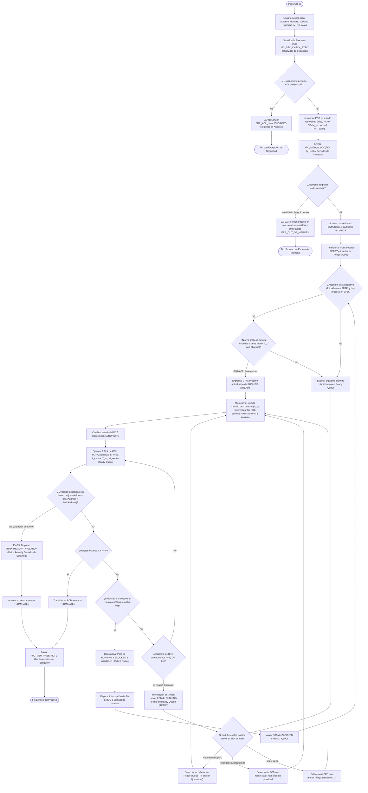
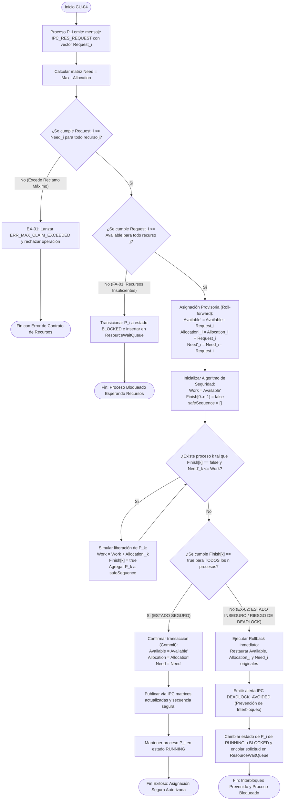
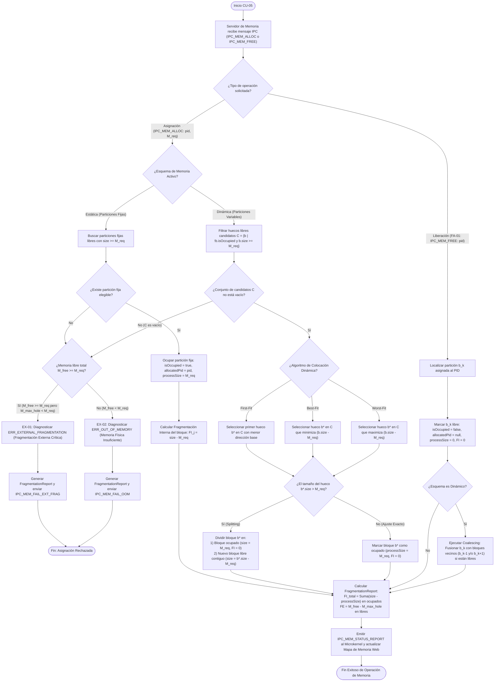
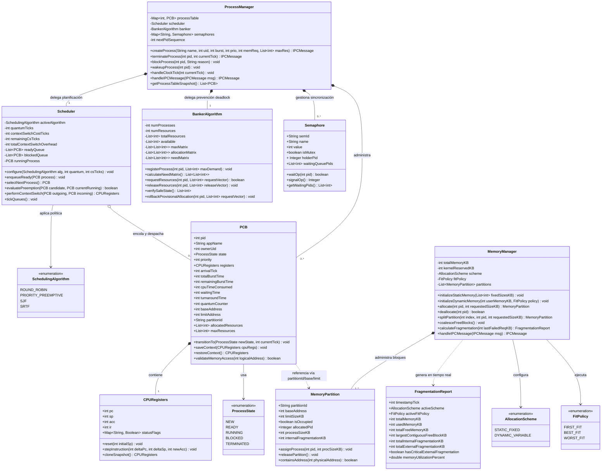

# Especificación Técnica de Ingeniería: Módulo de Administración de Procesos (2.1) y Módulo de Administración de Memoria (2.2)

**Proyecto:** Diseño y Simulación Web de un Minikernel (SO2026-2)  
**Institución:** Universidad Distrital Francisco José de Caldas — Facultad de Ingeniería — Proyecto Curricular de Ingeniería de Sistemas  
**Especialidad:** Ingeniería de Procesos, Sincronización, Deadlock y Gestión de Memoria Física/Virtual Simulada  
**Paradigma Arquitectónico:** Microkernel / Minikernel Estricto basado en Paso de Mensajes (IPC)

---

## 1. Matriz de Requerimientos del Sistema (Módulos 2.1 y 2.2)

### 1.1 Requerimientos Funcionales (`RF-07` a `RF-16`)

| Código | Nombre | Entrada | Procesamiento | Salida | Restricciones de Arquitectura Minikernel |
| :--- | :--- | :--- | :--- | :--- | :--- |
| **RF-07** | Creación de Aplicaciones/Programas y Procesos | Solicitud de creación de programa compilado/interpretado con parámetros: `nombreApp`, tiempo de llegada ($T_a$), ráfaga total de CPU ($T_{burst}$), prioridad base ($P \in \mathbb{Z}^+$), requerimiento de memoria en KB ($M_{req}$), vector de demanda máxima de recursos ($Max_i$) y perfil de usuario emisor (`uid`). | 1. El **Servidor de Procesos** valida mediante IPC con el **Servidor de Seguridad** los permisos de ejecución en la ACL para el `uid`. 2. Genera un identificador único secuencial (`pid`) y solicita al **Servidor de Memoria** la reserva de espacio ($M_{req}$). 3. Si hay memoria disponible, instancia el bloque de control de proceso (`PCB`) en estado `NEW` y lo transiciona a `READY`. | Instancia `PCB` registrada en la tabla global del Servidor de Procesos, memoria base/límite vinculada e inserción en la `Ready Queue` notificada por evento IPC a la UI. | El Servidor de Procesos ejecuta en espacio de usuario/servidor abstraído; nunca manipula tablas de páginas/particiones ni registros físicos directamente sin mediación de mensajes `IPCMessage` hacia el Microkernel y el Servidor de Memoria. |
| **RF-08** | Gestión de Estructura Dinámica del PCB y Registros de CPU Simulados | `pid` del proceso activo o seleccionado, pulsos del reloj del sistema (`tick`) e instrucciones simuladas del programa en ejecución. | 1. Mantiene y actualiza en cada ciclo de reloj la estructura `PCB`: `pid`, `state` (`NEW`, `READY`, `RUNNING`, `BLOCKED`, `TERMINATED`), registros de CPU simulados (`PC` Program Counter, `SP` Stack Pointer, `Acc` Acumulador), `priority`, métricas temporales ($T_a$, ráfaga restante $T_r$, CPU consumido $T_{cpu}$, tiempo de espera $W_t$, tiempo de retorno $T_{tat}$) y punteros de memoria (`baseAddress`, `limitAddress`, `partitionId`). 2. Incrementa `PC`, modifica `SP`/`Acc` según la micro-instrucción simulada y verifica que toda dirección lógica $d$ cumpla $0 \le d < \text{limitAddress}$. | Estado actualizado del objeto `PCB` serializado en tiempo real para inspección en el panel de control web. | Cualquier intento de direccionamiento fuera del rango $[\text{baseAddress}, \text{baseAddress} + \text{limitAddress})$ dispara una trampa de hardware simulada (`TRAP_MEMORY_VIOLATION`) hacia el Microkernel, el cual notifica vía IPC al Servidor de Seguridad y aborta el proceso (`TERMINATED`). |
| **RF-09** | Planificación de CPU Parametrizable (Round Robin, Prioridades Apropiativas, SJF/SRTF) | Cola de procesos listos (`Ready Queue`), algoritmo activo seleccionado ($A \in \{\text{RR}, \text{PRIO\_PREEMPTIVE}, \text{SJF}, \text{SRTF}\}$), parámetro `quantum` ($Q \in \mathbb{Z}^+$ ticks para RR) y vector de estados de procesos. | Evaluación por tick: 1. **Round Robin (RR):** Asigna CPU por un máximo de $Q$ ticks; si el contador `quantumSlice` llega a $Q$ y $T_r > 0$, expropia la CPU y reencola el proceso al final de `Ready Queue`. 2. **Prioridades Apropiativas:** Selecciona $\arg\min_{p \in \text{Ready}} (p.\text{priority})$ (menor valor numérico = mayor prioridad; desempate por FCFS). Si llega un proceso con $P_{nuevo} < P_{actual}$, ejecuta expropiación inmediata (`Preemption`). 3. **SJF / SRTF:** En SJF (no apropiativo) selecciona $\arg\min (T_r)$ al liberar CPU; en SRTF (apropiativo) recalcula en cada tick si un proceso entrante cumple $T_{r,\text{nuevo}} < T_{r,\text{actual}}$, expropiando la CPU. | `pid` del proceso seleccionado para despacho (`Dispatch`), actualización de contadores $W_t$ para procesos en `Ready Queue` y traza de decisión del planificador. | El despachador básico de bajo nivel reside en el Microkernel, mientras que la política algorítmica parametrizable es orquestada con el Servidor de Procesos mediante primitivas IPC de planificación (`SCHED_SELECT_NEXT`, `SCHED_PREEMPT`). |
| **RF-10** | Gestión de Transiciones de Estado y Colas (Ready, CPU, Blocked) | Eventos de ciclo de vida del proceso: admisión, despacho (`Dispatch`), expiración de quantum (`Timer Interrupt`), solicitud de E/S o recurso (`Wait`), finalización de E/S o recurso (`Signal/Interrupt`) y terminación (`Exit`). | Administra de forma determinista el grafo de transiciones entre colas: - `New Queue` $\rightarrow$ `Ready Queue` (Admisión tras asignación de memoria). - `Ready Queue` $\rightarrow$ `CPU (Running)` (Despacho). - `CPU (Running)` $\rightarrow$ `Ready Queue` (Expropiación por Quantum o Prioridad/SRTF). - `CPU (Running)` $\rightarrow$ `Blocked Queue` (Solicitud de E/S o espera en semáforo/Banquero). - `Blocked Queue` $\rightarrow$ `Ready Queue` (Interrupción de fin de E/S o liberación de recurso). - `CPU (Running)` $\rightarrow$ `Terminated` (Ráfaga $T_r = 0$ o excepción fatal). | Estado instantáneo de las colas (`readyQueue`, `runningProcess`, `blockedIoQueue`, `blockedSyncQueue`, `terminatedList`) emitido al bus de eventos de visualización. | Las transiciones hacia `BLOCKED` por operaciones de disco, red o archivos deben efectuarse exclusivamente enviando un mensaje IPC asíncrono/bloqueante al Servidor de E/S o Servidor de Archivos a través del Microkernel. |
| **RF-11** | Sincronización de Procesos mediante Semáforos, Mutex y Paso de Mensajes | Primitivas invocadas por procesos: `wait(semId)` ($P$), `signal(semId)` ($V$), `mutex.lock()`, `mutex.unlock()`, `send(destPid, payload)` y `receive(srcPid)`. | 1. **Semáforo/Mutex:** En `wait(S)`, decrementa $S.\text{value} \leftarrow S.\text{value} - 1$. Si $S.\text{value} < 0$, inserta el `PCB` invocador en $S.\text{waitQueue}$ y cambia su estado a `BLOCKED`. En `signal(S)`, incrementa $S.\text{value} \leftarrow S.\text{value} + 1$; si $S.\text{value} \le 0$, extrae el primer proceso de $S.\text{waitQueue}$ (FIFO) y lo mueve a `READY`. 2. **IPC entre procesos:** Gestiona buzones sincronizados validando capacidad de buffer y bloqueando al receptor si el buzón está vacío. | Actualización atómica del valor del semáforo/mutex, lista de procesos en cola de espera del recurso y confirmación de entrega de mensaje IPC. | Las primitivas `wait()` y `signal()` se ejecutan como llamadas al sistema (`Syscalls`) canalizadas por el Microkernel para garantizar atomicidad libre de condiciones de carrera en la simulación. |
| **RF-12** | Prevención y Detección de Interbloqueos mediante el Algoritmo del Banquero (Dijkstra) | Número de procesos activos $n$, tipos de recursos $m$, vector de recursos disponibles $Available \in \mathbb{N}^{1 \times m}$, matriz de demanda máxima $Max \in \mathbb{N}^{n \times m}$, matriz de asignación actual $Allocation \in \mathbb{N}^{n \times m}$ y vector de solicitud $Request_i \in \mathbb{N}^{1 \times m}$ del proceso $P_i$. | 1. Calcula la matriz de necesidad restante: $Need[i][j] = Max[i][j] - Allocation[i][j]$. 2. Verifica validez: $Request_i \le Need_i$ (si falla, lanza excepción por exceder reclamo máximo). 3. Verifica disponibilidad: $Request_i \le Available$ (si falla, $P_i$ pasa a `BLOCKED` esperando recursos). 4. **Simulación Provisoria (Roll-forward):** $Available' = Available - Request_i$ $Allocation'_i = Allocation_i + Request_i$ $Need'_i = Need_i - Request_i$ 5. **Algoritmo de Seguridad:** Inicializa $Work = Available'$ y $Finish[k] = \text{false}$ $\forall k \in [0, n-1]$. Busca un índice $k$ tal que $Finish[k] == \text{false} \land Need'_k \le Work$. Si existe, actualiza $Work \leftarrow Work + Allocation'_k$, $Finish[k] \leftarrow \text{true}$ y añade $P_k$ a la secuencia segura $\langle P_{s_1}, P_{s_2}, \dots \rangle$. 6. Si $\forall k, Finish[k] == \text{true}$, confirma la asignación; de lo contrario, revierte (**Rollback**) la asignación provisoria y bloquea a $P_i$. | Booleano `isSafeState`, secuencia segura ordenada $\langle P_{s_1}, \dots, P_{s_n} \rangle$ (si existe), matrices actualizadas ($Allocation, Max, Need, Available$) y alerta de prevención de Deadlock si el estado resulta inseguro. | Ningún recurso compartido crítico del sistema se asigna sin la autorización formal del motor `BankerAlgorithm` en el Servidor de Procesos, notificando los bloqueos al Microkernel vía IPC. |
| **RF-13** | Simulación Explícita de Cambio de Contexto ($T_{cs}$ / Context Switch Overhead) | Proceso saliente $P_{out}$ (en `RUNNING`), proceso entrante $P_{in}$ (seleccionado de `Ready Queue`) y parámetro configurable de penalización de conmutación $T_{cs} \in \mathbb{N}$ (en ticks de reloj). | 1. Cuando ocurre una conmutación de CPU ($P_{out} \neq P_{in}$), el procesador entra en fase `CONTEXT_SWITCHING` durante exactamente $T_{cs}$ ticks. 2. **Fase Save:** vuelca los registros físicos simulados de la CPU (`PC`, `SP`, `Acc`, flags) dentro de la estructura `PCB` de $P_{out}$. 3. Consume $T_{cs}$ ticks de reloj durante los cuales ningún proceso de usuario ejecuta instrucciones útiles (se acumula en la métrica `contextSwitchOverheadTicks`). 4. **Fase Restore:** carga en la CPU los registros almacenados en el `PCB` de $P_{in}$ y cambia su estado a `RUNNING`. | Estado del procesador en conmutación visible en UI, registros restaurados en CPU y actualización del porcentaje de utilización efectiva de CPU: $\eta_{CPU} = \frac{\sum T_{cpu}}{\sum T_{cpu} + \sum T_{cs} + T_{idle}} \times 100\%$. | El guardado y restauración de registros `CPURegisters` es ejecutado exclusivamente por el Microkernel en modo privilegiado antes de devolver el control al espacio de usuario. |
| **RF-14** | Gestión de Memoria en Esquema Estático (Particiones Fijas) | Tamaño total de RAM física simulada ($M_{total}$), arreglo preconfigurado de particiones fijas $Part = \{B_1, B_2, \dots, B_k\}$ con tamaños estáticos $\{S_1, S_2, \dots, S_k\}$ ($\sum S_j = M_{total} - M_{kernel}$) y solicitud de asignación $(pid, M_{req})$. | 1. El **Servidor de Memoria** busca la partición libre $B_j$ (`isOccupied == false`) que cumpla $S_j \ge M_{req}$ (según selector de ajuste en particiones fijas: primera disponible o mejor ajuste fijo). 2. Si la encuentra, marca $B_j.\text{isOccupied} = \text{true}$, asigna $B_j.\text{allocatedPid} = pid$, registra $B_j.\text{processSize} = M_{req}$ y calcula la fragmentación interna de la partición: $FI_j = S_j - M_{req}$. 3. Al terminar el proceso, limpia la partición restaurando $B_j.\text{isOccupied} = \text{false}$ y $FI_j = 0$. | Descriptor de partición asignada (`partitionId`, `baseAddress`, `limitAddress` $= S_j$, `internalFragmentation` $= FI_j$) o código de error `ERR_OUT_OF_MEMORY`. | Toda operación de lectura/escritura de la tabla de particiones se realiza dentro del Servidor de Memoria tras recibir una solicitud `IPC_MEM_ALLOC` o `IPC_MEM_FREE` desde el Servidor de Procesos vía Microkernel. |
| **RF-15** | Gestión de Memoria en Esquema Dinámico (Particiones Variables: First-Fit, Best-Fit, Worst-Fit y Coalescing) | Lista enlazada/arreglo ordenado de bloques de memoria variables $H = \{b_1, b_2, \dots, b_m\}$, política de colocación seleccionada ($Pol \in \{\text{FIRST\_FIT}, \text{BEST\_FIT}, \text{WORST\_FIT}\}$) y solicitud $(pid, M_{req})$ o liberación $(pid)$. | 1. Filtra el conjunto de huecos libres candidatos: $C = \{b \in H \mid \neg b.\text{isOccupied} \land b.\text{size} \ge M_{req}\}$. 2. Selección según política: - **First-Fit:** Selecciona el primer bloque $b^* \in C$ con menor dirección base. - **Best-Fit:** Selecciona $b^* = \arg\min_{b \in C} (b.\text{size} - M_{req})$ (deja el residuo más pequeño). - **Worst-Fit:** Selecciona $b^* = \arg\max_{b \in C} (b.\text{size} - M_{req})$ (deja el residuo más grande). 3. **Splitting (División):** Si $b^*.\text{size} > M_{req}$, divide $b^*$ en dos bloques contiguos: $b_{\text{alloc}}$ de tamaño $M_{req}$ ocupado por `pid` y $b_{\text{free}}$ libre de tamaño $b^*.\text{size} - M_{req}$ con base $b^*.\text{baseAddress} + M_{req}$. 4. **Liberación y Coalescing (Compactación de adyacentes):** Al liberar un bloque $b_k$, lo marca libre y si $b_{k-1}$ o $b_{k+1}$ están libres, los fusiona en un único hueco contiguo sumando sus tamaños. | Mapa actualizado de particiones dinámicas, punteros `baseAddress` y `limitAddress` $= M_{req}$ entregados al PCB, o excepción `ERR_EXTERNAL_FRAGMENTATION` / `ERR_OUT_OF_MEMORY`. | En asignación dinámica, `internalFragmentation` es $0\text{ KB}$ por bloque exacto, pero el Servidor de Memoria debe validar los límites exactos `[baseAddress, baseAddress + M_req)` en cada acceso reportado por el Microkernel. |
| **RF-16** | Cálculo Matemático y Reporte en Tiempo Real de Fragmentación Interna y Externa + Abstracción IPC | Estado actual del vector de particiones de memoria $H = \{b_1, \dots, b_m\}$ y solicitud fallida o activa de tamaño $M_{req}$. | Calcula en cada cambio de estado de memoria: 1. **Fragmentación Interna Total ($FI_{\text{total}}$):** $$FI_{\text{total}} = \sum_{b_i \in H, \, b_i.\text{isOccupied}} (b_i.\text{size} - b_i.\text{processSize})$$ 2. **Memoria Libre Total ($M_{\text{free}}$):** $$M_{\text{free}} = \sum_{b_i \in H, \, \neg b_i.\text{isOccupied}} b_i.\text{size}$$ 3. **Bloque Libre Máximo Contiguo ($M_{\text{max\_hole}}$):** $$M_{\text{max\_hole}} = \max_{b_i \in H, \, \neg b_i.\text{isOccupied}} (b_i.\text{size}) \quad (\text{o } 0 \text{ si no hay libres})$$ 4. **Fragmentación Externa ($FE$):** $$FE = M_{\text{free}} - M_{\text{max\_hole}}$$ Adicionalmente, determina condición crítica de fallo por fragmentación externa cuando $M_{\text{free}} \ge M_{req} \land M_{\text{max\_hole}} < M_{req}$. | Objeto inmutable `FragmentationReport` enviado mediante mensaje IPC al panel visualizador del mapa de memoria RAM. | La interfaz de usuario y el Servidor de Procesos no calculan métricas de memoria por su cuenta; consumen el payload del mensaje `IPC_MEM_STATUS_REPORT` publicado por el Servidor de Memoria a través del Microkernel. |

---

### 1.2 Requerimientos No Funcionales (`RNF-04` a `RNF-06`)

| Código | Nombre | Entrada | Procesamiento | Salida | Restricciones de Arquitectura Minikernel |
| :--- | :--- | :--- | :--- | :--- | :--- |
| **RNF-04** | Determinismo Algorítmico y Complejidad Acotada por Tick de Reloj | Eventos concurrentes de reloj (`CLOCK_TICK`), colas de hasta $N \le 100$ procesos activos, $M \le 20$ tipos de recursos en el Banquero y hasta $K \le 256$ particiones de memoria. | El motor matemático de planificación ($O(N)$), el Algoritmo de Seguridad del Banquero ($O(M \cdot N^2)$) y los algoritmos de colocación de memoria ($O(K)$) deben ejecutarse de manera completamente determinista y sin bloqueos del hilo principal del navegador (UI Thread) en menos de $16\text{ ms}$ por tick (garantizando $60\text{ FPS}$ en las animaciones de colas y mapa de memoria). | Ejecución fluida, reproducible paso a paso (modo *Step-by-Step* o continuo) y trazabilidad matemática exacta sin condiciones de carrera en el motor de simulación. | El bucle de reloj (`Clock Interrupt`) es gobernado únicamente por el Microkernel, el cual emite pulsos sincronizados a los servidores de Procesos y Memoria mediante despacho secuencial de mensajes IPC. |
| **RNF-05** | Desacoplamiento Estricto Microkernel y Protección de Fronteras de Memoria | Llamadas entre el Módulo de Procesos (`ProcessManager`), el Módulo de Memoria (`MemoryManager`), el Módulo de Seguridad (`SecurityController`) y el Módulo de E/S. | Se prohíbe la mutación directa de referencias cruzadas entre módulos de distintos servidores. Toda interacción entre el Servidor de Procesos y el Servidor de Memoria debe serializarse en una estructura `IPCMessage` (`sender`, `receiver`, `type`, `payload`, `timestamp`) enrutada por el bus del Microkernel. | Registro auditable de mensajes IPC en la consola del sistema y cero acoplamiento monolítico entre clases de servidores. | Cumplimiento del 100% con la restricción de arquitectura Microkernel/Minikernel exigida en la rúbrica (Sección 1 y 5 de la Guía del Proyecto) para evitar penalizaciones por acoplamiento o "Falla de Kernel". |
| **RNF-06** | Coherencia Matemática e Integridad de Invariantes de Recursos y Memoria | Estado instantáneo de las matrices del Banquero ($Allocation, Max, Need, Available$) y del mapa de memoria ($H$). | En cada tick se verifican automáticamente los invariantes matemáticos del sistema: 1. Invariante del Banquero: $\forall i, j: Need[i][j] = Max[i][j] - Allocation[i][j] \ge 0$ y $\sum_{i=1}^n Allocation[i][j] + Available[j] = TotalResources[j]$. 2. Invariante de Memoria: $\sum_{b_k \in H} b_k.\text{size} + M_{\text{kernel}} = M_{\text{total}}$ y ausencia de solapamiento de intervalos $[b_k.\text{base}, b_k.\text{base} + b_k.\text{size})$. | Validación silenciosa exitosa o disparo inmediato de excepción controlada de integridad (`KERNEL_PANIC_INVARIANT_VIOLATION`) con volcado de diagnóstico. | Garantiza que el mecanismo de Verificación de Inconsistencias (Sección 4 de la Guía) mantenga correspondencia exacta entre la especificación formal, los diagramas UML y el motor web en tiempo de ejecución. |

---

## 2. Especificación Formal de Casos de Uso (`CU-03`, `CU-04` y `CU-05`)

### 2.1 Caso de Uso `CU-03`: Crear Proceso, Asignar PCB y Planificar CPU (RR, Prioridades Apropiativas, SJF/SRTF)

| Campo | Descripción Formal |
| :--- | :--- |
| **ID** | `CU-03` |
| **Nombre** | Crear Proceso, Asignar PCB y Planificar CPU (Round Robin, Prioridades Apropiativas, SJF/SRTF) |
| **Actor(es)** | **Primario:** Usuario / Administrador de Simulación. **Secundarios (Sistemas):** Microkernel (Dispatcher/IPC), Servidor de Procesos (`ProcessManager` + `Scheduler`), Servidor de Memoria (`MemoryManager`), Servidor de Seguridad (`SecurityController`). |
| **Módulo** | Módulo 2.1: Administración de Procesos (en integración IPC con Módulo 2.2 y Módulo 2.5). |
| **Precondiciones** | 1. El Minikernel se encuentra inicializado y el reloj del sistema está operativo. 2. El usuario actual posee una sesión autenticada en el sistema. 3. Existe un algoritmo de planificación activo configurado (`RR` con Quantum $Q > 0$, `PRIO_PREEMPTIVE`, `SJF` o `SRTF`) y un costo de cambio de contexto $T_{cs} \ge 0$. |
| **Postcondiciones** | **Éxito:** El proceso es creado con su estructura `PCB` completa, recibe una partición válida de memoria RAM, transita por las colas de planificación (`NEW` $\rightarrow$ `READY` $\rightarrow$ `RUNNING` $\rightarrow$ `TERMINATED`), actualiza sus registros simulados (`PC`, `SP`, `Acc`) y libera su memoria al finalizar. **Fallo:** Si no hay permisos ACL o no existe memoria suficiente, el proceso es rechazado o retenido en cola de admisión y se registra el evento en el log del sistema. |
| **Flujo Principal (Escenario de Éxito)** | 1. El Usuario solicita crear un nuevo proceso ingresando: nombre, ráfaga de CPU ($T_{burst}$), prioridad ($P$), tamaño de memoria ($M_{req}$) y vector de recursos máximos ($Max_i$). 2. El Servidor de Procesos envía un mensaje IPC `IPC_SEC_CHECK_EXEC` al Servidor de Seguridad a través del Microkernel para validar permisos del usuario. 3. El Servidor de Seguridad confirma la autorización (`ACL_GRANTED`). 4. El Servidor de Procesos instancia el `PCB` en estado `NEW` con `pid` único, `PC = 0`, `SP = M_req`, `Acc = 0`, $T_r = T_{burst}$, $T_{cpu} = 0$, $W_t = 0$. 5. El Servidor de Procesos envía el mensaje IPC `IPC_MEM_ALLOC(pid, M_req)` al Servidor de Memoria. 6. El Servidor de Memoria reserva un bloque de memoria (según `CU-05`) y retorna `baseAddress`, `limitAddress` y `partitionId`. 7. El Servidor de Procesos vincula los punteros de memoria en el `PCB`, cambia su estado a `READY` y lo inserta en la `Ready Queue`. 8. En el siguiente pulso de reloj (`CLOCK_TICK`), el `Scheduler` evalúa la `Ready Queue` según la política activa: &nbsp;&nbsp;&nbsp;a. **Si es Round Robin:** Selecciona el primer proceso de la cola FIFO y le asigna un presupuesto de $Q$ ticks. &nbsp;&nbsp;&nbsp;b. **Si es Prioridades Apropiativas:** Selecciona el proceso con menor valor numérico de `priority`. &nbsp;&nbsp;&nbsp;c. **Si es SJF / SRTF:** Selecciona el proceso con menor tiempo de ráfaga restante ($T_r$). 9. El Microkernel ejecuta el **Cambio de Contexto ($T_{cs}$)**: guarda los registros (`PC`, `SP`, `Acc`) del proceso saliente en su `PCB`, consume $T_{cs}$ ticks de overhead, carga los registros del proceso seleccionado en la CPU y cambia su estado a `RUNNING`. 10. Durante cada tick de ejecución en CPU, el proceso incrementa `PC`, actualiza `SP` y `Acc`, incrementa $T_{cpu}$ en 1 y decrementa $T_r$ en 1, mientras los demás procesos en `Ready Queue` incrementan su tiempo de espera $W_t$ en 1. 11. Cuando $T_r == 0$, el proceso transiciona a `TERMINATED`, el Servidor de Procesos envía `IPC_MEM_FREE(pid)` al Servidor de Memoria y libera los recursos asignados en el Banquero. |
| **Flujos Alternos** | **FA-01 (Expropiación por Expiración de Quantum en Round Robin):** En el paso 10, si el algoritmo es `RR`, el contador de quantum consumido alcanza $Q$ y aún $T_r > 0$: el Microkernel lanza una interrupción de temporizador (`TIMER_PREEMPT`), guarda el contexto del proceso en su `PCB`, cambia su estado de `RUNNING` a `READY`, lo reencola al final de la `Ready Queue` y despacha el siguiente proceso.  **FA-02 (Expropiación por Prioridad Superior o SRTF):** En el paso 7, cuando un nuevo proceso entra a `READY` (o vuelve de `BLOCKED`), si el algoritmo es `PRIO_PREEMPTIVE` y $P_{\text{nuevo}} < P_{\text{running}}$, o si el algoritmo es `SRTF` y $T_{r,\text{nuevo}} < T_{r,\text{running}}$: el `Scheduler` emite señal de expropiación inmediata (`PREEMPT_CURRENT`), devuelve el proceso en ejecución a `READY`, aplica el cambio de contexto ($T_{cs}$) y asigna la CPU al nuevo proceso.  **FA-03 (Bloqueo por Solicitud de E/S o Sincronización):** En el paso 10, si el proceso en `RUNNING` ejecuta una syscall de E/S o un `wait()` sobre un semáforo con valor $\le 0$: el proceso pasa a estado `BLOCKED`, se transfiere a la `Blocked Queue` correspondiente y el `Scheduler` selecciona otro proceso de la `Ready Queue`. |
| **Excepciones** | **EX-01 (`ERR_ACL_UNAUTHORIZED`):** En el paso 3, si el usuario (ej. perfil `Invitado`) no tiene permisos de creación/ejecución de procesos, el Servidor de Seguridad rechaza la solicitud, se aborta la creación del `PCB` y se registra una alerta en el log de auditoría.  **EX-02 (`ERR_OUT_OF_MEMORY` en Admisión):** En el paso 6, si el Servidor de Memoria informa que no hay espacio suficiente para $M_{req}$, el proceso permanece retenido en la cola de admisión (`NEW`) o es rechazado según política de admisión sin ingresar a la `Ready Queue`.  **EX-03 (`TRAP_MEMORY_VIOLATION`):** En el paso 10, si una instrucción simulada intenta acceder a una dirección fuera de `[baseAddress, baseAddress + limitAddress)`, el Microkernel aborta inmediatamente el proceso (`TERMINATED`), solicita liberar su memoria y envía una alerta crítica al Servidor de Seguridad. |

---

### 2.2 Caso de Uso `CU-04`: Evaluar Estado Seguro y Prevenir Interbloqueo mediante el Algoritmo del Banquero

| Campo | Descripción Formal |
| :--- | :--- |
| **ID** | `CU-04` |
| **Nombre** | Evaluar Estado Seguro y Prevenir Interbloqueo mediante el Algoritmo del Banquero |
| **Actor(es)** | **Primario:** Proceso en Ejecución (`PCB` en estado `RUNNING`) / Usuario Simulador. **Secundarios (Sistemas):** Servidor de Procesos (`BankerAlgorithm`), Microkernel (Gestor de Colas y Bloqueos IPC). |
| **Módulo** | Módulo 2.1: Administración de Procesos — Submódulo de Sincronización e Interbloqueos. |
| **Precondiciones** | 1. El sistema cuenta con $m$ tipos de recursos críticos inicializados con capacidades totales $Total \in \mathbb{N}^{1 \times m}$ y vector disponible actual $Available \in \mathbb{N}^{1 \times m}$. 2. Existen $n$ procesos activos, cada uno habiendo declarado al crearse su fila de demanda máxima $Max_i \in \mathbb{N}^{1 \times m}$. 3. El sistema se encuentra actualmente en un **Estado Seguro** verificado y la matriz $Need = Max - Allocation$ está sincronizada. |
| **Postcondiciones** | **Éxito (Estado Seguro):** La solicitud $Request_i$ es concedida, las matrices $Allocation$, $Need$ y el vector $Available$ se actualizan permanentemente, y se publica en la interfaz web la secuencia segura $\langle P_{s_1}, P_{s_2}, \dots, P_{s_n} \rangle$. **Prevención de Deadlock (Estado Inseguro):** La asignación provisoria se revierte íntegramente (**Rollback**), el proceso solicitante $P_i$ pasa a estado `BLOCKED` en la cola de recursos y se emite una advertencia de interbloqueo evitado. |
| **Flujo Principal (Escenario de Éxito)** | 1. El proceso $P_i$ (o el usuario desde el panel de sincronización) emite mediante IPC una solicitud de recursos $Request_i = [r_1, r_2, \dots, r_m]$ hacia el Servidor de Procesos (`IPC_RES_REQUEST`). 2. El motor `BankerAlgorithm` valida la condición de reclamo máximo: verifica que para todo recurso $j \in [0, m-1]$ se cumpla $Request_i[j] \le Need[i][j]$. 3. El motor valida la condición de disponibilidad inmediata: verifica que para todo $j \in [0, m-1]$ se cumpla $Request_i[j] \le Available[j]$. 4. El motor realiza una **Asignación Provisoria (Simulada)** en memoria temporal: &nbsp;&nbsp;&nbsp;- $Available' \leftarrow Available - Request_i$ &nbsp;&nbsp;&nbsp;- $Allocation'[i] \leftarrow Allocation[i] + Request_i$ &nbsp;&nbsp;&nbsp;- $Need'[i] \leftarrow Need[i] - Request_i$ 5. El motor ejecuta el **Algoritmo de Verificación de Seguridad (Safety Algorithm)**: &nbsp;&nbsp;&nbsp;a. Inicializa el vector de trabajo $Work \leftarrow Available'$ y el vector booleano $Finish[k] \leftarrow \text{false}$ para todo $k \in \{0, \dots, n-1\}$. &nbsp;&nbsp;&nbsp;b. Busca un proceso $P_k$ tal que $Finish[k] == \text{false}$ y $\forall j: Need'[k][j] \le Work[j]$. &nbsp;&nbsp;&nbsp;c.Al encontrarlo, simula la finalización de $P_k$: actualiza $Work \leftarrow Work + Allocation'[k]$, marca $Finish[k] \leftarrow \text{true}$, agrega $P_k$ a la lista `safeSequence` y repite desde 5.b. 6. Al comprobar que $Finish[k] == \text{true}$ para todos los $n$ procesos activos, el motor dictamina **ESTADO SEGURO (`SAFE_STATE`)**. 7. El motor confirma la transacción copiando el estado provisorio al estado real ($Available \leftarrow Available'$, $Allocation \leftarrow Allocation'$, $Need \leftarrow Need'$). 8. El Servidor de Procesos notifica por IPC al Microkernel y a la interfaz web las matrices actualizadas y la secuencia segura $\langle P_{s_1}, P_{s_2}, \dots, P_{s_n} \rangle$, manteniendo a $P_i$ en estado `RUNNING`. |
| **Flujos Alternos** | **FA-01 (Recursos Temporalmente Insuficientes — $Request_i > Available$):** En el paso 3, si existe algún recurso $j$ tal que $Request_i[j] > Available[j]$: el motor no ejecuta la simulación provisoria, coloca la petición de $P_i$ en la cola de espera de recursos (`ResourceWaitQueue`), ordena al Microkernel transicionar $P_i$ de `RUNNING` a `BLOCKED` y solicita al `Scheduler` despachar otro proceso listo.  **FA-02 (Liberación de Recursos y Despertar de Procesos Bloqueados):** Cuando un proceso $P_k$ libera recursos (`IPC_RES_RELEASE(Release_k)` o al terminar su ejecución): el motor actualiza $Available \leftarrow Available + Release_k$, $Allocation[k] \leftarrow Allocation[k] - Release_k$ y reevalúa en orden FIFO las solicitudes pendientes en `ResourceWaitQueue`, despertando (`BLOCKED` $\rightarrow$ `READY`) a aquellos procesos cuya solicitud ahora produzca un estado seguro. |
| **Excepciones** | **EX-01 (`ERR_MAX_CLAIM_EXCEEDED`):** En el paso 2, si existe algún $j$ tal que $Request_i[j] > Need[i][j]$, el proceso ha violado su contrato de demanda máxima declarada. El motor rechaza la operación inmediatamente, devuelve un error fatal al proceso y registra el evento en la consola del sistema.  **EX-02 (`UNSAFE_STATE_DEADLOCK_PREVENTED` — Estado Inseguro Detectado):** En el paso 5, si no existe ningún proceso $P_k$ con $Need'[k] \le Work$ pero aún existen procesos con $Finish[k] == \text{false}$: el motor detecta un **Estado Inseguro (Riesgo de Deadlock)**, ejecuta un **Rollback** inmediato restaurando los vectores originales ($Available, Allocation, Need$), bloquea al proceso solicitante $P_i$ (`RUNNING` $\rightarrow$ `BLOCKED`), encola su petición y emite la alerta visual `DEADLOCK_AVOIDED` indicando qué procesos habrían quedado en interbloqueo. |

---

### 2.3 Caso de Uso `CU-05`: Asignar y Liberar Memoria RAM (Estática/Dinámica: First-Fit, Best-Fit, Worst-Fit) y Calcular Fragmentación

| Campo | Descripción Formal |
| :--- | :--- |
| **ID** | `CU-05` |
| **Nombre** | Asignar y Liberar Memoria RAM (Estática/Dinámica: First-Fit, Best-Fit, Worst-Fit) y Calcular Fragmentación |
| **Actor(es)** | **Primario:** Servidor de Procesos (mediante llamada IPC) / Usuario Configurador. **Secundarios (Sistemas):** Microkernel (Router IPC), Servidor de Memoria (`MemoryManager`). |
| **Módulo** | Módulo 2.2: Administración de Memoria. |
| **Precondiciones** | 1. El Servidor de Memoria está inicializado con una capacidad física total $M_{\text{total}}$ (ej. $1024\text{ KB}$) y un área reservada para el Microkernel ($M_{\text{kernel}}$). 2. El esquema de particionamiento activo está configurado como **Estático** (Particiones Fijas predefinidas) o **Dinámico** (Particiones Variables con política `FIRST_FIT`, `BEST_FIT` o `WORST_FIT`). |
| **Postcondiciones** | **Éxito en Asignación:** Se adjudica un bloque de memoria contiguo al proceso solicitante, se actualizan los registros `baseAddress` y `limitAddress` del `PCB` vía IPC y se recalcula el reporte de fragmentación interna y externa. **Éxito en Liberación:** La partición se marca como libre, se fusionan bloques libres adyacentes (si el esquema es dinámico) y se actualiza el mapa visual de memoria. |
| **Flujo Principal (Escenario de Éxito)** | 1. El Servidor de Memoria recibe del Microkernel un mensaje `IPC_MEM_ALLOC` con el `pid` del proceso y el tamaño requerido $M_{req}$ (en KB). 2. El `MemoryManager` verifica el esquema de gestión de memoria activo: 3. **Si el esquema es Estático (Particiones Fijas):** &nbsp;&nbsp;&nbsp;a. Recorre el vector de particiones fijas buscando aquellas con `isOccupied == false` y `size` $\ge M_{req}$. &nbsp;&nbsp;&nbsp;b. Selecciona la partición correspondiente, marca `isOccupied = true`, `allocatedPid = pid`, `processSize = M_req`. &nbsp;&nbsp;&nbsp;c. Calcula la fragmentación interna de esa partición: $FI_j = \text{size} - M_{req}$. 4. **Si el esquema es Dinámico (Particiones Variables):** &nbsp;&nbsp;&nbsp;a. Construye la lista de huecos libres candidatos $C = \{b \in H \mid \neg b.\text{isOccupied} \land b.\text{size} \ge M_{req}\}$. &nbsp;&nbsp;&nbsp;b. Aplica el algoritmo de selección configurado: &nbsp;&nbsp;&nbsp;&nbsp;&nbsp;&nbsp;- **First-Fit:** Toma el primer hueco $b^* \in C$ en orden de dirección base. &nbsp;&nbsp;&nbsp;&nbsp;&nbsp;&nbsp;- **Best-Fit:** Ordena $C$ ascendentemente por $(b.\text{size} - M_{req})$ y toma el primero ($b^*$). &nbsp;&nbsp;&nbsp;&nbsp;&nbsp;&nbsp;- **Worst-Fit:** Ordena $C$ descendentemente por $(b.\text{size} - M_{req})$ y toma el primero ($b^*$). &nbsp;&nbsp;&nbsp;c. Si $b^*.\text{size} > M_{req}$, ejecuta la operación `splitPartition(b*, M_req)`: transforma $b^*$ en un bloque ocupado de tamaño exacto $M_{req}$ (`base = b*.base`, `limit = M_req`, `FI = 0`) e inserta inmediatamente después un nuevo bloque libre con `base` $= b^*.\text{base} + M_{req}$ y `size` $= b^*.\text{size} - M_{req}$. &nbsp;&nbsp;&nbsp;d. Si $b^*.\text{size} == M_{req}$, marca $b^*$ como ocupado por `pid` sin dividir. 5. El `MemoryManager` ejecuta `calculateFragmentation()` para generar el objeto `FragmentationReport` con: &nbsp;&nbsp;&nbsp;- $FI_{\text{total}} = \sum (b_i.\text{size} - b_i.\text{processSize})$ en bloques ocupados. &nbsp;&nbsp;&nbsp;- $FE = M_{\text{free}} - M_{\text{max\_hole}}$ en bloques libres. 6. El Servidor de Memoria envía por IPC el mensaje `IPC_MEM_ALLOC_OK(pid, baseAddress, limitAddress, report)` al Servidor de Procesos y actualiza el mapa gráfico de memoria RAM. |
| **Flujos Alternos** | **FA-01 (Liberación de Memoria y Fusión de Huecos Adyacentes — Coalescing):** 1. Cuando un proceso termina o libera memoria, el Servidor de Memoria recibe `IPC_MEM_FREE(pid)`. 2. Localiza la partición $b_k$ donde `allocatedPid == pid`, restablece `isOccupied = false`, `allocatedPid = null`, `processSize = 0` y `internalFragmentation = 0`. 3. Si el esquema es **Dinámico**, ejecuta `coalesceFreeBlocks()`: &nbsp;&nbsp;&nbsp;- Si el bloque vecino izquierdo $b_{k-1}$ está libre, fusiona $b_{k-1}$ y $b_k$ sumando sus tamaños ($b_{k-1}.\text{size} \leftarrow b_{k-1}.\text{size} + b_k.\text{size}$) y elimina $b_k$. &nbsp;&nbsp;&nbsp;- Si el bloque vecino derecho $b_{k+1}$ está libre, fusiona el bloque actual con $b_{k+1}$ sumando sus tamaños y manteniendo la dirección base menor. 4. Recalcula el `FragmentationReport` y emite `IPC_MEM_STATUS_REPORT` al Microkernel. |
| **Excepciones** | **EX-01 (`ERR_EXTERNAL_FRAGMENTATION` — Fallo por Fragmentación Externa):** En el paso 4.a (o 3.a), si el conjunto de candidatos es vacío ($C = \emptyset$), pero la suma total de memoria libre cumple $M_{\text{free}} \ge M_{req}$ mientras que el hueco contiguo más grande cumple $M_{\text{max\_hole}} < M_{req}$: el Servidor de Memoria diagnostica **Fragmentación Externa Crítica**, rechaza la asignación devolviendo `IPC_MEM_FAIL_EXT_FRAG` junto con el reporte de los bloques dispersos que impiden alojar el proceso.  **EX-02 (`ERR_OUT_OF_MEMORY` — Memoria Física Agotada):** Si $C = \emptyset$ y además $M_{\text{free}} < M_{req}$: la memoria RAM física simulada es insuficiente. El Servidor de Memoria retorna `IPC_MEM_FAIL_OOM` y el proceso queda en espera o es abortado según la política del Servidor de Procesos. |

---

## 3. Diagramas de Actividad UML (Sintaxis Mermaid `flowchart TD`)

### 3.1 Diagrama de Actividad para `CU-03`: Creación de Proceso, PCB y Planificación de CPU

---

### 3.2 Diagrama de Actividad para `CU-04`: Algoritmo del Banquero (Evaluación de Estado Seguro y Prevención de Deadlock)

---

### 3.3 Diagrama de Actividad para `CU-05`: Gestión de Memoria RAM (Estática/Dinámica) y Cálculo de Fragmentación

---

## 4. Arquitectura y Diagrama de Clases UML (Módulos 2.1 y 2.2)

### 4.1 Diseño Orientado a Objetos bajo Arquitectura Minikernel
El diseño de clases respeta estrictamente la separación entre el **Servidor de Procesos** y el **Servidor de Memoria**, comunicados mediante mensajes `IPCMessage` a través del `Kernel`. Se especifican las 9 clases obligatorias de la especialidad (`PCB`, `CPURegisters`, `ProcessManager`, `Scheduler`, `BankerAlgorithm`, `Semaphore`, `MemoryManager`, `MemoryPartition`, `FragmentationReport`) junto con sus enumeraciones y contratos de métodos.

---

### 4.2 Especificación de Responsabilidades y Contratos de las Clases Clave

1. **`PCB` (Process Control Block):**
   - Encapsula el estado completo de un proceso en el Minikernel.
   - Contiene por composición una instancia de `CPURegisters` y mantiene tanto métricas de planificación ($T_a$, $T_{burst}$, $T_r$, $T_{cpu}$, $W_t$, $T_{tat}$) como descriptores de protección de memoria (`baseAddress`, `limitAddress`, `partitionId`) y vectores de recursos para el Algoritmo del Banquero.
2. **`CPURegisters`:**
   - Modela los registros arquitectónicos del procesador simulado: Contador de Programa (`pc`), Puntero de Pila (`sp`), Acumulador aritmético (`acc`), Registro de Instrucción (`ir`) y banderas de estado (`statusFlags`).
   - Provee `cloneSnapshot()` para permitir el volcado atómico durante el cambio de contexto ($T_{cs}$).
3. **`ProcessManager` (Servidor de Procesos):**
   - Servidor de espacio de usuario encargado de administrar la tabla de procesos (`processTable`), coordinar la creación/terminación de procesos mediante mensajes IPC hacia el `MemoryManager` y el `SecurityController`, y orquestar el `Scheduler`, el `BankerAlgorithm` y el mapa de instancias `Semaphore`.
4. **`Scheduler`:**
   - Implementa los algoritmos parametrizables **Round Robin** (con `quantumTicks` configurable), **Prioridades Apropiativas** y **SJF / SRTF**.
   - Controla el contador de penalización por cambio de contexto (`contextSwitchCostTicks` / $T_{cs}$) y evalúa en cada tick si corresponde una expropiación (`evaluatePreemption`).
5. **`BankerAlgorithm`:**
   - Mantiene las estructuras matriciales de Dijkstra ($Allocation$, $Max$, $Need$, $Available$) y ejecuta el método `verifySafeState()` antes de conceder cualquier petición de recursos, aplicando `rollbackProvisionalAllocation()` cuando detecta que una asignación llevaría a un estado inseguro.
6. **`Semaphore`:**
   - Implementa semáforos contadores y binarios (`Mutex`) con las primitivas atómicas `waitOp(pid)` y `signalOp()`, gestionando su propia cola FIFO de procesos bloqueados (`waitingQueuePids`).
7. **`MemoryManager` (Servidor de Memoria):**
   - Administra el espacio de direcciones físico simulado tanto en modo **Estático (`STATIC_FIXED`)** como **Dinámico (`DYNAMIC_VARIABLE`)** con las políticas `FIRST_FIT`, `BEST_FIT` y `WORST_FIT`.
   - Ejecuta la división dinámica de bloques (`splitPartition`) al asignar y la compactación de huecos contiguos (`coalesceFreeBlocks`) al liberar.
8. **`MemoryPartition`:**
   - Representa un segmento contiguo de memoria RAM (fijo o variable), almacenando su dirección de inicio (`baseAddress`), tamaño total del bloque (`limitSizeKB`), estado de ocupación (`isOccupied`), `allocatedPid`, tamaño real del proceso (`processSizeKB`) y su fragmentación interna individual (`internalFragmentationKB`).
9. **`FragmentationReport`:**
   - DTO (Data Transfer Object) inmutable generado tras cada operación de memoria y transmitido vía IPC para alimentar el dashboard web con el cálculo exacto de fragmentación interna total ($FI_{\text{total}}$), fragmentación externa ($FE = M_{\text{free}} - M_{\text{max\_hole}}$), bloque libre contiguo máximo y porcentaje de utilización de RAM.
