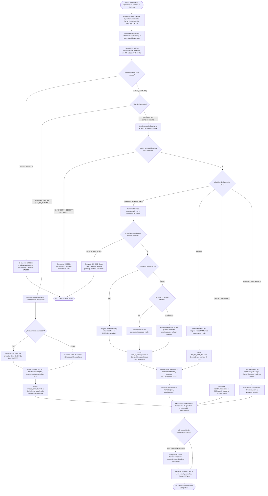
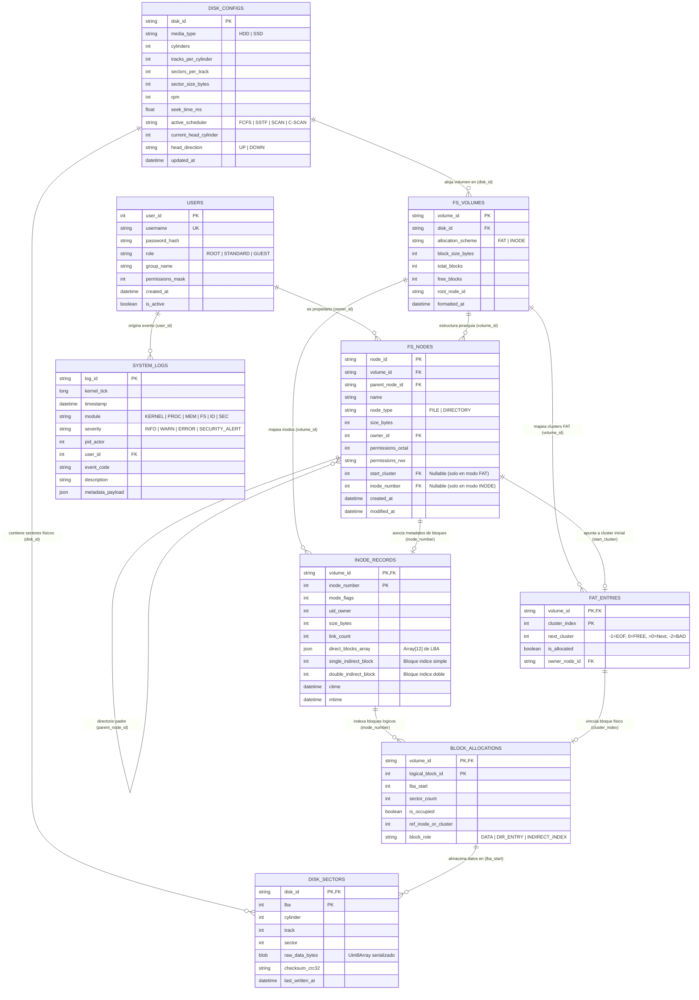

# Especificación Técnica de Ingeniería: Subsistema de Administración de Archivos, Entrada/Salida (E/S) y Persistencia

**Proyecto:** Diseño y Simulación Web de un Minikernel (SO 2026-2)  
**Especialidad:** Subsistemas de Almacenamiento, Periféricos y Persistencia (`Storage-IO-Engineer`)  
**Módulos Cubiertos:** Módulo 2.3 (Administración de Archivos), Módulo 2.4 (Administración de Entrada/Salida) y Modelo de Persistencia Relacional / NoSQL (LocalStorage / IndexedDB)  
**Arquitectura Base:** Microkernel / Minikernel Estricto (Servidores desacoplados en espacio de usuario comunicados exclusivamente vía paso de mensajes IPC)

---

## 1. Matriz de Requerimientos Funcionales y No Funcionales

A continuación se especifican de forma exhaustiva los Requerimientos Funcionales (`RF-17` a `RF-24`) y No Funcionales (`RNF-07` a `RNF-09`) correspondientes al Servidor de Archivos (`FileManager`), Servidor de Entrada/Salida (`DeviceDriver`, `DMAController`, `SimulatedSocket`) y Capa de Persistencia (`PersistenceStore`).

### 1.1 Requerimientos Funcionales (RF-17 a RF-24)

| Código | Nombre | Entrada | Procesamiento | Salida | Restricciones de Arquitectura Minikernel |
| :--- | :--- | :--- | :--- | :--- | :--- |
| **RF-17** | Gestión del Árbol Jerárquico de Directorios y Metadatos | Ruta absoluta o relativa (`path`: ej. `/`, `/bin`, `/home`, `/etc`), identificador de propietario (`ownerId`), máscara de permisos UNIX (`permissions` en formato octal `0755` / simbólico `rwxr-xr-x`), tipo de nodo (`FILE` o `DIRECTORY`). | El `FileManager` resuelve la ruta recorriendo el árbol de nodos `FSNode` desde la raíz (`/`). Valida la existencia de directorios padres, asigna un identificador único (`nodeId`), registra la marca de tiempo de creación/modificación (`creationDate`, `modifiedDate`), calcula el tamaño acumulado (`size`) y vincula el nodo con su estructura de bloques subyacente. | Estructura de árbol jerárquico actualizada en memoria del Servidor de Archivos, metadatos del nodo serializados en JSON y notificación de actualización para la vista de explorador jerárquico en la UI web. | El núcleo (`Kernel`) no mantiene referencias ni punteros a directorios o archivos. Toda consulta o mutación del árbol jerárquico se solicita mediante un mensaje `IPCMessage` (`SYS_FS_LOOKUP`, `SYS_FS_STAT`) enviado al Servidor de Archivos en espacio de usuario. |
| **RF-18** | Formateo Parametrizable del Sistema de Archivos (FAT / Inodos) | Esquema de asignación seleccionado (`scheme`: `FAT` o `INODE`), capacidad total del volumen virtual (`totalSize`), tamaño de bloque/cluster parametrizable (`blockSize`: `512B`, `1KB`, `2KB`, `4KB`), y bandera de confirmación de formateo. | Calcula el número total de bloques lógicos ($N_{bloques} = \lfloor \text{totalSize} / \text{blockSize} \rfloor$). Si el modo es `FAT`, inicializa la tabla de asignación `FATTable` con entradas libres (`0x0000`), reservadas y marcas de fin de cadena (`EOF = 0xFFFF`). Si el modo es `INODE`, inicializa el mapa de bits de inodos/bloques y preasigna la tabla de estructuras `Inode` (con 12 punteros directos, 1 indirecto simple y 1 indirecto doble). Crea los directorios base (`/`, `/bin`, `/home`, `/etc`). | Volumen virtual formateado, tabla de asignación de bloques limpia, creación del directorio raíz (`/`) y actualización inmediata del mapa visual de bloques/clusters en la interfaz web. | El formateo es ejecutado por el Servidor de Archivos en espacio de usuario previa validación de permisos `Root/Admin` ante el Servidor de Seguridad (`SecurityController`) vía IPC (`IPC_SEC_CHECK_PRIVILEGE`) y sincronización de limpieza física con el Servidor de E/S. |
| **RF-19** | Operaciones CRUD sobre Archivos y Directorios | Tipo de operación (`createFile`, `readFile`, `writeFile`, `deleteFile`, `rename`, `mkdir`, `rmdir`), ruta objetivo (`targetPath`), payload de datos o nuevo nombre, y contexto de seguridad del proceso solicitante (`pid`, `uid`). | 1. Solicita validación de permisos `rwx` en la ACL al Servidor de Seguridad. 2. Para `createFile`/`writeFile`, calcula los bloques requeridos ($B_{req} = \lceil \text{size} / \text{blockSize} \rceil$), busca bloques libres en `FATTable` o mediante un `Inode`, encadena los clusters o punteros de inodo y emite peticiones de escritura de sectores al Servidor de E/S. 3. Para `readFile`, resuelve la lista de bloques asociados al archivo y solicita lectura física al Servidor de E/S. 4. Para `deleteFile`/`rmdir`, libera las entradas en `FATTable` o los bloques del `Inode` y desvincula el `FSNode` del directorio padre. | Código de retorno de la llamada al sistema (`0 = OK`, `-ENOENT`, `-EACCES`, `-ENOSPC`, `-ENOTEMPTY`), datos leídos en el buffer del proceso, y tabla de asignación visual actualizada en tiempo real. | Ningún proceso de usuario accede directamente a las estructuras `FATTable` o `Inode`. Toda operación CRUD requiere el envío de un `IPCMessage` al `FileManager`, el cual a su vez delega la lectura/escritura de bloques lógicos al Servidor de E/S mediante mensajes IPC de bloque (`IPC_BLK_READ`, `IPC_BLK_WRITE`). |
| **RF-20** | Parametrización Geométrica de Disco Magnético / SSD | Tipo de medio (`HDD` o `SSD`), número total de cilindros (`cylinders`), pistas por cilindro/cabezas (`tracksPerCylinder`), sectores por pista (`sectorsPerTrack`), tamaño de sector en bytes (`sectorSize`), velocidad de rotación (`rpm`: ej. `5400`, `7200`, `10000`, `15000` RPM; `0` para SSD) y tiempo de búsqueda por cilindro (`seekTimePerCylinderMs`). | El `DeviceDriver` instancia y valida el objeto `DiskGeometry`. Calcula la capacidad física total ($C_{disco} = \text{cylinders} \times \text{tracksPerCylinder} \times \text{sectorsPerTrack} \times \text{sectorSize}$), el retardo rotacional promedio para HDD ($T_{rot} = \frac{1}{2} \times \frac{60 \times 1000}{\text{rpm}}\text{ ms}$) y establece la función de traducción de Dirección de Bloque Lógico (`LBA`) a coordenadas físicas $(C, H, S)$: $C = \lfloor \text{LBA} / (\text{H}_{total} \times \text{S}_{pista}) \rfloor$, $H = \lfloor (\text{LBA} \bmod (\text{H}_{total} \times \text{S}_{pista})) / \text{S}_{pista} \rfloor$, $S = (\text{LBA} \bmod \text{S}_{pista}) + 1$. | Configuración geométrica activa en el controlador de disco, métricas de latencia rotacional/seek calculadas y renderización de la topología física del disco en el panel de control web. | La geometría del hardware simulado está encapsulada estrictamente dentro del Servidor de E/S (`DeviceDriver`). Ni el Microkernel ni el Servidor de Archivos conocen la topología física $(C, H, S)$; el Servidor de Archivos opera únicamente con direcciones lógicas de bloque (`LBA`). |
| **RF-21** | Planificación de Brazo de Disco (FCFS, SSTF, SCAN, C-SCAN) | Cola de peticiones pendientes de E/S (`requestQueue`: lista de objetos `DiskRequest` con `cylinder`, `track`, `sector`, `pid`, `operation`), posición actual del cabezal (`currentCylinder`), dirección actual del brazo (`direction`: `UP` / `DOWN`), límite de cilindros (`maxCylinder`) y algoritmo activo (`FCFS`, `SSTF`, `SCAN`, `C-SCAN`). | El planificador del `DeviceDriver` ordena la cola según la política seleccionada: • **FCFS:** Atiende en estricto orden FIFO de llegada. • **SSTF:** Selecciona la petición con menor distancia absoluta $\min \|C_{req} - C_{actual}\|$. • **SCAN (Elevador):** Desplaza el brazo en la dirección activa atendiendo peticiones hasta el extremo del disco ($0$ o $C_{max}-1$) e invierte la dirección. • **C-SCAN:** Atiende peticiones en dirección ascendente hasta $C_{max}-1$, salta al cilindro $0$ sin atender en el retorno y continúa ascendiendo. Calcula la distancia total recorrida ($\sum \|\Delta C\|$) y el tiempo de servicio por petición. | Secuencia ordenada de movimiento del cabezal, actualización de la posición actual del brazo (`currentCylinder`), métricas de desplazamiento total de cilindros y gráfica de trayectoria del cabezal en función del tiempo. | El algoritmo de planificación de disco se ejecuta de forma autónoma dentro del Servidor de E/S (`DeviceDriver`). El Microkernel solo interviene en el despacho de mensajes IPC de solicitud y en la recepción de interrupciones de hardware al concluir cada operación. |
| **RF-22** | Transferencia por Canal DMA y Manejo de Interrupciones de E/S | Descriptores de transferencia desde el `DeviceDriver`: dirección física/lógica en disco (`LBA`), dirección destino/origen en RAM (`memoryAddress` validada por el Servidor de Memoria), cantidad de bytes (`byteCount`), modo (`READ`/`WRITE`) y `pid` del proceso emisor. | 1. El proceso que solicita E/S pasa a estado `BLOCKED` en el Servidor de Procesos. 2. El `DeviceDriver` programa los registros del `DMAController` (`SAR`, `DAR`, `BCR`, `CCR`) e inicia la transferencia asíncrona por ticks de reloj. 3. En cada tick de transferencia, el `DMAController` mueve bloques directamente entre el buffer del dispositivo y la RAM (mediante canal directo con el `MemoryManager`) **sin consumir ciclos de ejecución de la CPU**, la cual continúa ejecutando otros procesos de la `Ready Queue`. 4. Al llegar el contador `BCR` a `0`, el `DMAController` afirma la línea `IRQ_DMA_DONE` hacia el Microkernel. | Datos transferidos en los marcos/particiones de memoria RAM, disparo de la interrupción `IRQ_DMA_DONE`, vectorización en el Microkernel, envío de mensaje IPC de desbloqueo y transición del proceso solicitante de `BLOCKED` a `READY`. | Cumplimiento estricto del desacoplamiento DMA/CPU: la CPU principal del Minikernel no ejecuta instrucciones de copia byte a byte. El `Kernel` únicamente captura la señal de interrupción física al finalizar el conteo de transferencia del `DMAController` y la traduce en un mensaje IPC de notificación hacia el Servidor de Procesos y Servidor de E/S. |
| **RF-23** | Interfaces de Red Simuladas mediante Sockets y Buffers TX/RX | Identificador de proceso origen (`sourcePid`), proceso destino (`targetPid`), puerto local (`localPort`), puerto remoto (`remotePort`), protocolo simulado (`TCP_SIM` / `UDP_SIM`), tamaño máximo de buffer (`bufferCapacity`) y payload del paquete (`packetData`). | El Servidor de E/S gestiona pares de endpoints `SimulatedSocket`. 1. Al invocar `send()`, valida espacio disponible en el buffer de transmisión (`txBuffer`) del emisor y en el buffer de recepción (`rxBuffer`) del receptor. 2. Encapsula el payload con cabeceras simuladas (`seqNum`, `ackNum`, `checksum`, `timestamp`), encola en `txBuffer`, simula la latencia de tránsito de red en ticks y transfiere al `rxBuffer` destino. 3. Si `rxBuffer` estaba vacío y el receptor esperaba en `recv()`, emite interrupción de red (`IRQ_NET_RX`) para desbloquear al proceso receptor. | Paquete transmitido y almacenado en `rxBuffer`, contadores de bytes enviados/recibidos actualizados, estado del socket (`LISTEN`, `ESTABLISHED`, `CLOSED`) y visualización en vivo del tráfico en los buffers `TX/RX`. | La pila de red simulada y los buffers `TX/RX` residen en el Servidor de E/S. Los procesos de usuario invocan primitivas de socket a través de llamadas al sistema enrutadas por el Microkernel vía IPC (`SYS_NET_BIND`, `SYS_NET_SEND`, `SYS_NET_RECV`). |
| **RF-24** | Persistencia Transaccional del Estado en LocalStorage / IndexedDB | Estado en memoria de: Árbol de nodos `FSNode`, tablas `FATTable` / `Inode`, bloques de datos de sectores del disco, configuración geométrica (`DiskGeometry`), catálogo de `Users`/`ACL` y registros históricos (`SystemLogs`). | El servicio `PersistenceStore` serializa las estructuras de datos de los servidores en colecciones estructuradas de **IndexedDB** (para datos voluminosos: bloques de disco, árbol FS e historial de logs) y **LocalStorage** (para metadatos ligeros de sesión y configuración geométrica activa). Soporta snapshots automáticos tras operaciones de mutación (`commit`), carga inicial (`hydrate`), exportación a archivo JSON e inicialización a estado de fábrica (`reset`). | Estado persistido de forma atómica en el navegador web, garantizando la preservación íntegra del sistema de archivos, sectores de disco, usuarios y logs tras recargas de página (`F5`) o cierre de sesión. | El motor `PersistenceStore` actúa como el sustrato físico virtualizado de bajo nivel debajo del Servidor de E/S, el Servidor de Archivos y el Servidor de Seguridad, sin violar las fronteras de espacio de usuario ni introducir estado global compartido dentro del `Kernel`. |

---

### 1.2 Requerimientos No Funcionales (RNF-07 a RNF-09)

| Código | Nombre | Entrada | Procesamiento | Salida | Restricciones de Arquitectura Minikernel |
| :--- | :--- | :--- | :--- | :--- | :--- |
| **RNF-07** | Desacoplamiento Estricto de Servidores de Archivos y E/S vía IPC | Llamadas al sistema de archivos (`open`, `read`, `write`, `stat`) o de dispositivos (`ioctl`, `dma_transfer`, `socket_io`) originadas por procesos o desde la interfaz de usuario. | Verificación arquitectónica de que toda comunicación entre el Servidor de Archivos (`FileManager`), el Servidor de E/S (`DeviceDriver`), el Servidor de Memoria (`MemoryManager`) y el Servidor de Seguridad (`SecurityController`) ocurra exclusivamente emitiendo y encolando instancias inmutables de `IPCMessage` a través del bus del Microkernel, prohibiendo referencias directas cruzadas o mutación directa de propiedades entre módulos. | Trazabilidad del 100% de las interacciones entre servidores en la consola de auditoría IPC y ausencia total de acoplamiento monolítico (Verificación de Inconsistencias sin *Falla de Kernel*). | El `Kernel` actúa únicamente como conmutador de mensajes IPC y despachador de interrupciones (`IRQ`). Ni `FileManager` ni `DeviceDriver` pueden ejecutarse en modo núcleo ni invocar métodos privados de otros servidores sin pasar por el enrutador IPC. |
| **RNF-08** | Determinismo Matemático y Fidelidad en Planificación y Geometría | Secuencias de peticiones de cilindros ($C_1, C_2, \dots, C_n$), parámetros geométricos del disco y configuración de tamaño de bloque/cluster. | Ejecución determinista y libre de condiciones de carrera de los algoritmos `FCFS`, `SSTF`, `SCAN` y `C-SCAN`, así como del cálculo exacto de fragmentación interna en bloques/clusters ($F_{int} = (B_{asignados} \times \text{blockSize}) - \text{fileSize}$) y tiempos de búsqueda/rotación. | Resultados matemáticos reproducibles al 100% ante el mismo vector de entrada, permitiendo comparar objetivamente el rendimiento de los 4 algoritmos de brazo de disco y los 2 esquemas de FS (`FAT` vs `Inodos`). | Las simulaciones temporales de búsqueda de cilindro, rotación y transferencia DMA deben sincronizarse estrictamente con el pulso discreto de reloj (`SystemClock` / ticks) gobernado por el Microkernel. |
| **RNF-09** | Atomicidad, Integridad Referencial y Rendimiento de Persistencia Web | Operaciones concurrentes de escritura en el sistema de archivos, actualización de sectores de disco y generación de logs de auditoría. | Implementación de transacciones asíncronas en `IndexedDB` (`readwrite` transactions) con mecanismos de *rollback* ante fallos de cuota (`QuotaExceededError`) y validación de sumas de verificación/consistencia entre el árbol de directorios (`FSNode`) y las tablas de asignación (`FATTable`/`Inode`) al hidratar el estado (`fsck` simulado al arranque). | Latencia de persistencia inferior a `50 ms` por transacción en navegador sin bloquear el hilo principal de renderizado UI, manteniendo coherencia total entre el árbol de directorios y los bloques ocupados. | Si durante la carga inicial el `PersistenceStore` detecta corrupción o inconsistencia entre `FSNode` y `FATTable`/`Inode`, debe reportar un evento al Servidor de Archivos y al Servidor de Seguridad antes de habilitar el montaje del volumen. |

---

## 2. Especificación Formal de Casos de Uso (`CU-06`, `CU-07`, `CU-08`)

### 2.1 Caso de Uso `CU-06`: Formatear Sistema de Archivos (FAT / Inodos) y Ejecutar Operaciones CRUD Jerárquicas

| Campo | Especificación Detallada |
| :--- | :--- |
| **ID** | `CU-06` |
| **Nombre** | Formatear Sistema de Archivos (FAT / Inodos) y Ejecutar Operaciones CRUD Jerárquicas |
| **Actor(es)** | • **Actor Primario:** Usuario Operador / Proceso de Usuario. • **Actores Secundarios:** Microkernel (`Kernel`), Servidor de Archivos (`FileManager`), Servidor de Seguridad (`SecurityController`), Servidor de E/S (`DeviceDriver`), Servicio de Persistencia (`PersistenceStore`). |
| **Módulo** | Módulo 2.3 — Administración de Archivos (con integración con Módulo 2.4 E/S, Módulo 2.5 Seguridad y Persistencia). |
| **Precondiciones** | 1. El Minikernel se encuentra inicializado y los servidores de espacio de usuario (`FileManager`, `DeviceDriver`, `SecurityController`) están registrados en la tabla de puertos IPC. 2. Existe un usuario autenticado con sesión activa (`uid`, `role`) en el sistema. 3. El dispositivo de disco virtual cuenta con una geometría válida configurada en `DeviceDriver`. |
| **Postcondiciones** | **Éxito:** 1. El volumen virtual queda formateado bajo el esquema elegido (`FAT` o `Inodos`) con el tamaño de bloque parametrizado, o la operación CRUD solicitada (`createFile`, `readFile`, `writeFile`, `deleteFile`, `rename`, `mkdir`, `rmdir`) se refleja íntegramente en el árbol de `FSNode`. 2. La tabla de asignación (`FATTable` o tabla de `Inode`) y los sectores físicos del disco virtual reflejan los bloques asignados/liberados. 3. Los cambios quedan persistidos transaccionalmente en `IndexedDB`/`LocalStorage` a través de `PersistenceStore`. **Fallo:** 1. El estado previo del sistema de archivos permanece intacto (atomicidad). 2. Se registra un evento de error o violación de acceso en los logs del sistema. |
| **Flujo Principal** | 1. El Actor solicita desde la interfaz web o mediante llamada de un proceso: **(a)** Formatear el volumen seleccionando el esquema (`FAT` o `INODE`) y el tamaño de bloque (`512B`, `1KB`, `2KB`, `4KB`), o **(b)** Ejecutar una operación CRUD indicando tipo de operación, ruta (`path`), datos y permisos. 2. El Microkernel intercepta la llamada al sistema (`SYS_FS_FORMAT` o `SYS_FS_CRUD`), construye un `IPCMessage` con el contexto del proceso/usuario (`pid`, `uid`) y lo enruta al Servidor de Archivos (`FileManager`). 3. El `FileManager` envía un mensaje IPC (`IPC_SEC_VERIFY_ACL`) al `SecurityController` para validar si el `uid` posee privilegios de administrador (en caso de formateo) o los permisos `r`/`w`/`x` requeridos sobre el nodo objetivo o directorio padre. 4. El `SecurityController` verifica las credenciales y permisos octales/simbólicos del nodo y responde con `ACL_GRANTED`. 5. **Si la operación es Formateo:**    5.1. El `FileManager` calcula la cantidad total de bloques lógicos según la capacidad reportada por `DeviceDriver` y el `blockSize` elegido.    5.2. Inicializa la estructura `FATTable` (con entradas `FREE = 0`, `EOF = -1`) o el arreglo de estructuras `Inode` y su mapa de bits de bloques libres.    5.3. Crea el nodo raíz `/` y los directorios estándar (`/bin`, `/home`, `/etc`) asignando metadatos (`size=0`, `creationDate`, `ownerId=root`, `permissions=0755`). 6. **Si la operación es CRUD (`createFile` / `writeFile` / `readFile` / `rename` / `deleteFile` / `mkdir` / `rmdir`):**    6.1. El `FileManager` resuelve la ruta en el árbol de objetos `FSNode` verificando la existencia de los directorios intermedios.    6.2. Calcula el número de bloques necesarios ($B_{req} = \lceil \text{size} / \text{blockSize} \rceil$).    6.3. Consulta la `FATTable` o el mapa de bits de bloques para localizar $B_{req}$ bloques libres.    6.4. Asigna los bloques actualizando los enlaces en `FATTable` (cadena de clusters) o registrando los índices en los punteros directos/indirectos del `Inode` asociado al `FSNode`.    6.5. El `FileManager` emite mensajes IPC (`IPC_IO_DISK_WRITE` o `IPC_IO_DISK_READ`) hacia el `DeviceDriver` indicando los números de bloque lógico (`LBA`) involucrados. 7. El `DeviceDriver` traduce los `LBA` a coordenadas $(C, H, S)$, ejecuta la operación de disco y confirma la finalización vía IPC (`IPC_IO_COMPLETED`). 8. El `FileManager` actualiza los metadatos del `FSNode` (`size`, `modifiedDate`) y solicita a `PersistenceStore` el guardado transaccional del árbol FS y la tabla de asignación en `IndexedDB`. 9. El `FileManager` envía el mensaje IPC de respuesta al Microkernel, el cual retorna el resultado a la UI web actualizando el árbol visual de directorios y el mapa de asignación de bloques. |
| **Flujos Alternos** | • **FA-06.1 (Selección de Esquema por Inodos con Punteros Indirectos):** En el paso 6.4, si el esquema activo es `INODE` y el archivo requiere más de 12 bloques (superando los punteros directos del `Inode`), el `FileManager` asigna automáticamente un bloque adicional de índice para el puntero indirecto simple (`singleIndirect`) o indirecto doble (`doubleIndirect`), registrando los punteros a bloques de datos dentro de dicho bloque índice. • **FA-06.2 (Operación de Renombrado `rename` o Lectura de Metadatos `stat`):** En el paso 6, si la operación solo modifica el atributo `name` del `FSNode` dentro del mismo directorio o consulta sus metadatos, el `FileManager` actualiza el nodo en el directorio padre sin requerir reasignación de bloques de datos en `FATTable`/`Inode`. • **FA-06.3 (Eliminación de Archivo `deleteFile`):** En el paso 6, el `FileManager` recorre la cadena de clusters en `FATTable` (marcándolos como `FREE = 0`) o libera los punteros directos/indirectos y el `Inode` correspondiente, elimina la referencia del `FSNode` en su directorio padre y recalcula la fragmentación/espacio libre. |
| **Excepciones** | • **EX-06.1 (Violación de Permisos ACL — `-EACCES`):** En el paso 4, si el usuario no posee permisos `rwx` suficientes (o no es `Root/Admin` al intentar formatear), el `SecurityController` retorna `ACL_DENIED`, registra una alerta de auditoría de seguridad y el `FileManager` aborta la operación. • **EX-06.2 (Disco Lleno / Sin Bloques ni Inodos Disponibles — `-ENOSPC`):** En el paso 6.3, si la cantidad de bloques libres es menor que $B_{req}$ (o no quedan estructuras `Inode` libres), el `FileManager` cancela la asignación, revierte cualquier reserva parcial y retorna el código de error `-ENOSPC` (*Disk Full*). • **EX-06.3 (Ruta Inexistente, Nodo Duplicado o Directorio No Vacío — `-ENOENT` / `-EEXIST` / `-ENOTEMPTY`):** En el paso 6.1, si la ruta padre no existe, si se intenta crear un nodo con un nombre ya existente en el mismo directorio, o si se invoca `rmdir` sobre un directorio que aún contiene hijos, el `FileManager` aborta la operación y devuelve el código de error POSIX correspondiente. • **EX-06.4 (Error de Persistencia en IndexedDB):** En el paso 8, si `PersistenceStore` detecta un fallo de almacenamiento local (`QuotaExceededError`), revierte la transacción en IndexedDB y emite una advertencia en la consola del sistema manteniendo la copia en memoria RAM. |

---

### 2.2 Caso de Uso `CU-07`: Planificar Brazo de Disco (FCFS, SSTF, SCAN, C-SCAN) y Transferir Datos vía Canal DMA con Interrupción

| Campo | Especificación Detallada |
| :--- | :--- |
| **ID** | `CU-07` |
| **Nombre** | Planificar Brazo de Disco (FCFS, SSTF, SCAN, C-SCAN) y Transferir Datos vía Canal DMA con Interrupción |
| **Actor(es)** | • **Actor Primario:** Proceso de Usuario / Servidor de Archivos (`FileManager`) / Operador Web. • **Actores Secundarios:** Microkernel (`Kernel`), Servidor de E/S (`DeviceDriver`, `DMAController`), Servidor de Memoria (`MemoryManager`), Servidor de Procesos (`ProcessManager`). |
| **Módulo** | Módulo 2.4 — Administración de Entrada/Salida (con integración con Módulo 2.1 Procesos y Módulo 2.2 Memoria). |
| **Precondiciones** | 1. El controlador de disco (`DeviceDriver`) tiene inicializada su geometría (`DiskGeometry`: cilindros, pistas, sectores, RPM) y seleccionado un algoritmo de planificación (`FCFS`, `SSTF`, `SCAN` o `C-SCAN`). 2. El proceso solicitante posee una región de memoria RAM válida asignada en el `MemoryManager` para actuar como buffer de origen/destino. 3. El canal `DMAController` se encuentra inicializado y vinculado al bus de memoria y a la línea de interrupción del Microkernel. |
| **Postcondiciones** | **Éxito:** 1. La cola de peticiones de disco (`DiskRequest`) ha sido ordenada y despachada según el algoritmo activo (`FCFS`, `SSTF`, `SCAN`, `C-SCAN`), registrando la distancia exacta recorrida en cilindros y la latencia total. 2. El `DMAController` ha transferido los bloques de datos directamente entre el disco y la RAM sin consumir ciclos de ejecución de la CPU principal. 3. El `DMAController` ha emitido la interrupción `IRQ_DMA_DONE`, provocando que el Microkernel notifique al `ProcessManager` para transicionar el proceso solicitante del estado `BLOCKED` al estado `READY`. **Fallo:** 1. La petición inválida es rechazada sin mover el brazo de disco ni iniciar el canal DMA. 2. El proceso solicitante recibe un código de fallo de E/S (`-EIO` o `-EINVAL`). |
| **Flujo Principal** | 1. Uno o más procesos (directamente o a través del `FileManager`) emiten solicitudes de lectura/escritura de bloques de disco. El Microkernel recibe la llamada al sistema, solicita al `ProcessManager` cambiar el estado del proceso emisor de `RUNNING` a `BLOCKED` (encolándolo en la Cola de Espera de E/S) y envía el mensaje IPC `IPC_IO_REQUEST` al `DeviceDriver`. 2. Mientras el proceso solicitante permanece `BLOCKED`, el planificador de CPU del Microkernel despacha otro proceso de la `Ready Queue` para que la CPU continúe ejecutando trabajo útil. 3. El `DeviceDriver` recibe la solicitud, valida el bloque lógico (`LBA`) o coordenada física $(C, H, S)$ contra los límites de `DiskGeometry`, crea una instancia de `DiskRequest` y la inserta en la cola de espera del disco (`requestQueue`). 4. Cuando el canal de disco está libre para atender la siguiente petición, el `DeviceDriver` ejecuta el algoritmo de planificación configurado sobre `requestQueue` considerando la posición actual del cabezal (`currentCylinder`) y la dirección (`direction`):    • Si es **FCFS**, selecciona la primera petición en orden de llegada.    • Si es **SSTF**, selecciona la petición con el menor tiempo de búsqueda ($\min \|C_{req} - C_{actual}\|$).    • Si es **SCAN**, selecciona la siguiente petición en el sentido actual del brazo; si no hay más en esa dirección, desplaza el brazo hasta el cilindro extremo ($0$ o $C_{max}-1$) e invierte el sentido.    • Si es **C-SCAN**, selecciona la siguiente petición en sentido ascendente; al llegar al extremo superior ($C_{max}-1$), retorna al cilindro $0$ y continúa en sentido ascendente. 5. El `DeviceDriver` simula el movimiento físico del brazo hasta `targetCylinder`, acumula los cilindros recorridos ($\Delta C = \|C_{target} - C_{actual}\|$), calcula el tiempo de búsqueda ($T_{seek}$) más el retardo rotacional ($T_{rot}$ según RPM) y posiciona el cabezal. 6. Una vez posicionado el cabezal en el sector objetivo, el `DeviceDriver` configura los registros internos del `DMAController`: Registro de Dirección Origen (`SAR`), Registro de Dirección Destino en RAM (`DAR`), Contador de Bytes/Bloques (`BCR`) y Registro de Control (`CCR = START | IE`). 7. Durante los siguientes ticks de reloj, el `DMAController` transfiere los bloques de datos directamente entre el buffer del disco y la dirección de memoria RAM en el `MemoryManager` mediante robo de ciclos de bus (*cycle stealing*), **sin intervención de la CPU principal**. 8. Al decrementarse el contador `BCR` a `0`, el `DMAController` cambia su estado a `COMPLETED` y dispara la señal de interrupción de hardware `IRQ_DMA_DONE` hacia el vector de interrupciones del Microkernel. 9. El Microkernel atiende la interrupción `IRQ_DMA_DONE` al finalizar el tick actual, identifica la `DiskRequest` completada y envía un mensaje IPC (`IPC_PROC_WAKEUP`) al `ProcessManager` y una confirmación al `FileManager`. 10. El `ProcessManager` mueve el PCB del proceso desde la Cola de Espera de E/S hacia la `Ready Queue` (estado `READY`), y la interfaz web actualiza la gráfica de recorrido del cabezal y el monitor de estado DMA. |
| **Flujos Alternos** | • **FA-07.1 (Dispositivo Configurado como SSD):** En el paso 5, si `DiskGeometry` está parametrizado en modo `SSD` (`rpm = 0`, `seekTimePerCylinderMs = 0`), el `DeviceDriver` omite la latencia rotacional mecánica y aplica un tiempo de acceso electrónico uniforme, manteniendo la visualización de la cola de despacho y ejecutando la transferencia por `DMAController` de forma idéntica. • **FA-07.2 (Llegada Dinámica de Peticiones Durante el Movimiento del Brazo):** Si nuevas instancias de `DiskRequest` ingresan a `requestQueue` mientras una petición está en curso, el planificador (`SSTF`, `SCAN` o `C-SCAN`) reevalúa dinámicamente la cola al concluir la transferencia actual para decidir el próximo cilindro destino. • **FA-07.3 (Cambio en Caliente del Algoritmo de Planificación):** Si el operador cambia el algoritmo activo en el panel de control web (ej. de `FCFS` a `C-SCAN`), el `DeviceDriver` aplica la nueva política inmediatamente a las peticiones pendientes en `requestQueue` sin perder ninguna solicitud encolada. |
| **Excepciones** | • **EX-07.1 (Sector o Cilindro Inválido Fuera de Rango Geométrico — `-EINVAL`):** En el paso 3, si la petición solicita un cilindro $C \ge \text{cylinders}$, una pista $H \ge \text{tracksPerCylinder}$ o un sector $S > \text{sectorsPerTrack}$ (o un `LBA` mayor a la capacidad total del disco), el `DeviceDriver` rechaza inmediatamente la petición, genera una interrupción de error `IRQ_DISK_ERROR` y retorna `-EINVAL` al proceso solicitante. • **EX-07.2 (Violación de Rango de Memoria en Transferencia DMA — `DMA_MEM_FAULT`):** En el paso 6 o 7, si la dirección de memoria RAM (`DAR`/`SAR`) suministrada al `DMAController` no pertenece al espacio de direcciones asignado al proceso en el `MemoryManager`, el `DMAController` aborta la transferencia, dispara `IRQ_DMA_FAULT` y el `SecurityController` registra un intento de violación de memoria por DMA. • **EX-07.3 (Cola de Disco Saturada — `-EBUSY`):** En el paso 3, si `requestQueue` alcanza su límite máximo de peticiones en vuelo (`maxQueueDepth`), el `DeviceDriver` notifica `-EBUSY` vía IPC para que el emisor reintente tras liberarse entradas en la cola. |

---

### 2.3 Caso de Uso `CU-08`: Transmitir Paquetes entre Procesos mediante Sockets de Red Simulados (Buffers TX/RX)

| Campo | Especificación Detallada |
| :--- | :--- |
| **ID** | `CU-08` |
| **Nombre** | Transmitir Paquetes entre Procesos mediante Sockets de Red Simulados (Buffers TX/RX) |
| **Actor(es)** | • **Actor Primario:** Proceso Emisor (`Source Process`) y Proceso Receptor (`Target Process`). • **Actores Secundarios:** Microkernel (`Kernel`), Servidor de E/S — Subsistema de Red (`DeviceDriver` / `SimulatedSocket`), Servidor de Procesos (`ProcessManager`), Servidor de Seguridad (`SecurityController`). |
| **Módulo** | Módulo 2.4 — Administración de Entrada/Salida (Interfaces de Red Simuladas). |
| **Precondiciones** | 1. Existen al menos dos procesos activos registrados en el `ProcessManager` (`sourcePid` y `targetPid`). 2. El proceso receptor ha creado un `SimulatedSocket` y lo ha vinculado a un puerto local (`bind(port)`) en estado `LISTEN` o `ESTABLISHED`. 3. Los buffers de transmisión (`txBuffer`) y recepción (`rxBuffer`) están inicializados con una capacidad finita parametrizada (`bufferCapacity`, ej. `4096 bytes` o `16 paquetes`). |
| **Postcondiciones** | **Éxito:** 1. El paquete de red ha sido ensamblado, encolado en el `txBuffer` del socket origen, transferido a través del enlace virtual al `rxBuffer` del socket destino y consumido por el proceso receptor. 2. Los contadores estadísticos (`bytesSent`, `bytesReceived`, `packetsInFlight`) y los indicadores visuales de ocupación de buffers `TX/RX` se actualizan en tiempo real. **Fallo:** 1. Si el buffer está lleno (`Buffer Full`) o el socket destino está cerrado, el paquete se retiene/descarta según la política del socket y se notifica la condición de error/bloqueo al proceso emisor. |
| **Flujo Principal** | 1. El Proceso Emisor (`sourcePid`) invoca la primitiva de envío de red (`send(socketId, targetPort, payload)`). El Microkernel captura la llamada (`SYS_NET_SEND`) y la encamina mediante un `IPCMessage` al Servidor de E/S. 2. El Servidor de E/S localiza la instancia de `SimulatedSocket` origen y verifica con el `SecurityController` que el proceso `sourcePid` tiene permiso sobre el descriptor del socket. 3. El `SimulatedSocket` origen verifica el espacio disponible en su buffer de salida (`txBuffer`): comprueba que $\text{txBuffer.usedBytes} + \text{payload.length} \le \text{txBuffer.capacity}$. 4. El `SimulatedSocket` encapsula el `payload` en un marco de paquete simulado (`NetworkPacket`) agregando cabeceras de control (`packetId`, `sourcePid`, `targetPid`, `sourcePort`, `destPort`, `seqNumber`, `payloadSize`, `checksum`, `timestamp`) y lo inserta en el `txBuffer`. 5. Durante el siguiente ciclo de reloj de E/S, el controlador de red del `DeviceDriver` extrae el paquete en la cabeza del `txBuffer`, localiza el `SimulatedSocket` destino asociado a `destPort` y verifica el espacio disponible en su buffer de entrada (`rxBuffer`): $\text{rxBuffer.usedBytes} + \text{packet.size} \le \text{rxBuffer.capacity}$. 6. El controlador de red transfiere el paquete hacia el `rxBuffer` del socket destino, libera el espacio ocupado en el `txBuffer` del socket origen e incrementa las métricas de tráfico (`txPackets++`, `rxPackets++`). 7. El Servidor de E/S emite una interrupción de recepción de red (`IRQ_NET_RX`) hacia el Microkernel indicando que hay datos disponibles en el socket del proceso `targetPid`. 8. Si el Proceso Receptor (`targetPid`) se encontraba en estado `BLOCKED` esperando una llamada `recv(socketId)`, el Microkernel envía un mensaje IPC al `ProcessManager` para cambiar su estado a `READY`. 9. Cuando el Proceso Receptor ejecuta su lectura del socket, el `SimulatedSocket` destino desencola el paquete de `rxBuffer`, verifica el `checksum`, entrega el `payload` al espacio del proceso y actualiza en la UI web el estado de las colas `TX/RX`. |
| **Flujos Alternos** | • **FA-08.1 (Recepción Asíncrona con Datos ya Presentes en `rxBuffer`):** Si el Proceso Receptor invoca `recv(socketId)` cuando `rxBuffer` ya contiene paquetes pendientes, el Servidor de E/S entrega inmediatamente el primer paquete de la cola FIFO sin bloquear al proceso receptor. • **FA-08.2 (Fragmentación de Payload en Múltiples Paquetes — MTU):** En el paso 4, si el tamaño del mensaje supera la Unidad Máxima de Transmisión (`MTU`, ej. `512 bytes`), el `SimulatedSocket` segmenta el mensaje en múltiples paquetes numerados secuencialmente (`seqNumber`) y los encola en `txBuffer` para su reensamblaje en el receptor. • **FA-08.3 (Cierre Ordenado del Enlace — `closeSocket`):** Cuando cualquiera de los procesos invoca `close(socketId)`, el `SimulatedSocket` drena los paquetes pendientes en `txBuffer`, envía una señal de control `FIN`, cambia el estado a `CLOSED` y desbloquea con retorno `EOF (0)` a cualquier proceso que espere lectura en el extremo opuesto. |
| **Excepciones** | • **EX-08.1 (Buffer de Transmisión o Recepción Lleno — `Buffer Full` / `-ENOBUFS` / Backpressure):** En el paso 3 o paso 5, si `txBuffer` o `rxBuffer` no tienen capacidad suficiente para alojar el paquete:    - En modo **Bloqueante (`BLOCKING`)**: El Servidor de E/S solicita al Microkernel bloquear al Proceso Emisor (`STATE = BLOCKED` por evento `WAIT_SOCKET_BUFFER`) hasta que el receptor consuma datos de `rxBuffer` y libere ventana.    - En modo **No Bloqueante (`NON_BLOCKING`)**: El `SimulatedSocket` rechaza el envío inmediatamente retornando el error `-EAGAIN` / `-ENOBUFS` y registra el evento de saturación de buffer en la UI. • **EX-08.2 (Puerto Destino Inalcanzable o Socket No Conectado — `-ECONNREFUSED` / `-ENOTCONN`):** En el paso 5, si no existe ningún `SimulatedSocket` activo escuchando en `destPort` o el proceso destino ha terminado abruptamente, el Servidor de E/S descarta el paquete, incrementa el contador de paquetes caídos (`droppedPackets`) y retorna `-ECONNREFUSED` al proceso emisor. • **EX-08.3 (Corrupción de Paquete Detectada por Checksum — `CHECKSUM_ERR`):** En el paso 9, si se simula ruido en el canal y el `checksum` calculado al desencolar de `rxBuffer` no coincide con el de la cabecera, el `SimulatedSocket` descarta el paquete corrupto, solicita retransmisión (en modo `TCP_SIM`) o reporta el descarte en el log de red. |

---

## 3. Diagramas de Actividad UML por Caso de Uso

### 3.1 Diagrama de Actividad UML — `CU-06`: Formatear Sistema de Archivos (FAT / Inodos) y Ejecutar Operaciones CRUD Jerárquicas

---

### 3.2 Diagrama de Actividad UML — `CU-07`: Planificar Brazo de Disco (FCFS, SSTF, SCAN, C-SCAN) y Transferir Datos vía Canal DMA con Interrupción

```mermaid
flowchart TD
    Start(["Inicio: Petición de Lectura/Escritura de Bloques de Disco"]) --> BlockProc["Microkernel solicita a ProcessManager pasar el proceso emisor a estado BLOCKED"]
    BlockProc --> CpuContinue["Planificador de CPU despacha otro proceso LISTO (Ejecución concurrente)"]
    CpuContinue --> SendIOReq["Microkernel envía IPC_IO_REQUEST a DeviceDriver"]
    SendIOReq --> ValidateGeom["DeviceDriver traduce LBA a (Cilindro, Pista, Sector) y valida contra DiskGeometry"]

    ValidateGeom --> IsGeomValid{"¿Coordenadas (C, H, S) dentro de rango físico?"}
    IsGeomValid -- "No (Sector/Cilindro Inválido)" --> ExInvalidSector["Excepción EX-07.1: Disparar IRQ_DISK_ERROR y retornar -EINVAL"]
    ExInvalidSector --> EndError(["Fin: Transferencia Abortada"])

    IsGeomValid -- "Sí" --> CheckQueueCap{"¿Cola requestQueue tiene espacio disponible?"}
    CheckQueueCap -- "No (Cola Saturada)" --> ExQueueFull["Excepción EX-07.3: Retornar -EBUSY al proceso solicitante"]
    ExQueueFull --> EndError

    CheckQueueCap -- "Sí" --> EnqueueReq["Insertar objeto DiskRequest en requestQueue"]
    EnqueueReq --> SelectAlgo{"¿Algoritmo de Planificación de Brazo Activo?"}

    SelectAlgo -- "FCFS" --> AlgoFCFS["Seleccionar petición en cabeza de cola por orden estricto de llegada (FIFO)"]
    SelectAlgo -- "SSTF" --> AlgoSSTF["Calcular |C_req - C_actual| para toda la cola y elegir la distancia mínima"]
    SelectAlgo -- "SCAN (Elevador)" --> AlgoSCAN["Elegir petición más cercana en la dirección actual (UP/DOWN); invertir al tocar extremo"]
    SelectAlgo -- "C-SCAN (Circular)" --> AlgoCSCAN["Elegir petición más cercana en sentido ascendente; al llegar a C_max saltar a cilindro 0"]

    AlgoFCFS --> CheckMediaType{"¿Tipo de unidad en DiskGeometry?"}
    AlgoSSTF --> CheckMediaType
    AlgoSCAN --> CheckMediaType
    AlgoCSCAN --> CheckMediaType

    CheckMediaType -- "HDD Magnético" --> MoveArmHDD["Desplazar brazo a targetCylinder: calcular T_seek = |ΔC| * seekTime + T_rot (según RPM)"]
    CheckMediaType -- "SSD Estado Sólido (FA-07.1)" --> MoveArmSSD["Aplicar latencia de acceso electrónico uniforme (RPM = 0, T_seek = 0)"]

    MoveArmHDD --> ConfigDMA["DeviceDriver configura registros de DMAController (SAR, DAR, BCR, CCR=START)"]
    MoveArmSSD --> ConfigDMA

    ConfigDMA --> CheckDMAMem{"¿Dirección RAM (DAR/SAR) válida en MemoryManager?"}
    CheckDMAMem -- "No (Violación de Memoria)" --> ExDMAFault["Excepción EX-07.2: Disparar IRQ_DMA_FAULT, abortar DMA y notificar a SecurityController"]
    ExDMAFault --> EndError

    CheckDMAMem -- "Sí" --> DMALoop["Ciclo de Reloj DMA: Transferir bloque entre Disco y RAM sin usar la CPU principal"]
    DMALoop --> DecrementBCR["Decrementar contador BCR (BCR = BCR - blockSize)"]
    DecrementBCR --> IsBCROk{"¿Contador BCR == 0?"}
    IsBCROk -- "No" --> DMALoop

    IsBCROk -- "Sí" --> FireIRQ["DMAController afirma línea de interrupción física IRQ_DMA_DONE ante el Microkernel"]
    FireIRQ --> HandleIRQ["Microkernel ejecuta rutina ISR de IRQ_DMA_DONE al finalizar el tick actual"]
    HandleIRQ --> WakeupIPC["Microkernel envía IPC_PROC_WAKEUP a ProcessManager y confirmación a FileManager"]
    WakeupIPC --> UnblockProc["ProcessManager cambia estado del PCB del proceso de BLOCKED a READY (Ready Queue)"]
    UnblockProc --> MoreReqs{"¿Quedan peticiones en requestQueue?"}
    MoreReqs -- "Sí (FA-07.2)" --> SelectAlgo
    MoreReqs -- "No" --> UpdateUI["Actualizar gráfica de recorrido de cilindros y telemetría DMA en UI Web"]
    UpdateUI --> EndOK(["Fin: Operación de Disco y DMA Completada"])
```

---

### 3.3 Diagrama de Actividad UML — `CU-08`: Transmitir Paquetes entre Procesos mediante Sockets de Red Simulados (Buffers TX/RX)

```mermaid
flowchart TD
    Start(["Inicio: Proceso Emisor invoca send(socketId, destPort, payload)"]) --> SyscallSend["Microkernel intercepta SYS_NET_SEND y envía IPCMessage al Servidor de E/S"]
    SyscallSend --> ValidateDest{"¿Existe SimulatedSocket activo en destPort (LISTEN / ESTABLISHED)?"}

    ValidateDest -- "No (Puerto cerrado o inexistente)" --> ExConnRefused["Excepción EX-08.2: Incrementar droppedPackets y retornar -ECONNREFUSED"]
    ExConnRefused --> EndFail(["Fin: Transmisión Fallida"])

    ValidateDest -- "Sí" --> CheckMTU{"¿Tamaño de payload > MTU (FA-08.2)?"}
    CheckMTU -- "Sí" --> FragmentPayload["Segmentar payload en múltiples paquetes secuenciales (seqNumber)"]
    CheckMTU -- "No" --> BuildPacket["Construir paquete único con cabeceras (sourcePid, targetPid, ports, checksum)"]
    FragmentPayload --> CheckTXSpace{"¿Hay espacio en txBuffer del Socket Emisor?"}
    BuildPacket --> CheckTXSpace

    CheckTXSpace -- "No (txBuffer Lleno - EX-08.1)" --> CheckSocketModeTX{"¿Modo del Socket Emisor?"}
    CheckSocketModeTX -- "NON_BLOCKING" --> RetEnobufsTX["Retornar inmediatamente error -ENOBUFS / -EAGAIN al Proceso Emisor"]
    RetEnobufsTX --> EndFail
    CheckSocketModeTX -- "BLOCKING" --> BlockSenderTX["Microkernel cambia estado del Proceso Emisor a BLOCKED (WAIT_TX_BUFFER)"]
    BlockSenderTX --> WaitDrainTX["Esperar tick de drenaje de txBuffer"]
    WaitDrainTX --> CheckTXSpace

    CheckTXSpace -- "Sí" --> EnqueueTX["Encolar NetworkPacket en txBuffer y actualizar métrica txBuffer.usedBytes"]
    EnqueueTX --> NetTick["Tick del Canal de Red Simulada: Extraer paquete de cabeza de txBuffer"]
    NetTick --> CheckRXSpace{"¿Hay espacio en rxBuffer del Socket Receptor?"}

    CheckRXSpace -- "No (rxBuffer Lleno - EX-08.1)" --> ApplyBackpressure["Aplicar Backpressure: Retener paquete y pausar drenaje (Bloquear emisor o descartar según protocolo)"]
    ApplyBackpressure --> CheckProtoDrop{"¿Protocolo UDP_SIM o Timeout?"}
    CheckProtoDrop -- "Sí" --> DropOverflow["Descartar paquete por desbordamiento de rxBuffer y registrar alerta"]
    DropOverflow --> EndFail
    CheckProtoDrop -- "No (TCP_SIM)" --> WaitConsumerRX["Esperar a que Proceso Receptor consuma datos de rxBuffer"]
    WaitConsumerRX --> CheckRXSpace

    CheckRXSpace -- "Sí" --> TransferToRX["Mover paquete de txBuffer a rxBuffer y liberar espacio en txBuffer"]
    TransferToRX --> FireNetIRQ["Servidor de E/S dispara interrupción IRQ_NET_RX hacia el Microkernel"]
    FireNetIRQ --> IsReceiverBlocked{"¿Proceso Receptor estaba BLOCKED esperando en recv()?"}

    IsReceiverBlocked -- "Sí" --> WakeReceiver["Microkernel envía IPC a ProcessManager: cambiar Receptor de BLOCKED a READY"]
    IsReceiverBlocked -- "No (FA-08.1)" --> KeepInRX["Mantener paquete encolado en rxBuffer hasta próxima llamada recv()"]

    WakeReceiver --> ReceiverRead["Proceso Receptor ejecuta SYS_NET_RECV sobre el SimulatedSocket destino"]
    KeepInRX --> ReceiverRead
    ReceiverRead --> VerifyChecksum{"¿Checksum del paquete válido?"}

    VerifyChecksum -- "No (Corrupción de Datos)" --> ExChecksum["Excepción EX-08.3: Descartar paquete corrupto y solicitar retransmisión / reportar error"]
    ExChecksum --> EndFail

    VerifyChecksum -- "Sí" --> DeliverPayload["Desencolar paquete de rxBuffer, entregar payload al Proceso Receptor y liberar ventana RX"]
    DeliverPayload --> UpdateNetUI["Actualizar monitores visuales de ocupación TX/RX y estadísticas del socket"]
    UpdateNetUI --> EndOK(["Fin: Paquete Transmitido y Entregado con Éxito"])
```

---

## 4. Arquitectura y Diagrama de Clases UML del Subsistema

### 4.1 Decisiones Arquitectónicas Orientadas a Objetos

1. **Separación Estricta de Espacio de Usuario y Microkernel:** Tanto `FileManager` como `DeviceDriver` implementan el contrato de servidor de espacio de usuario, recibiendo peticiones exclusivamente a través de objetos `IPCMessage` despachados por el `Kernel`.
2. **Doble Estrategia de Asignación en el Sistema de Archivos (Patrón Strategy/Polimorfismo de Asignación):** `FileManager` administra el árbol jerárquico mediante nodos compuestos (`FSNode`) y delega la resolución de bloques físicos ya sea a la tabla contigua de enlaces `FATTable` o al catálogo de estructuras `Inode` (que soporta punteros directos, indirecto simple e indirecto doble).
3. **Modelado Físico y Planificación Desacoplada:** `DeviceDriver` encapsula un objeto de valor `DiskGeometry` (encargado de las conversiones matemáticas `LBA <-> CHS` y del cálculo de tiempos mecánicos según las `RPM`), una cola priorizable de objetos `DiskRequest` y una referencia al `DMAController` para ejecutar transferencias por robo de ciclos sin ocupar la CPU.
4. **Persistencia Transaccional Unificada:** `PersistenceStore` abstrae el almacenamiento en `IndexedDB` y `LocalStorage`, proveyendo métodos de instantánea (`saveSnapshot`), restauración (`loadSnapshot`), validación de consistencia (`runFsck`) y exportación/importación JSON.

### 4.2 Diagrama de Clases UML (`classDiagram`)

```mermaid
classDiagram
    direction TB

    class FileManager {
        -String serverPortId
        -FSAllocationScheme activeScheme
        -int blockSize
        -int totalBlocks
        -FSNode rootNode
        -FATTable fatTable
        -Map~int, Inode~ inodeTable
        -boolean[] blockBitmap
        -PersistenceStore persistenceStore
        +handleIPCMessage(msg: IPCMessage) IPCMessage
        +formatVolume(scheme: FSAllocationScheme, blockSize: int, totalSize: int, uid: int) boolean
        +createFile(path: String, content: Uint8Array, uid: int, perms: int) FSNode
        +readFile(path: String, uid: int) Uint8Array
        +writeFile(path: String, data: Uint8Array, offset: int, uid: int) int
        +deleteFile(path: String, uid: int) boolean
        +renameNode(path: String, newName: String, uid: int) boolean
        +mkdir(path: String, uid: int, perms: int) FSNode
        +rmdir(path: String, uid: int) boolean
        +resolvePath(path: String) FSNode
        +calculateInternalFragmentation() int
    }

    class FSNode {
        -String nodeId
        -String name
        -FSNodeType nodeType
        -int size
        -Date creationDate
        -Date modifiedDate
        -int ownerId
        -int permissionsOctal
        -String permissionsRwx
        -int startClusterFAT
        -int inodeNumber
        -FSNode parent
        -Map~String, FSNode~ children
        +isDirectory() boolean
        +hasPermission(uid: int, groupIds: int[], requiredPerm: char) boolean
        +addChild(node: FSNode) void
        +removeChild(name: String) FSNode
        +getAbsolutePath() String
        +toMetadataDTO() Object
    }

    class FATTable {
        -int totalClusters
        -int clusterSize
        -int[] entries
        -int freeClusterCount
        + static int FREE_CLUSTER
        + static int RESERVED_CLUSTER
        + static int BAD_CLUSTER
        + static int EOF_CLUSTER
        +initialize(totalClusters: int, clusterSize: int) void
        +allocateChain(numClusters: int) int[]
        +getChain(startCluster: int) int[]
        +appendClusters(lastCluster: int, additionalClusters: int) int[]
        +freeChain(startCluster: int) int
        +getFreeClustersCount() int
        +toVisualMatrix() int[]
    }

    class Inode {
        -int inodeNumber
        -int mode
        -int uid
        -int size
        -Date ctime
        -Date mtime
        -int linkCount
        -int[] directBlocks
        -int singleIndirectBlock
        -int doubleIndirectBlock
        + static int DIRECT_POINTERS_COUNT
        +allocateBlocks(blockIds: int[], indexBlockAllocator: Function) void
        +getAllDataBlockIds(indexBlockReader: Function) int[]
        +releaseAllBlocks(indexBlockReleaser: Function) int[]
        +getBlockCount() int
    }

    class DeviceDriver {
        -String driverId
        -DiskGeometry geometry
        -DiskSchedulingAlgorithm activeAlgorithm
        - int currentCylinder
        -ArmDirection armDirection
        -DiskRequest[] requestQueue
        -DiskRequest activeRequest
        -DMAController dmaController
        -Map~int, SimulatedSocket~ socketTable
        -int totalCylindersTraveled
        +handleIPCMessage(msg: IPCMessage) IPCMessage
        +configureGeometry(config: DiskGeometry) void
        +setSchedulingAlgorithm(algo: DiskSchedulingAlgorithm) void
        +enqueueDiskRequest(req: DiskRequest) void
        +scheduleNextRequest() DiskRequest
        +runFCFS() DiskRequest
        +runSSTF() DiskRequest
        +runSCAN() DiskRequest
        +runCSCAN() DiskRequest
        +stepSimulationTick() void
        +createSocket(pid: int, port: int, protocol: String, capacity: int) SimulatedSocket
        +sendPacket(sourceSocketId: int, destPort: int, payload: Uint8Array) int
        +receivePacket(socketId: int, pid: int) Uint8Array
    }

    class DiskGeometry {
        -String mediaType
        -int cylinders
        -int tracksPerCylinder
        -int sectorsPerTrack
        -int sectorSize
        -int rpm
        -float seekTimePerCylinderMs
        +getTotalSectors() int
        +getTotalCapacityBytes() long
        +lbaToCHS(lba: int) CHSAddress
        +chsToLBA(cylinder: int, track: int, sector: int) int
        +validateCHS(cylinder: int, track: int, sector: int) boolean
        +calculateSeekTimeMs(fromCylinder: int, toCylinder: int) float
        +calculateRotationalLatencyMs() float
    }

    class DiskRequest {
        -String requestId
        -int pid
        -IOOperationType operation
        -int lba
        -int cylinder
        -int track
        -int sector
        -int byteCount
        -int targetMemoryAddress
        -RequestStatus status
        -long arrivalTick
        -long completionTick
        +calculateCylinderDistance(currentCylinder: int) int
        +getServiceLatencyTicks() long
    }

    class DMAController {
        -int channelId
        -int sourceAddressRegister
        -int destinationAddressRegister
        -int byteCountRegister
        -int controlStatusRegister
        -DMAState state
        -DiskRequest currentTransferRequest
        -int bytesTransferredPerTick
        +configureChannel(sar: int, dar: int, bcr: int, mode: IOOperationType, req: DiskRequest) void
        +startTransfer() void
        +executeCycleStealingTick() boolean
        +triggerInterruptDone() IPCMessage
        +triggerInterruptFault(reason: String) IPCMessage
        +isBusy() boolean
        +reset() void
    }

    class SimulatedSocket {
        -int socketId
        -int ownerPid
        -int localPort
        -int remotePort
        -String protocol
        -SocketState state
        -boolean blockingMode
        -int bufferCapacityBytes
        -NetworkPacket[] txBuffer
        -NetworkPacket[] rxBuffer
        -int txUsedBytes
        -int rxUsedBytes
        -long totalBytesSent
        -long totalBytesReceived
        -int droppedPacketsCount
        +bind(port: int) boolean
        +connect(remotePort: int) boolean
        +enqueueTX(payload: Uint8Array, destPort: int) boolean
        +dequeueTX() NetworkPacket
        +enqueueRX(packet: NetworkPacket) boolean
        +dequeueRX() Uint8Array
        +hasSpaceInTX(byteLength: int) boolean
        +hasSpaceInRX(byteLength: int) boolean
        +close() void
    }

    class PersistenceStore {
        -String dbName
        -int dbVersion
        -IDBDatabase idbInstance
        -String localStoragePrefix
        +initializeDatabase() Promise~boolean~
        +saveFileSystemState(nodes: FSNode[], fat: FATTable, inodes: Inode[]) Promise~void~
        +loadFileSystemState() Promise~Object~
        +saveDiskConfigAndSectors(geometry: DiskGeometry, sectors: Map~int, Uint8Array~) Promise~void~
        +loadDiskConfigAndSectors() Promise~Object~
        +appendSystemLog(logEntry: Object) Promise~void~
        +saveUsersAndACL(users: Object[]) Promise~void~
        +runConsistencyCheckFsck() Promise~FsckReport~
        +exportFullSnapshotJSON() String
        +importFullSnapshotJSON(jsonPayload: String) Promise~boolean~
        +clearAllStorage() Promise~void~
    }

    FileManager "1" *-- "1..*" FSNode : gestiona árbol jerárquico
    FSNode "0..1" o-- "0..*" FSNode : padre / hijos
    FileManager "1" *-- "0..1" FATTable : asigna mediante (modo FAT)
    FileManager "1" *-- "0..*" Inode : asigna mediante (modo INODE)
    FSNode "1" --> "0..1" Inode : referencia inodeNumber
    FSNode "1" --> "0..1" FATTable : referencia startClusterFAT
    FileManager "1" ..> "1" DeviceDriver : solicita lectura/escritura LBA vía IPC
    FileManager "1" --> "1" PersistenceStore : persiste árbol FS y tablas

    DeviceDriver "1" *-- "1" DiskGeometry : parametriza hardware
    DeviceDriver "1" *-- "0..*" DiskRequest : encola y planifica
    DeviceDriver "1" *-- "1" DMAController : delega transferencia RAM
    DeviceDriver "1" *-- "0..*" SimulatedSocket : administra endpoints de red
    DeviceDriver "1" --> "1" PersistenceStore : persiste geometría y sectores
    DMAController "1" --> "0..1" DiskRequest : procesa transferencia activa
```

---

## 5. Modelo del Esquema Relacional / Persistencia (`LocalStorage` / `IndexedDB`)

Para garantizar la persistencia atómica del estado del Minikernel en el navegador web sin pérdida de información tras recargas de página (`RF-24`, `RNF-09`), se diseña un esquema relacional normalizado mapeado sobre almacenes de objetos (`Object Stores`) transaccionales en **IndexedDB** (base de datos `MinikernelStorageDB_v1`) complementado con claves de acceso rápido en **LocalStorage** para las preferencias de sesión.

### 5.1 Diagrama Entidad-Relación (`erDiagram`)

---

### 5.2 Especificación de Tablas / Colecciones (`IndexedDB` & `LocalStorage`)

#### 1. Colección `users` (Almacén de Usuarios y Perfiles ACL)
* **Motor:** `IndexedDB` (`ObjectStore: "users"`, `keyPath: "user_id"`) + Caché de sesión activa en `LocalStorage` (`minikernel_active_session`).
* **Índices:** `idx_username` (`unique: true`), `idx_role` (`unique: false`).
* **Propósito:** Almacena las cuentas de usuario (`Root/Admin`, `Usuario Estándar`, `Invitado`), hashes de credenciales y máscaras de permisos para que el `SecurityController` y el `FileManager` verifiquen la propiedad (`owner_id`) y los permisos `rwx` de cada nodo del sistema de archivos.

#### 2. Colección `system_logs` (Bitácora de Auditoría de Eventos, E/S y Seguridad)
* **Motor:** `IndexedDB` (`ObjectStore: "system_logs"`, `keyPath: "log_id"`).
* **Índices:** `idx_kernel_tick`, `idx_module`, `idx_severity`, `idx_user_id`.
* **Propósito:** Registra de forma cronológica e inmutable todas las operaciones de formateo, llamadas CRUD de archivos, trazas de movimientos del brazo de disco, interrupciones `IRQ_DMA_DONE`, saturaciones de buffers `TX/RX` y eventos de violación de permisos (`-EACCES`) o fallos de memoria DMA.

#### 3. Colección `disk_configs` (Parametrización Geométrica y Estado del Controlador de Disco)
* **Motor:** `LocalStorage` (`key: "minikernel_disk_config"`) sincronizado con `IndexedDB` (`ObjectStore: "disk_configs"`, `keyPath: "disk_id"`).
* **Propósito:** Persiste los parámetros físicos del disco (`cylinders`, `tracks_per_cylinder`, `sectors_per_track`, `sector_size_bytes`, `rpm`, `seek_time_ms`), el algoritmo de planificación activo (`FCFS`, `SSTF`, `SCAN`, `C-SCAN`) y la última posición conocida del cabezal (`current_head_cylinder`, `head_direction`).

#### 4. Colección `fs_volumes` y `fs_nodes` (Jerarquía del Sistema de Archivos)
* **Motor:** `IndexedDB` (`ObjectStore: "fs_volumes"`, `keyPath: "volume_id"`; `ObjectStore: "fs_nodes"`, `keyPath: "node_id"`).
* **Índices en `fs_nodes`:** `idx_parent_name` (`["volume_id", "parent_node_id", "name"]`, `unique: true`), `idx_owner_id`, `idx_inode_number`.
* **Propósito:** Representa el superbloque del volumen formateado (`FAT` o `INODE`, `block_size_bytes`) y cada directorio o archivo del árbol jerárquico (`/`, `/bin`, `/home`, `/etc`), garantizando unicidad de nombres dentro de un mismo directorio padre y manteniendo la referencia al cluster inicial (`start_cluster`) o al número de inodo (`inode_number`).

#### 5. Colecciones `fat_entries`, `inode_records`, `block_allocations` y `disk_sectors` (Tablas de Asignación y Datos Crudos)
* **Motor:** `IndexedDB` (Transacción atómica multi-store `["fs_nodes", "fat_entries", "inode_records", "block_allocations", "disk_sectors"]`).
* **Índices:**
  * `fat_entries`: Clave compuesta `["volume_id", "cluster_index"]`, índice `idx_owner_node`.
  * `inode_records`: Clave compuesta `["volume_id", "inode_number"]`.
  * `block_allocations`: Clave compuesta `["volume_id", "logical_block_id"]`, índice `idx_is_occupied`.
  * `disk_sectors`: Clave compuesta `["disk_id", "lba"]`, índice `idx_chs` (`["cylinder", "track", "sector"]`).
* **Propósito:**
  * Cuando el volumen opera en modo **FAT**, `fat_entries` almacena la lista enlazada de clusters (`0 = FREE`, `-1 = EOF`, `-2 = BAD`).
  * Cuando el volumen opera en modo **INODE**, `inode_records` conserva los 12 punteros directos (`direct_blocks_array`), el puntero indirecto simple (`single_indirect_block`) y el puntero indirecto doble (`double_indirect_block`).
  * `block_allocations` y `disk_sectors` almacenan el mapeo exacto entre bloques lógicos del sistema de archivos y sectores físicos $(C, H, S)$ junto con su contenido binario (`Uint8Array`) y su suma de verificación `CRC32` para validación de integridad mediante `runConsistencyCheckFsck()`.
