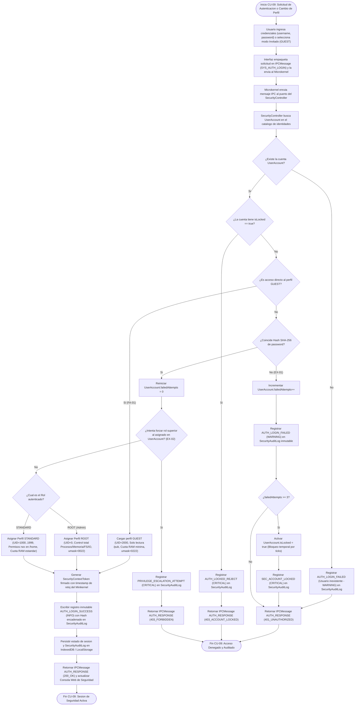
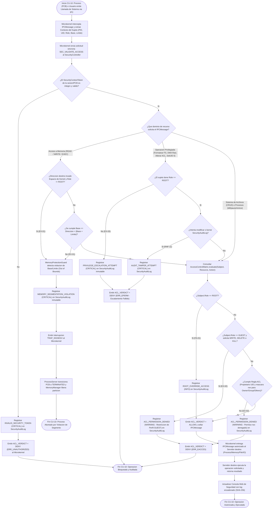

# Especificación Técnica de Ingeniería: Módulo 2.5 — Administración de Seguridad, Matriz de Control de Acceso (ACL) y Auditoría Inmutable

**Proyecto:** Diseño y Simulación Web de un Minikernel  
**Institución:** Universidad Distrital Francisco José de Caldas — Facultad de Ingeniería — Proyecto Curricular de Ingeniería de Sistemas  
**Asignatura:** Sistemas Operativos (2026)  
**Especialidad:** Oficial de Seguridad y Auditoría del Minikernel (`Security-Audit-Officer`)  
**Arquitectura Base:** Microkernel / Minikernel Estricto con Servidores en Espacio de Usuario comunicados exclusivamente vía Paso de Mensajes (IPC).

---

## 1. Fundamentos Arquitectónicos del Servidor de Seguridad en el Minikernel

Bajo el paradigma **Microkernel / Minikernel**, el núcleo en modo privilegiado (*Ring 0* simulado) conserva exclusivamente la planificación básica de hilos/procesos, el enrutamiento de mensajes IPC (`IPCMessage`) y el despacho de vectores de interrupción/trampas de hardware (`Trap` / `System Call`). Toda la lógica de políticas de seguridad, gestión de identidades, evaluación de la Matriz de Control de Acceso (ACL), validación de fronteras lógicas de memoria (Base/Límite) y registro forense de auditoría reside en el **Servidor de Seguridad (`SecurityController`)**, el cual se ejecuta como un proceso servidor desacoplado en espacio de usuario (*User Space Server*).

Ningún servidor hermano (`ProcessServer`, `MemoryManager`, `FileManager`, `DeviceDriver`) ejecuta una operación mutadora o de lectura sensible sin que medie un token de sesión válido o una verificación síncrona por paso de mensajes IPC ante el `SecurityController` (patrón *Reference Monitor* / *Flask Microkernel Security Architecture*).

---

## 2. Matriz de Requerimientos Funcionales y No Funcionales (Módulo 2.5)

### 2.1. Requerimientos Funcionales (`RF-25` a `RF-30`)

| Código | Nombre | Entrada | Procesamiento | Salida | Restricciones de Arquitectura Minikernel |
| :--- | :--- | :--- | :--- | :--- | :--- |
| **RF-25** | **Autenticación de Identidad y Gestión de Perfiles (`ROOT`, `STANDARD`, `GUEST`)** | Credenciales de usuario ingresadas en interfaz web (`username`, `passwordHash` SHA-256, perfil solicitado) encapsuladas en un mensaje IPC `SYS_AUTH_LOGIN` dirigido al puerto del Servidor de Seguridad. | 1. El `SecurityController` intercepta el `IPCMessage` desde el Microkernel. 2. Consulta el repositorio de cuentas (`UserAccount`) en memoria/persistencia. 3. Verifica el hash criptográfico de la credencial y el estado de bloqueo de la cuenta. 4. Asigna el rol estricto (`ROOT` UID=0, `STANDARD` UID=1000..1999, `GUEST` UID=2000) junto con su cuota máxima de memoria, máscara de permisos por defecto (`umask`) y capacidades sobre periféricos. 5. Emite un token de contexto de seguridad (`SecurityContextToken`) firmado en la sesión activa. | Mensaje IPC `AUTH_RESPONSE` con código `200_OK` o `401_UNAUTHORIZED`, estructura `UserAccount` activa, `SecurityContextToken` asociado a los futuros `PCB` creados, y evento de auditoría `AUTH_LOGIN_SUCCESS` o `AUTH_LOGIN_FAILED`. | El Microkernel no almacena contraseñas ni valida perfiles en el núcleo; únicamente adjunta el `UID` y `Role` validados por el `SecurityController` en el encabezado inmutable de cada `IPCMessage` y `PCB`. |
| **RF-26** | **Control de Acceso sobre Procesos y Señales (`kill`, `pause`, `renice`)** | Mensaje IPC `SEC_CHECK_PROC_OP` conteniendo: `callerPID`, `callerUID`, `callerRole`, `targetPID`, `targetOwnerUID` y operación solicitada (`SIGKILL`, `SIGSTOP`, `SIGCONT`, `SET_PRIORITY`). | 1. El `SecurityController` consulta la `AccessControlMatrix` para el dominio de procesos. 2. Si `callerRole == ROOT`, autoriza cualquier operación excepto terminar el proceso `init`/Microkernel (`PID 0`). 3. Si `callerRole == STANDARD`, verifica la invariante `callerUID == targetOwnerUID`; prohíbe incrementar la prioridad por encima del umbral base (escalamiento de privilegios de planificación). 4. Si `callerRole == GUEST`, rechaza toda señal destructiva o de alteración de prioridad sobre procesos de otros usuarios o del sistema. | Mensaje IPC `ACL_VERDICT` booleano (`ALLOW` / `DENY`), código de causa (`ERR_EPERM`, `ERR_EACCES`, `OK`) y despacho automático de registro en `SecurityAuditLog` si el veredicto es `DENY`. | El Servidor de Procesos no puede invocar transiciones de estado en un `PCB` ajeno sin recibir primero el mensaje `ACL_VERDICT = ALLOW` desde el `SecurityController` vía bus IPC. |
| **RF-27** | **Protección de Fronteras de Memoria (`Base + Límite` y Espacio de Kernel)** | Solicitud de acceso a dirección lógica/física o asignación de partición (`SEC_VALIDATE_MEM_ACCESS`): `PID`, `UID`, `Role`, `targetAddress`, `operationType` (`READ`, `WRITE`, `EXEC`), y registros `baseAddress` y `limitRegister` del `PCB`. | 1. El componente `MemoryProtectionGuard` verifica primero si `targetAddress < KERNEL_RESERVED_BOUNDARY`: si el proceso se ejecuta en modo usuario y solicita escritura/ejecución sobre el área del Microkernel, dispara violación inmediata. 2. Verifica la desigualdad estricta de hardware simulado: `baseAddress <= targetAddress < (baseAddress + limitRegister)`. 3. En asignaciones nuevas, valida que la memoria acumulada por el `UID` no supere la cuota del perfil (`STANDARD` o `GUEST`). | Veredicto `MEM_ACCESS_OK` o interrupción de trampa de hardware simulada `TRAP_SIGSEGV` (*Segmentation Fault* / Violación de Segmento) enviada al Microkernel para abortar el proceso infractor (`Estado -> Terminado`) y liberar sus marcos/particiones. | La validación de `Base + Límite` simula la MMU en coordinación con el `MemoryProtectionGuard`; ante un fallo, el Microkernel enruta la trampa #14 (`SIGSEGV`) al `SecurityController` y al `MemoryManager` mediante IPC prioritario. |
| **RF-28** | **Evaluación de Matriz ACL y Permisos `rwx` en el Sistema de Archivos** | Mensaje IPC `SEC_CHECK_FS_ACL` enviado por el `FileManager` con: `callerUID`, `callerGID`, `callerRole`, metadatos del Inodo/Entrada FAT (`ownerUID`, `groupGID`, máscara octal `rwx` de 9 bits para `Owner/Group/Others`, `filePath`) y operación (`CREATE`, `READ`, `WRITE`, `EXEC`, `DELETE`, `CHMOD`). | 1. Si `callerRole == ROOT`, concede acceso de lectura/escritura salvo en archivos de log de auditoría marcados con atributo inmutable (`append-only`). 2. Si `callerRole == GUEST`, restringe el alcance exclusivamente a `/pub` o `/guest` con máscara efectiva `r-x` (prohibición total de `WRITE` y `DELETE`). 3. Evalúa secuencialmente la tripleta POSIX/ACL: si `callerUID == ownerUID` aplica bits 8-6 (`rwx------`); si pertenece al grupo aplica bits 5-3 (`---rwx---`); en caso contrario aplica bits 2-0 (`------rwx`). | Mensaje IPC `ACL_FS_DECISION` (`ALLOW` / `DENY`), máscara efectiva calculada y, en caso de rechazo (`ERR_EACCES`), generación de entrada en `SecurityAuditLog` detallando ruta, usuario e intento ilegal. | El `FileManager` no posee lógica de autenticación propia; delega la resolución de la regla `ACLRule` al `SecurityController` antes de alterar cualquier bloque/cluster o tabla FAT/Inodo. |
| **RF-29** | **Detección y Bloqueo de Escalamiento de Privilegios y Acceso a Periféricos/DMA** | Solicitud de llamada al sistema privilegiada o comando de E/S directa (`SYS_SETUID`, `SYS_FORMAT_DISK`, `SYS_DMA_CONFIG`, `SYS_RAW_SOCKET`, `SYS_ALTER_ACL`) originada por un proceso con `PID` y `callerRole`. | 1. Analiza si la primitiva solicitada requiere nivel de anillo/privilegio `ROOT`. 2. Detecta intentos de un proceso `STANDARD` o `GUEST` de modificar su propio `UID` a `0` en el `PCB`, formatear el sistema de archivos, reprogramar el controlador DMA o inyectar reglas en `AccessControlMatrix`. 3. Clasifica el evento como amenaza crítica (`CRITICAL_PRIVILEGE_ESCALATION`). 4. Ordena la terminación forzosa o cuarentena del proceso si supera el umbral de intentos fallidos. | Rechazo inmediato `ERR_PRIVILEGE_VIOLATION`, incremento del contador de infracciones de la sesión, alerta visual en el panel web de seguridad y registro de severidad `CRITICAL` en el `SecurityAuditLog`. | Ningún proceso de usuario puede comunicarse directamente con el controlador DMA o el disco físico; toda petición pasa por el Microkernel y es filtrada por el `SecurityController`. |
| **RF-30** | **Servidor de Auditoría Inmutable (`SecurityAuditLog`) y Consola Forense Web** | Evento de seguridad generado por cualquier validador (`timestamp`, `tickReloj`, `eventType`, `severity`, `actorUID`, `actorRole`, `sourcePID`, `targetResource`, `operation`, `verdict`, `details`). | 1. Construye una instancia inmutable de `SecurityAuditLog` con número de secuencia monótonamente creciente. 2. Calcula un hash encadenado (`previousHash + currentPayload -> entryHash`) para garantizar integridad forense y evidenciar cualquier intento de manipulación. 3. Persiste el registro en modo *Append-Only* (solo adición) en el almacenamiento (`LocalStorage` / `IndexedDB`) y lo transmite por el bus de eventos hacia la interfaz web. | Registro persistido e inmutable visualizado en tiempo real en la Consola Web de Seguridad con filtros por severidad (`INFO`, `WARNING`, `CRITICAL`), rol, tipo de violación y exportación en formato JSON/CSV para auditoría. | Ni siquiera el perfil `ROOT` posee una llamada de sistema habilitada en el `SecurityController` para editar o eliminar registros históricos del `SecurityAuditLog` durante la sesión de simulación. |

---

### 2.2. Requerimientos No Funcionales (`RNF-10` a `RNF-12`)

| Código | Nombre | Entrada | Procesamiento | Salida | Restricciones de Arquitectura Minikernel |
| :--- | :--- | :--- | :--- | :--- | :--- |
| **RNF-10** | **Mediación Completa (*Complete Mediation*) y Aislamiento Zero-Trust por IPC** | Cualquier mensaje `IPCMessage` que solicite operaciones sobre Procesos, Memoria, Sistema de Archivos o E/S dentro de la simulación. | El enrutador IPC del Microkernel verifica la presencia de la firma de validación del `SecurityController` antes de entregar el mensaje al servidor de destino, evitando *bypass* o llamadas directas de referencias de objetos en JavaScript/TypeScript. | Garantía del 100 % de intercepción de llamadas al sistema sin caminos laterales (*backdoors*) entre módulos de la aplicación web. | Prohibición arquitectónica de invocar métodos públicos de `MemoryManager`, `FileManager` o `DeviceDriver` sin pasar por la cola de mensajes del `Kernel` y la validación del `SecurityController`. |
| **RNF-11** | **Inmutabilidad Criptográfica y Persistencia de Auditoría (*Tamper-Evident Logs*)** | Secuencia de objetos `SecurityAuditLog` almacenados en memoria volátil y sincronizados en `IndexedDB` / `LocalStorage`. | Aplicación de `Object.freeze()` en tiempo de ejecución sobre cada entrada de log creada y encadenamiento hash ligero (SHA-256 / FNV-1a encadenado) verificable por el motor de detección de inconsistencias. | Integridad del 100 % del historial de auditoría ante recargas de página o intentos de mutación desde la consola de usuario simulada. | El almacenamiento de auditoría está segregado del Sistema de Archivos de usuario simulado (FAT/Inodos), impidiendo que un formateo del disco virtual borre la bitácora forense de seguridad. |
| **RNF-12** | **Determinismo y Baja Latencia en Evaluación de Reglas ACL (`O(1)` Amortizado)** | Consulta de permisos sobre la `AccessControlMatrix` y validación aritmética en `MemoryProtectionGuard` en cada ciclo de instrucción (tick de reloj). | Indexación de reglas ACL mediante tablas hash compuestas (`SubjectRole:ResourceType:ResourceID`) y evaluación de límites de memoria mediante comparaciones enteras de registros (`Base`, `Limit`). | Tiempo de resolución de validación de seguridad inferior a `1 tick` lógico de sobrecarga IPC y `< 2 ms` de tiempo real de renderizado en el navegador web. | El `SecurityController` no debe bloquear el bucle de planificación (*Scheduler*) del Microkernel ni inducir inanición (*Starvation*) en procesos legítimos de alta frecuencia. |

### 2.3. Compuerta de Sesión para la Terminal Web y Comando `whoami`

Aunque el simulador arranca con el perfil `root` activo para los demás módulos, la Terminal Web de Comandos (`WebTerminalCLI`) permanece bloqueada hasta que el operador complete un `SYS_AUTH_LOGIN` válido **mediante el botón "Autenticar" del panel 2.5**. El `SecurityController` mantiene el estado en memoria `sessionAuthenticated = false` y lo eleva a `true` únicamente cuando el mensaje IPC incluye `payload.source = 'SECURITY_PANEL_LOGIN'`. El selector rápido de sesión (`TOP_BAR_SESSION`) cambia el perfil pero vuelve a bloquear la CLI, cerrando un posible camino lateral de escalamiento. El comando interno `su` (`TERMINAL_SU`) conserva el estado por ser alcanzable sólo desde una terminal ya habilitada.

Un intento de ejecución sin sesión autenticada es rechazado en `AppController.executeTerminalCommand()`, registra `TERMINAL_ACCESS_DENIED` (severidad `WARNING`, veredicto `DENY`) en `SecurityAuditLog` y no despacha la syscall. El estado de la compuerta **no se persiste**, por lo que toda recarga del navegador exige una nueva autenticación. El comando `whoami` reporta usuario, rol, UID y `userId` obtenidos mediante `GET_ACTIVE_SESSION` al `SECURITY_SERVER`, sin acceso directo a su estado interno.

El inventario detallado de archivos, símbolos y acciones IPC de esta compuerta se documenta en `04b_Seguridad_Mapa_Codigo.md`.

---

## 3. Especificación Formal de Casos de Uso (`CU-09` y `CU-10`)

### 3.1. Caso de Uso `CU-09`: Autenticar Usuario y Gestionar Sesión de Perfil de Seguridad (Root, Estándar, Invitado)

| Campo | Especificación Detallada |
| :--- | :--- |
| **ID del Caso de Uso** | `CU-09` |
| **Nombre** | Autenticar Usuario y Gestionar Sesión de Perfil de Seguridad (`ROOT`, `STANDARD`, `GUEST`) |
| **Actor(es)** | **Actor Primario:** Usuario Operador del Simulador Web. **Actores Secundarios:** Microkernel (`Kernel` / Enrutador IPC), Servidor de Seguridad (`SecurityController`), Servidor de Procesos (`ProcessServer`). |
| **Módulo** | Módulo 2.5 — Administración de Seguridad |
| **Precondiciones** | 1. El Microkernel ha completado su secuencia de arranque (*Bootstrap*) y el proceso `SecurityController` se encuentra activo escuchando en su puerto IPC reservado. 2. El catálogo inicial de cuentas (`UserAccount`) con los perfiles predefinidos (`root`, `user_std`, `guest`) está cargado en memoria o recuperado desde `IndexedDB`/`LocalStorage`. |
| **Postcondiciones** | **Éxito:** Se instancia una sesión activa con un `SecurityContextToken` válido, se configura el perfil de privilegios (`ROOT`, `STANDARD` o `GUEST`), se ajustan las cuotas de memoria y máscara `rwx` en la interfaz web, y se escribe un registro inmutable `AUTH_LOGIN_SUCCESS` en `SecurityAuditLog`. **Fallo:** Se mantiene el sistema bloqueado o en el contexto previo, se incrementa el contador de fallos de autenticación (`failedAttempts`) y se registra un evento `AUTH_LOGIN_FAILED` (o `ACCOUNT_LOCKED`) en `SecurityAuditLog`. |
| **Flujo Principal (Camino Feliz)** | 1. El Usuario Operador selecciona en el panel de control de seguridad el perfil o ingresa su identificador (`username`) y credencial (`password`), o solicita cambio de usuario activo (`su` / `login`). 2. La interfaz empaqueta la solicitud en una primitiva de sistema y envía un `IPCMessage` de tipo `SYS_AUTH_LOGIN` al Microkernel. 3. El Microkernel despacha el mensaje al buzón IPC del `SecurityController`. 4. El `SecurityController` localiza la entidad `UserAccount` correspondiente al `username`. 5. El `SecurityController` verifica que la cuenta se encuentre activa (`isLocked == false`) y compara el hash SHA-256 de la credencial suministrada contra el `passwordHash` almacenado. 6. Tras coincidir las credenciales, el `SecurityController` reinicia el contador `failedAttempts = 0` y carga la política del rol:    - **`ROOT` (UID 0):** Acceso irrestricto a procesos del sistema, particiones reservadas, montaje/formateo de FS y reconfiguración de dispositivos.    - **`STANDARD` (UID 1000):** Ejecución de procesos propios, lectura/escritura en `/home/<user>`, cuota de RAM acotada y permisos sujetos a bits `rwx` de propietario/grupo.    - **`GUEST` (UID 2000):** Solo lectura/ejecución en `/pub`, cuota mínima de RAM y prohibición de señales a procesos ajenos o escritura en disco. 7. El `SecurityController` genera un `SecurityContextToken` con marca de tiempo (`issuedAtTick`), lo vincula como contexto de seguridad predeterminado para los nuevos `PCB` y solicita a `SecurityAuditLog` registrar el evento `AUTH_LOGIN_SUCCESS` (Severidad: `INFO`). 8. El `SecurityController` responde vía IPC con `AUTH_RESPONSE (200_OK)` al Microkernel, actualizando el panel de usuario activo y la Consola de Auditoría Web. |
| **Flujos Alternos** | **FA-01 (Acceso Rápido en Modo Invitado `GUEST`):** 1. En el paso 1, el usuario selecciona el ingreso como `GUEST` sin contraseña compleja (credencial pública de invitado). 2. El `SecurityController` asigna directamente el perfil restringido `GUEST` (`UID=2000`, `umask=0222` solo lectura), deshabilita en la UI los controles de formateo de disco/creación de archivos en raíz, registra `AUTH_GUEST_SESSION` en `SecurityAuditLog` y retorna al paso 8.  **FA-02 (Cambio de Perfil en Caliente `Switch User / Logout`):** 1. Un usuario con sesión activa solicita cerrar sesión o cambiar de perfil. 2. El `SecurityController` invalida el `SecurityContextToken` anterior, notifica al `ProcessServer` que los procesos en segundo plano del usuario previo conservan su `ownerUID` original en sus `PCB` (aislamiento multisesión), registra `AUTH_LOGOUT` en `SecurityAuditLog` y procede al paso 1 del Flujo Principal. |
| **Excepciones** | **EX-01 (Credenciales Inválidas — `ERR_AUTH_INVALID_CREDENTIALS`):** 1. En el paso 5, el hash de la contraseña no coincide o el usuario no existe. 2. El `SecurityController` incrementa `failedAttempts` en la instancia `UserAccount`. 3. Registra en `SecurityAuditLog` el evento `AUTH_LOGIN_FAILED` con severidad `WARNING`, incluyendo `username` y tick del reloj. 4. Si `failedAttempts >= 3`, activa `isLocked = true` por una ventana de enfriamiento de ticks de reloj y registra `SEC_ACCOUNT_LOCKED` con severidad `CRITICAL`. 5. Retorna mensaje IPC `AUTH_RESPONSE (401_UNAUTHORIZED)` rechazando el inicio de sesión.  **EX-02 (Intento de Escalamiento de Privilegios vía Suplantación `su root` No Autorizada):** 1. Un proceso o sesión en rol `GUEST` intenta invocar directamente una primitiva de elevación a `ROOT` sin credenciales de administrador válidas o manipulando el payload IPC. 2. El `SecurityController` detecta la discrepancia entre el `SecurityContextToken` emisor y el privilegio reclamado. 3. Dispara la alarma `PRIVILEGE_ESCALATION_ATTEMPT` (Severidad: `CRITICAL`) en `SecurityAuditLog` y bloquea la operación con código `403_FORBIDDEN`. |

---

### 3.2. Caso de Uso `CU-10`: Validar Matriz de Control de Acceso (ACL) en Llamada IPC y Registrar Auditoría de Seguridad

| Campo | Especificación Detallada |
| :--- | :--- |
| **ID del Caso de Uso** | `CU-10` |
| **Nombre** | Validar Matriz de Control de Acceso (ACL) en Llamada IPC y Registrar Auditoría de Seguridad |
| **Actor(es)** | **Actor Primario:** Proceso de Usuario en Ejecución (`PCB` activo) / Usuario Operador. **Actores Secundarios:** Microkernel (`Kernel`), Servidor de Seguridad (`SecurityController`), Guardia de Protección de Memoria (`MemoryProtectionGuard`), Servidores de Recursos (`ProcessServer`, `MemoryManager`, `FileManager`, `DeviceDriver`). |
| **Módulo** | Módulo 2.5 — Administración de Seguridad |
| **Precondiciones** | 1. Existe una sesión autenticada (resultado de `CU-09`) y al menos un proceso activo con su `PCB` inicializado (`PID`, `ownerUID`, `role`, `baseAddress`, `limitRegister`). 2. La `AccessControlMatrix` contiene las reglas `ACLRule` cargadas para los objetos del sistema (Procesos, Particiones de Memoria, Archivos/Directorios del FS y Dispositivos de E/S). |
| **Postcondiciones** | **Éxito (`ALLOW`):** El `SecurityController` firma el mensaje IPC con autorización positiva, el servidor de destino ejecuta la operación sobre el recurso y se registra la traza operativa si corresponde. **Fallo (`DENY` / Trampa):** La operación es abortada antes de modificar el estado del recurso destino, se genera obligatoriamente un registro inmutable en `SecurityAuditLog` (`WARNING` o `CRITICAL`), y si se trata de una violación de segmento de memoria, el proceso infractor es terminado (`SIGSEGV`). |
| **Flujo Principal (Camino Feliz)** | 1. Un proceso en ejecución (`CPU`) o una acción del usuario sobre un módulo emite una llamada al sistema empaquetada en un `IPCMessage` (ej. leer/escribir un archivo, enviar señal a un proceso, acceder a una dirección de RAM o solicitar E/S por DMA). 2. El Microkernel intercepta la llamada y redirige una solicitud de validación síncrona `SEC_VALIDATE_ACCESS` al `SecurityController`, adjuntando el contexto del sujeto (`PID`, `UID`, `Role`, `baseAddress`, `limitRegister`) y el descriptor del objeto destino (`ResourceType`, `ResourceID`, `OwnerUID`, `PermissionsRWX`, `TargetAddress`, `RequestedAction`). 3. El `SecurityController` clasifica el dominio del recurso solicitado (`MEMORY`, `FILE_SYSTEM`, `PROCESS` o `IO_DEVICE`). 4. Si el dominio involucra direccionamiento de memoria, invoca a `MemoryProtectionGuard.validateAddress(pcb, targetAddress, size, accessType)` verificando que `targetAddress >= KERNEL_BOUNDARY` (para procesos no-Root) y que `[targetAddress, targetAddress + size)` esté contenido estrictamente dentro de `[baseAddress, baseAddress + limitRegister)`. 5. El `SecurityController` consulta `AccessControlMatrix.evaluate(subject, resource, action)` verificando las reglas `ACLRule` aplicables y los bits `rwx` del objeto frente al rol (`ROOT`, `STANDARD`, `GUEST`) y al `ownerUID`. 6. Al cumplirse todas las invariantes de seguridad, el `SecurityController` emite el dictamen `ACL_VERDICT = ALLOW` y adjunta el sello de aprobación al `IPCMessage`. 7. El Microkernel entrega el mensaje autorizado al servidor correspondiente (`MemoryManager`, `FileManager`, `ProcessServer` o `DeviceDriver`), el cual ejecuta la operación de forma segura. 8. Si la operación es de índole sensible o administrativa, el `SecurityController` añade una entrada informativa en `SecurityAuditLog`. |
| **Flujos Alternos** | **FA-01 (Bypass Administrativo Auditado para Rol `ROOT` en Archivos de Usuario):** 1. En el paso 5, el sujeto emisor posee `Role == ROOT` (`UID == 0`) y solicita leer o modificar un archivo cuyo propietario es un usuario `STANDARD` con permisos `rwx` cerrados (`000`). 2. La `AccessControlMatrix` aplica la regla de superusuario (`CAP_DAC_OVERRIDE`), concede `ACL_VERDICT = ALLOW` (salvo que el objeto sea el propio `SecurityAuditLog` inmutable) y registra en `SecurityAuditLog` un evento `ROOT_OVERRIDE_ACCESS` (Severidad: `INFO`) para trazabilidad de acciones administrativas. |
| **Excepciones** | **EX-01 (Violación de Segmento / Acceso Fuera de Base y Límite o Espacio de Kernel — `TRAP_SIGSEGV`):** 1. En el paso 4, el `MemoryProtectionGuard` detecta que el proceso intenta acceder a una dirección `targetAddress < baseAddress`, `targetAddress >= (baseAddress + limitRegister)` o dentro de la región reservada del Microkernel. 2. El `MemoryProtectionGuard` bloquea en seco la lectura/escritura en RAM y retorna `MEM_PROTECTION_FAULT`. 3. El `SecurityController` instancia un registro inmutable en `SecurityAuditLog` con tipo `MEMORY_SEGMENTATION_VIOLATION` y severidad `CRITICAL` (detallando `PID`, `UID`, dirección ilegal y rango `[Base, Base+Límite]`). 4. El `SecurityController` emite al Microkernel una orden de interrupción de trampa `TRAP_SIGSEGV`; el `ProcessServer` cambia inmediatamente el estado del `PCB` infractor a `TERMINATED`, el `MemoryManager` libera su partición y se notifica la alerta roja en la interfaz web.  **EX-02 (Permiso `rwx` Denegado en Sistema de Archivos o Proceso Ajeno — `ERR_EACCES`):** 1. En el paso 5, un usuario `GUEST` intenta escribir/eliminar un archivo, o un usuario `STANDARD` intenta abrir un archivo o matar un proceso (`kill`) para el cual la evaluación de propietario y bits `rwx` arroja resultado negativo. 2. La `AccessControlMatrix` retorna `ACL_VERDICT = DENY` con código `ERR_EACCES`. 3. El `SecurityController` genera un registro inmutable en `SecurityAuditLog` con tipo `ACL_PERMISSION_DENIED` y severidad `WARNING` (indicando sujeto, recurso, máscara `rwx` actual y operación rechazada). 4. El Microkernel devuelve el código de error al proceso emisor sin ejecutar la operación en el `FileManager` ni en el `ProcessServer`.  **EX-03 (Intento de Escalamiento de Privilegios o Operación Crítica No Autorizada — `ERR_EPERM`):** 1. En el paso 3 o 5, un proceso con rol `STANDARD` o `GUEST` intenta ejecutar una llamada restringida a `ROOT` (formatear el sistema de archivos FAT/Inodos, modificar reglas de la `AccessControlMatrix`, alterar el vector de interrupciones/DMA o elevar la prioridad de un proceso por encima de su límite). 2. El `SecurityController` intercepta la operación, la clasifica como `PRIVILEGE_ESCALATION_ATTEMPT` con severidad `CRITICAL` en `SecurityAuditLog`, rechaza el mensaje IPC con `ERR_EPERM` y, si la política de contención está activa, suspende (`BLOCKED`) o termina el proceso infractor. |

---

## 4. Diagramas de Actividad UML por Caso de Uso

### 4.1. Diagrama de Actividad UML — `CU-09`: Autenticar Usuario y Gestionar Sesión de Perfil de Seguridad

---

### 4.2. Diagrama de Actividad UML — `CU-10`: Validar Matriz de Control de Acceso (ACL) en Llamada IPC y Registrar Auditoría de Seguridad

---

## 5. Arquitectura y Diagrama de Clases UML del Módulo de Seguridad

### 5.1. Descripción Arquitectónica de las Clases del Dominio de Seguridad

1. **`SecurityController` (Servidor Central de Seguridad y Monitor de Referencia):**  
   Proceso servidor en espacio de usuario que centraliza la recepción de mensajes `IPCMessage` de autenticación y autorización enviados por el `Kernel`. Coordina el catálogo de cuentas (`UserAccount`), el motor de reglas (`AccessControlMatrix`), el guardia de memoria (`MemoryProtectionGuard`) y el servidor de bitácora forense (`SecurityAuditLog`).
2. **`UserAccount` (Entidad de Identidad y Perfil de Usuario):**  
   Modela un sujeto del sistema operativo con atributos de identidad (`uid`, `gid`, `username`, `passwordHash`), nivel de privilegio (`role: UserRole` con valores `ROOT`, `STANDARD`, `GUEST`), cuotas de recursos (`memoryQuotaKB`, `maxProcesses`, `defaultUmask`) y estado de seguridad de sesión (`failedAttempts`, `isLocked`, `activeToken`).
3. **`AccessControlMatrix` (Motor de Matriz de Control de Acceso):**  
   Estructura matricial indexada que mapea sujetos (`UserRole` / `uid`) contra recursos (`ResourceType`: `PROCESS`, `MEMORY_REGION`, `FILE_NODE`, `IO_DEVICE`) aplicando un conjunto determinista de reglas `ACLRule` y evaluando máscaras POSIX `rwx` de 9 bits (`owner`, `group`, `others`).
4. **`ACLRule` (Regla Atómica de Control de Acceso):**  
   Representa una entrada individual en la matriz ACL que vincula un sujeto (`subjectRole`, `subjectUID`), un tipo e identificador de recurso (`resourceType`, `resourceId`, `ownerUID`), la máscara de permisos (`rwxMask`: lectura `04`, escritura `02`, ejecución `01`) y las capacidades especiales permitidas (`allowedSignals`, `allowDMA`).
5. **`MemoryProtectionGuard` (Unidad de Protección de Fronteras de Memoria y MMU Lógica):**  
   Componente especializado invocado ante cada acceso o reserva de memoria. Verifica que ningún proceso en modo usuario acceda por debajo de `kernelReservedBoundary` y comprueba la invariante aritmética `pcb.baseAddress <= targetAddress` y `(targetAddress + accessSize) <= (pcb.baseAddress + pcb.limitRegister)`. En caso de violación, dispara la trampa `TRAP_SIGSEGV`.
6. **`SecurityAuditLog` (Registro Inmutable de Auditoría Forense):**  
   Representa una entrada de bitácora inmutable (*append-only*) con marca de tiempo real y en ticks del reloj del Minikernel (`tickTimestamp`), severidad (`INFO`, `WARNING`, `CRITICAL`), categoría de evento (`AUTH_SUCCESS`, `AUTH_FAILURE`, `ACL_DENIED`, `SEGMENTATION_FAULT`, `PRIVILEGE_ESCALATION`), datos del actor y del recurso afectado, y un hash criptográfico encadenado (`previousHash`, `entryHash`) que garantiza la detección de cualquier intento de adulteración.

---

### 5.2. Diagrama de Clases UML (Mermaid `classDiagram`)

```mermaid
classDiagram
    direction TB

    class UserRole {
        <<enumeration>>
        ROOT
        STANDARD
        GUEST
    }

    class ResourceType {
        <<enumeration>>
        PROCESS
        MEMORY_REGION
        FILE_NODE
        IO_DEVICE
        KERNEL_CONFIG
    }

    class AuditSeverity {
        <<enumeration>>
        INFO
        WARNING
        CRITICAL
    }

    class AuditEventType {
        <<enumeration>>
        AUTH_LOGIN_SUCCESS
        AUTH_LOGIN_FAILED
        SEC_ACCOUNT_LOCKED
        ACL_PERMISSION_DENIED
        MEMORY_SEGMENTATION_VIOLATION
        PRIVILEGE_ESCALATION_ATTEMPT
        ROOT_OVERRIDE_ACCESS
        AUDIT_TAMPER_ATTEMPT
    }

    class SecurityController {
        -int serverPortIPC
        -Map~string, UserAccount~ userCatalog
        -UserAccount currentActiveUser
        -string activeSessionToken
        -AccessControlMatrix aclMatrix
        -MemoryProtectionGuard memoryGuard
        -List~SecurityAuditLog~ immutableAuditChain
        -string lastAuditHash
        +handleIPCMessage(msg: IPCMessage) IPCMessage
        +authenticateUser(username: string, passwordPlain: string, tick: int) SecurityContextToken
        +switchUserRole(targetUsername: string, credentials: string, tick: int) boolean
        +validateAccess(pcb: PCB, resourceType: ResourceType, resourceId: string, action: string, tick: int) boolean
        +validateFileRWX(callerUID: int, callerRole: UserRole, inodeOwnerUID: int, rwxMask: string, op: string) boolean
        +validateProcessSignal(callerPCB: PCB, targetPCB: PCB, signal: string) boolean
        +recordAuditEvent(type: AuditEventType, severity: AuditSeverity, uid: int, pid: int, target: string, details: string, tick: int) SecurityAuditLog
        +verifyAuditChainIntegrity() boolean
        +exportAuditLogsJSON() string
    }

    class UserAccount {
        -int uid
        -int gid
        -string username
        -string passwordHash
        -UserRole role
        -string homeDirectory
        -int memoryQuotaKB
        -int maxConcurrentProcesses
        -string defaultUmask
        -int failedAttempts
        -boolean isLocked
        -int lockUntilTick
        +verifyPassword(candidateHash: string) boolean
        +incrementFailedAttempts(currentTick: int) void
        +resetFailedAttempts() void
        +hasRootPrivileges() boolean
        +canWriteToFilesystem() boolean
    }

    class AccessControlMatrix {
        -Map~string, List~ACLRule~~ rulesByResource
        -Map~UserRole, Set~string~~ roleCapabilities
        +registerRule(rule: ACLRule) void
        +revokeRule(ruleId: string, requesterRole: UserRole) boolean
        +evaluate(subject: UserAccount, resourceType: ResourceType, resourceId: string, ownerUID: int, rwxOctal: string, action: string) boolean
        +evaluatePOSIXPermissions(callerUID: int, callerGID: int, ownerUID: int, ownerGID: int, rwxMask: string, requestedBit: char) boolean
        +isPrivilegedSyscallAllowed(role: UserRole, syscallName: string) boolean
    }

    class ACLRule {
        -string ruleId
        -UserRole subjectRole
        -int subjectUID
        -ResourceType resourceType
        -string resourceId
        -int resourceOwnerUID
        -string rwxPermissions
        -boolean allowRead
        -boolean allowWrite
        -boolean allowExecute
        -boolean allowSignalKill
        +matches(uid: int, role: UserRole, resType: ResourceType, resId: string) boolean
        +isActionPermitted(action: string) boolean
    }

    class MemoryProtectionGuard {
        -int kernelReservedBase
        -int kernelReservedLimit
        -int totalPhysicalMemoryKB
        +validateAddressBounds(pcb: PCB, targetAddress: int, accessSize: int, accessMode: string) boolean
        +isKernelSpaceAddress(targetAddress: int) boolean
        +checkUserMemoryQuota(account: UserAccount, currentUsedKB: int, requestedKB: int) boolean
        +buildSegmentationFaultTrap(pcb: PCB, offendingAddress: int, tick: int) IPCMessage
    }

    class SecurityAuditLog {
        <<immutable>>
        -int sequenceId
        -int tickTimestamp
        -string isoTimestamp
        -AuditEventType eventType
        -AuditSeverity severity
        -int actorUID
        -UserRole actorRole
        -int sourcePID
        -ResourceType targetResourceType
        -string targetResourceId
        -string requestedOperation
        -boolean accessGranted
        -string forensicDetails
        -string previousHash
        -string entryHash
        +computeSHA256Hash() string
        +validateIntegrity(expectedPrevHash: string) boolean
        +toFormattedConsoleLine() string
    }

    class Kernel {
        +dispatchIPC(msg: IPCMessage) IPCMessage
        +raiseHardwareTrap(trapVector: int, offendingPID: int) void
    }

    class IPCMessage {
        +int messageId
        +int senderPID
        +int senderUID
        +UserRole senderRole
        +string securityToken
        +string syscallType
        +string payloadJSON
        +boolean isSecurityValidated
    }

    class PCB {
        +int pid
        +int ownerUID
        +UserRole securityRole
        +int baseAddress
        +int limitRegister
        +string state
    }

    SecurityController "1" *-- "1..*" UserAccount : gestiona identidades
    SecurityController "1" *-- "1" AccessControlMatrix : evalua politicas en
    SecurityController "1" *-- "1" MemoryProtectionGuard : delega proteccion MMU a
    SecurityController "1" *-- "0..*" SecurityAuditLog : encadena inmutablemente
    AccessControlMatrix "1" *-- "1..*" ACLRule : contiene reglas
    UserAccount --> UserRole : posee perfil
    ACLRule --> UserRole : aplica a rol
    ACLRule --> ResourceType : protege recurso
    SecurityAuditLog --> AuditSeverity : clasifica nivel
    SecurityAuditLog --> AuditEventType : tipifica evento
    SecurityAuditLog --> ResourceType : referencia objeto
    SecurityController ..> Kernel : se comunica via IPC con
    SecurityController ..> IPCMessage : inspecciona y firma
    MemoryProtectionGuard ..> PCB : verifica registros Base y Limite de
```

---

## 6. Matriz de Políticas de Control de Acceso Predefinidas por Rol

Para garantizar la **Verificación de Inconsistencias** entre la especificación documental, el modelo de persistencia y el comportamiento en vivo de la simulación web, la siguiente tabla establece la política base obligatoria que inicializa la `AccessControlMatrix` en el arranque del Minikernel:

| Dominio / Operación del Minikernel | Rol `ROOT` (`UID = 0`) | Rol `STANDARD` (`UID = 1000..1999`) | Rol `GUEST` (`UID = 2000`) | Evento en `SecurityAuditLog` si Falla |
| :--- | :--- | :--- | :--- | :--- |
| **Procesos:** Crear proceso de usuario (`SYS_PROC_CREATE`) | Permitido (Prioridad `0..99`) | Permitido (Prioridad estándar `20..99`, dentro de cuota) | Permitido solo para utilitarios públicos de lectura (máx. 2 procesos) | `ACL_PERMISSION_DENIED` (`WARNING`) |
| **Procesos:** Enviar `SIGKILL` / `SIGSTOP` / Modificar prioridad | Permitido sobre cualquier `PID > 0` | Permitido **únicamente** si `PCB.ownerUID == callerUID` | **Denegado** sobre procesos del sistema o de otros usuarios | `ACL_PERMISSION_DENIED` (`WARNING`) / `PRIVILEGE_ESCALATION_ATTEMPT` (`CRITICAL`) |
| **Memoria:** Acceso a Región del Kernel (`0x0000 .. KERNEL_LIMIT`) | Permitido vía primitivas del núcleo | **Denegado** (Dispara `TRAP_SIGSEGV` y termina el proceso) | **Denegado** (Dispara `TRAP_SIGSEGV` y termina el proceso) | `MEMORY_SEGMENTATION_VIOLATION` (`CRITICAL`) |
| **Memoria:** Acceso fuera de `[Base, Base + Límite)` del `PCB` | **Denegado** (Aislamiento estricto por proceso) | **Denegado** (Dispara `TRAP_SIGSEGV` y termina el proceso) | **Denegado** (Dispara `TRAP_SIGSEGV` y termina el proceso) | `MEMORY_SEGMENTATION_VIOLATION` (`CRITICAL`) |
| **Archivos:** Operaciones en `/` y `/sys` (Raíz del FS) | Lectura, Escritura y Ejecución (`rwx`) | Solo lectura/ejecución (`r-x`) según máscara `others` | **Denegado** (Recluido al subárbol `/pub`) | `ACL_PERMISSION_DENIED` (`WARNING`) |
| **Archivos:** Operaciones en `/home/<user>` | Acceso administrativo auditado (`ROOT_OVERRIDE_ACCESS`) | `rwx` completo para el `ownerUID` del directorio; `---` o `r--` para otros | **Denegado** (`ERR_EACCES`) | `ACL_PERMISSION_DENIED` (`WARNING`) |
| **Archivos:** Operaciones en `/pub` (Directorio Público) | `rwx` completo | `rwx` en archivos propios; `r-x` en archivos públicos | **Solo Lectura y Ejecución (`r-x`)**; prohibido `WRITE`, `DELETE`, `RENAME` | `ACL_PERMISSION_DENIED` (`WARNING`) |
| **Archivos / E/S:** Formatear Disco (FAT/Inodos) o Reconfigurar DMA | Permitido (`SYS_FORMAT_FS`, `SYS_DMA_CFG`) | **Denegado** (`ERR_EPERM`) | **Denegado** (`ERR_EPERM`) | `PRIVILEGE_ESCALATION_ATTEMPT` (`CRITICAL`) |
| **Seguridad:** Modificar o Eliminar `SecurityAuditLog` | **Denegado** (Inmutabilidad `RNF-11` *Append-Only*) | **Denegado** (`ERR_EPERM`) | **Denegado** (`ERR_EPERM`) | `AUDIT_TAMPER_ATTEMPT` (`CRITICAL`) |
