# Especificación de Interfaz Web (UX/UI), Arquitectura de Presentación y Auditoría de Trazabilidad ("Anti-Fallas de Kernel")

**Proyecto:** Diseño y Simulación Web de un Minikernel  
**Asignatura:** Sistemas Operativos — Universidad Distrital Francisco José de Caldas (2026-2)  
**Especialidad:** 05 — Frontend, Experiencia de Usuario (UX/UI), Aseguramiento de Calidad (QA) y Trazabilidad Documental  

---

## 1. Mapa de Navegación Web y Arquitectura de Experiencia de Usuario (UX/UI)

La interfaz web del simulador Minikernel se concibe como un **Entorno Operativo de Observabilidad en Tiempo Real (Single-Page Application - SPA)**, donde el usuario interactúa con los cinco (5) servidores en espacio de usuario exclusivamente a través de llamadas al sistema (`syscalls`) despachadas por el **Microkernel** mediante paso de mensajes (`IPCMessage`).

### 1.1 Principios de Diseño Interactivo
1. **Visibilidad del Ciclo de Reloj y Conmutación de Contexto:** La barra superior global expone de manera permanente el estado del reloj maestro (`Tick Counter`), la frecuencia en milisegundos (`100 ms` a `2000 ms` o modo `Paso a Paso / Step-by-Step`), y un indicador visual de **Context Switch Overhead** cuando el microkernel invierte ciclos guardando/restaurando registros (`PC`, `SP`, `Acc`) del `PCB`.
2. **Trazabilidad IPC en Vivo:** Un panel acoplable inferior/lateral (**Monitor del Bus IPC & Interrupciones**) muestra en tiempo real cada `IPCMessage` en tránsito (`sender`, `receiver`, `type`, `payload`, `timestamp`) y las líneas de solicitud de interrupción (`IRQ_TIMER`, `IRQ_DISK_DMA`, `IRQ_NET_RX`, `TRAP_SYSCALL`, `EXCEPTION_ACL`).
3. **Control de Sesión Basado en Perfiles (RBAC/ACL):** Todo comando o acción disparada desde la interfaz lleva adjunto el `uid` y rol activo (`Root/Admin`, `Usuario Estándar`, `Invitado`), permitiendo evidenciar tanto operaciones exitosas como rechazos por violación de seguridad en la Consola de Auditoría.

### 1.2 Diagrama de Flujo de Navegación Web (UX/UI)

```mermaid
flowchart TD
    Start(["Inicio de Aplicación Web (SPA)"]) --> InitStorage["Inicializador de Persistencia (IndexedDB / LocalStorage)"]
    InitStorage --> AuthGate{"¿Sesión Activa en SecurityController?"}

    AuthGate -- "No Autenticado" --> LoginView["Vista de Autenticación y Selección de Perfil (Root/Admin, Estándar, Invitado)"]
    LoginView -- "Credenciales Inválidas (Evento AuditLog)" --> LoginError["Alerta de Fallo de Autenticación (Registro en sys_security_logs)"]
    LoginError --> LoginView
    LoginView -- "Autenticación Exitosa (Token de Sesión)" --> WorkspaceShell["Shell Principal del Minikernel (Layout Unificado)"]
    AuthGate -- "Sesión Vigente" --> WorkspaceShell

    subgraph GlobalBars ["Barras Persistentes del Entorno Operativo"]
        TopBar["Barra Superior: Reloj Maestro (Play / Pause / Step / Frecuencia Hz) + Indicador Context Switch + Selector Rápido de Usuario"]
        IPCDock["Monitor Global en Vivo del Bus IPC (Stream de IPCMessage, Syscalls, IRQs y Vector de Interrupciones)"]
        PersistenceModal["Modal de Persistencia y Snapshots (Exportar/Importar JSON, Reset de Fábrica IndexedDB)"]
    end

    WorkspaceShell --> TopBar
    WorkspaceShell --> IPCDock
    TopBar --> PersistenceModal

    WorkspaceShell --> NavRouter{"Selector de Paneles Interactivos (5 Módulos)"}

    %% Panel 1: Procesos
    NavRouter -- "Módulo 2.1" --> PanelProc["Panel 1: Monitor de Procesos y Sincronización"]
    subgraph ViewProcesos ["Vista Interactiva de Procesos"]
        ProcForm["Modal Crear Aplicación / Proceso (Código, Tamaño RAM, Prioridad, Recursos Max)"]
        SchedulerCfg["Configurador de Planificador (RR con Quantum, Prioridades Apropiativas, SJF / SRTF)"]
        QueuesView["Visualizador de Colas en Tiempo Real (New, Ready Queue, Running CPU, Blocked I/O, Terminated)"]
        PCBInspector["Inspector Dinámico de PCB (PID, Estado, PC, SP, Acc, Prioridad, CPU Time, Punteros RAM)"]
        BankerView["Simulador de IPC y Algoritmo del Banquero (Matrices Allocation, Max, Need, Available y Secuencia Segura)"]
        ProcForm --> QueuesView
        SchedulerCfg --> QueuesView
        QueuesView --> PCBInspector
        QueuesView --> BankerView
    end
    PanelProc --> ViewProcesos

    %% Panel 2: Memoria
    NavRouter -- "Módulo 2.2" --> PanelMem["Panel 2: Mapa Gráfico de Memoria RAM"]
    subgraph ViewMemoria ["Vista Interactiva de Memoria"]
        MemSchemeCfg["Modal de Esquema de Memoria (Estática Particiones Fijas vs. Dinámica Particiones Variables)"]
        AllocPolicyCfg["Selector de Algoritmo de Ubicación (First-Fit, Best-Fit, Worst-Fit)"]
        RAMMapCanvas["Mapa Gráfico de Bloques RAM en Tiempo Real (Kernel Space, Ocupado por PID, Huecos Libres)"]
        FragMetrics["Analizador de Fragmentación (Cálculo de Fragmentación Interna en KB y Externa en %)"]
        MemSchemeCfg --> AllocPolicyCfg
        AllocPolicyCfg --> RAMMapCanvas
        RAMMapCanvas --> FragMetrics
    end
    PanelMem --> ViewMemoria

    %% Panel 3: Archivos
    NavRouter -- "Módulo 2.3" --> PanelFS["Panel 3: Explorador del Sistema de Archivos"]
    subgraph ViewArchivos ["Vista Interactiva de Archivos (FS)"]
        FormatModal["Modal de Formateo y Parametrización (Tipo FAT vs. Inodos, Tamaño de Bloque/Cluster)"]
        TreeExplorer["Árbol Jerárquico de Directorios y Archivos + Operaciones CRUD (Crear, Leer, Modificar, Renombrar, Eliminar)"]
        MetaInspector["Inspector de Metadatos y Permisos (Tamaño, Fecha Creación, Propietario UID, Bits rwx)"]
        BlockMapTable["Visualizador de Tabla FAT / Tabla de Inodos y Mapa de Bloques de Disco"]
        FormatModal --> TreeExplorer
        TreeExplorer --> MetaInspector
        TreeExplorer --> BlockMapTable
    end
    PanelFS --> ViewArchivos

    %% Panel 4: Entrada/Salida
    NavRouter -- "Módulo 2.4" --> PanelIO["Panel 4: Simulador de E/S, Brazo de Disco, DMA y Red"]
    subgraph ViewIO ["Vista Interactiva de Entrada/Salida"]
        DiskGeometryModal["Modal Geometría de Disco Magnético/SSD (Cilindros, Pistas, Sectores, RPM) y Algoritmo (FCFS, SSTF, SCAN, C-SCAN)"]
        DiskArmChart["Gráfico Cartesiano en Tiempo Real del Desplazamiento del Cabezal de Disco (Pista vs. Tiempo)"]
        DMAMonitor["Monitor de Controlador DMA e Interrupciones (Estado Canal DMA, Bus de Datos a RAM sin CPU, IRQ Fin E/S)"]
        NetSocketSim["Simulador de Interfaces de Red (Sockets entre Procesos, Buffers RX/TX y Paquetes Simulados)"]
        DiskGeometryModal --> DiskArmChart
        DiskArmChart --> DMAMonitor
        DMAMonitor --> NetSocketSim
    end
    PanelIO --> ViewIO

    %% Panel 5: Seguridad
    NavRouter -- "Módulo 2.5" --> PanelSec["Panel 5: Consola de Seguridad, ACL y Terminal"]
    subgraph ViewSeguridad ["Vista Interactiva de Seguridad"]
        UserMgmtView["Gestor de Usuarios y Perfiles (Cambio de Sesión Root, Estándar, Invitado)"]
        ACLMatrixView["Editor y Verificador de Matriz ACL (Permisos de Proceso, Regiones de Memoria y Objetos FS)"]
        WebCLI["Terminal Interactiva de Comandos (ps, kill, alloc, ls, chmod, diskreq, netstat, su)"]
        AuditLogConsole["Consola de Auditoría de Seguridad en Vivo (Accesos Denegados, Violaciones RAM, Escalamiento Fallido)"]
        UserMgmtView --> ACLMatrixView
        ACLMatrixView --> WebCLI
        WebCLI --> AuditLogConsole
    end
    PanelSec --> ViewSeguridad

    %% Flujo de retorno al Bus IPC
    ViewProcesos -. "Emite Syscall / IPCMessage" .-> IPCDock
    ViewMemoria -. "Emite Syscall / IPCMessage" .-> IPCDock
    ViewArchivos -. "Emite Syscall / IPCMessage" .-> IPCDock
    ViewIO -. "Emite IRQ / DMA / IPCMessage" .-> IPCDock
    ViewSeguridad -. "Valida ACL / Emite AuditLog" .-> IPCDock
```

### 1.3 Especificación Detallada de Componentes Visuales por Panel

| Panel de la Interfaz | Subcomponentes Interactivos | Entradas del Usuario | Salidas Visuales en Tiempo Real |
| :--- | :--- | :--- | :--- |
| **Barra Global del Kernel & Bus IPC** | `KernelClockToolbar`, `ContextSwitchBadge`, `IPCStreamDrawer` | Botones `Play`, `Pause`, `Step (+1 Tick)`, `Reset`; Slider de velocidad (`1-20 Hz`); Filtro de mensajes IPC por servidor. | Contador de Ticks, estado de CPU (`USER_MODE`, `KERNEL_MODE`, `CONTEXT_SWITCHING`), cola animada de `IPCMessage` e interrupciones `IRQ`. |
| **1. Monitor de Procesos y Sincronización** | `ProcessCreatorModal`, `SchedulerSelector`, `ProcessQueuesBoard`, `PCBDetailCard`, `BankerMatricesGrid` | Nombre de app, instrucciones/ráfaga CPU, memoria requerida, prioridad, Quantum (para RR), vector `Max` de recursos, solicitud `Request` de recursos. | Diagrama de 5 estados (`NEW`, `READY`, `RUNNING`, `BLOCKED`, `TERMINATED`), tabla de `PCB` (`PID`, `PC`, `SP`, `Acc`, puntero base/límite), matrices `Allocation`, `Max`, `Need`, `Available` y alerta de **Estado Seguro / Interbloqueo (Deadlock)**. |
| **2. Mapa Gráfico de Memoria** | `MemoryConfigModal`, `AllocationPolicySwitch`, `RAMBlocksCanvas`, `FragmentationGauge` | Selección de esquema (`STATIC_FIXED` vs. `DYNAMIC_VARIABLE`), política (`FIRST_FIT`, `BEST_FIT`, `WORST_FIT`), solicitud manual de asignación/liberación. | Barra proporcional de bloques de RAM coloreados por `PID`, resaltado en amarillo para **Fragmentación Interna** (espacio sobrante dentro de partición fija) y en rojo punteado para **Fragmentación Externa** (huecos dispersos no contiguos). |
| **3. Explorador del Sistema de Archivos** | `FSFormatModal`, `DirectoryTreeView`, `FileCRUDToolbar`, `FATInodeVisualizer` | Selección de formato (`FAT` o `INODE`), tamaño de bloque (`512B`, `1KB`, `4KB`), botones Crear, Leer, Escribir, Renombrar, Eliminar y editor de permisos `rwx`. | Árbol interactivo de directorios, modal de contenido de archivo, tabla de encadenamiento FAT (`Cluster -> Next Cluster / EOF`) o estructura de `Inodo` (punteros directos/indirectos) y mapa de bloques libres/ocupados. |
| **4. Simulador de E/S, Disco, DMA y Red** | `DiskParamsModal`, `DiskHeadTrajectoryChart`, `DMAChannelStatus`, `SocketBufferPanel` | Parámetros físicos (cilindros, pistas, sectores, RPM), algoritmo (`FCFS`, `SSTF`, `SCAN`, `C-SCAN`), cola de pistas solicitadas, envío de paquete entre `PID` origen y `PID` destino. | Gráfica de línea del recorrido del cabezal y distancia total recorrida (`Seek Distance`), diagrama de bloques `Dispositivo <-> Canal DMA <-> RAM` (mostrando que la CPU sigue ejecutando otro proceso durante la transferencia DMA) y buffers de entrada/salida de sockets. |
| **5. Consola de Seguridad y Terminal** | `SessionRoleSwitcher`, `ACLMatrixTable`, `WebTerminalCLI`, `SecurityAuditFeed` | Login/cambio de rol (`Root`, `Standard`, `Guest`), modificación de reglas ACL, ejecución de comandos en terminal, pruebas de intrusión simuladas (acceso a RAM ajena o archivo sin permiso). | Matriz cruzada `Sujeto (Rol/UID) x Objeto (Proceso/Memoria/Archivo) -> Permisos (r/w/x)`, terminal interactiva con historial y tabla en vivo de eventos críticos (`UNAUTHORIZED_ACCESS`, `MEMORY_VIOLATION`, `PRIVILEGE_ESCALATION_FAILED`). |

---

## 2. Matriz de Trazabilidad Cruzada y Verificación de Inconsistencias ("Anti-Fallas de Kernel")

De acuerdo con la Sección 4 de la Guía del Proyecto (*Verificación de Inconsistencias*), cualquier contradicción entre la especificación de requerimientos, los diagramas UML, el modelo de datos y el código web constituye una **"Falla de Kernel"**. La siguiente matriz establece la trazabilidad biunívoca entre todos los artefactos de ingeniería del sistema.

### 2.1 Matriz Maestra de Trazabilidad Funcional (`RF-01` a `RF-30`)

| Código Req. | Módulo del Minikernel | Descripción Formal del Requerimiento Funcional (Entrada -> Procesamiento -> Salida) | Caso de Uso Asociado | Clase(s) UML Responsables | Componente de UI Web | Tabla / Store en Persistencia (`IndexedDB` / `LocalStorage`) |
| :--- | :--- | :--- | :--- | :--- | :--- | :--- |
| **RF-01** | Núcleo / Microkernel | Despachar mensajes síncronos y asíncronos entre clientes y servidores de espacio de usuario mediante estructura `IPCMessage` sin llamadas directas acopladas. | `CU-01`, `CU-02`..`CU-10` | `Kernel`, `IPCMessage` | `IPCStreamDrawer` | `sys_ipc_trace_logs` |
| **RF-02** | Núcleo / Microkernel | Gestionar el reloj maestro del sistema (`SystemClock`) y el vector de interrupciones (`IRQ_TIMER`, `IRQ_DMA`, `IRQ_IO`, `TRAP_SYSCALL`). | `CU-02`, `CU-08` | `Kernel`, `DeviceDriver` | `KernelClockToolbar` | `sys_kernel_config` |
| **RF-03** | 2.1 Procesos | Crear aplicaciones (compiladas/interpretadas) e instanciar sus procesos asignando un `PCB` único con `PID`, estado inicial `NEW`, prioridad y registros en cero. | `CU-01`: Crear Proceso y Asignar PCB | `Kernel`, `PCB` | `ProcessCreatorModal`, `PCBDetailCard` | `sys_processes_pcb` |
| **RF-04** | 2.1 Procesos | Representar y actualizar dinámicamente en cada tick los atributos del `PCB`: `PID`, `state` (`NEW`, `READY`, `RUNNING`, `BLOCKED`, `TERMINATED`), registros (`PC`, `SP`, `Acc`), prioridad, tiempo de CPU y punteros a memoria. | `CU-01`: Crear Proceso y Asignar PCB | `PCB` | `PCBDetailCard` | `sys_processes_pcb` |
| **RF-05** | 2.1 Procesos | Ejecutar planificación de CPU parametrizable mediante los algoritmos **Round Robin** (con `Quantum` configurable), **Prioridades Apropiativas** y **SJF / SRTF**. | `CU-02`: Planificar CPU y Conmutar Contexto | `Kernel`, `PCB` | `SchedulerSelector`, `ProcessQueuesBoard` | `sys_scheduler_settings` |
| **RF-06** | 2.1 Procesos | Gestionar y visualizar las transiciones en tiempo real entre la Cola de Listos (`Ready Queue`), Cola de Ejecución (`CPU`) y Colas de Espera de E/S o Eventos (`Blocked Queue`). | `CU-02`: Planificar CPU y Conmutar Contexto | `Kernel`, `PCB` | `ProcessQueuesBoard` | `sys_processes_pcb` |
| **RF-07** | 2.1 Procesos | Simular explícitamente el **Cambio de Contexto (Context Switch)** invirtiendo un número configurable de ticks de reloj para salvar y restaurar el `PCB` en cada conmutación. | `CU-02`: Planificar CPU y Conmutar Contexto | `Kernel`, `PCB` | `ContextSwitchBadge`, `PCBDetailCard` | `sys_kernel_config` |
| **RF-08** | 2.1 Procesos | Implementar mecanismos de sincronización e IPC entre procesos de usuario (paso de mensajes y semáforos/mutex) a través del Microkernel. | `CU-03`: Sincronizar Procesos y Evaluar Banquero | `Kernel`, `IPCMessage`, `PCB` | `IPCStreamDrawer`, `BankerMatricesGrid` | `sys_ipc_trace_logs` |
| **RF-09** | 2.1 Procesos | Ejecutar el **Algoritmo del Banquero** para prevención/detección de interbloqueos (*deadlocks*), calculando y mostrando las matrices `Allocation`, `Max`, `Need` y `Available`. | `CU-03`: Sincronizar Procesos y Evaluar Banquero | `Kernel`, `PCB` | `BankerMatricesGrid` | `sys_banker_resources` |
| **RF-10** | 2.2 Memoria | Soportar la configuración de **Memoria Estática (Particiones Fijas)** definiendo tamaños de partición al inicio o formateo de la RAM simulada. | `CU-04`: Asignar y Liberar Memoria RAM | `MemoryManager`, `IPCMessage` | `MemoryConfigModal`, `RAMBlocksCanvas` | `sys_memory_partitions` |
| **RF-11** | 2.2 Memoria | Soportar la configuración de **Memoria Dinámica (Particiones Variables)** aplicando los algoritmos de asignación **First-Fit**, **Best-Fit** y **Worst-Fit**. | `CU-04`: Asignar y Liberar Memoria RAM | `MemoryManager`, `PCB` | `AllocationPolicySwitch`, `RAMBlocksCanvas` | `sys_memory_partitions` |
| **RF-12** | 2.2 Memoria | Calcular y graficar en tiempo real la **Fragmentación Interna** (en esquemas fijos) y la **Fragmentación Externa** (en esquemas dinámicos tras múltiples asignaciones/liberaciones). | `CU-05`: Analizar Fragmentación de Memoria | `MemoryManager` | `FragmentationGauge`, `RAMBlocksCanvas` | `sys_memory_metrics` |
| **RF-13** | 2.2 Memoria | Garantizar la abstracción Microkernel en memoria: toda reserva o liberación de RAM se solicita enviando un `IPCMessage` al `MemoryManager` a través de `Kernel`. | `CU-04`, `CU-05` | `Kernel`, `MemoryManager`, `IPCMessage` | `IPCStreamDrawer`, `RAMBlocksCanvas` | `sys_ipc_trace_logs` |
| **RF-14** | 2.3 Archivos | Simular un sistema de archivos en árbol jerárquico de directorios y archivos conservando metadatos (`size`, `createdAt`, `ownerUid`, `permissionsRwx`). | `CU-06`: Gestionar Archivos y Directorios (CRUD) | `FileManager` | `DirectoryTreeView`, `MetaInspector` | `sys_fs_nodes` |
| **RF-15** | 2.3 Archivos | Permitir el formateo y parametrización del Sistema de Archivos eligiendo entre esquema **FAT** (File Allocation Table) o **Inodos simulados**, definiendo el tamaño de bloque/cluster. | `CU-06`: Gestionar Archivos y Directorios (CRUD) | `FileManager` | `FSFormatModal`, `FATInodeVisualizer` | `sys_fs_superblock`, `sys_fs_allocation_table` |
| **RF-16** | 2.3 Archivos | Ejecutar operaciones CRUD completas (Crear, Leer, Modificar, Renombrar y Eliminar archivos y directorios) actualizando en vivo la tabla FAT o los Inodos. | `CU-06`: Gestionar Archivos y Directorios (CRUD) | `FileManager`, `IPCMessage` | `FileCRUDToolbar`, `FATInodeVisualizer` | `sys_fs_nodes`, `sys_fs_allocation_table` |
| **RF-17** | 2.4 Entrada/Salida | Parametrizar físicamente el disco magnético/SSD simulado especificando número de cilindros, pistas, sectores y velocidad de rotación (RPM). | `CU-07`: Planificar Brazo de Disco | `DeviceDriver` | `DiskParamsModal` | `sys_io_disk_config` |
| **RF-18** | 2.4 Entrada/Salida | Planificar las solicitudes de lectura/escritura en disco mediante los algoritmos de barrido de cabezal **FCFS**, **SSTF**, **SCAN** y **C-SCAN**, graficando el desplazamiento. | `CU-07`: Planificar Brazo de Disco | `DeviceDriver`, `IPCMessage` | `DiskHeadTrajectoryChart` | `sys_io_disk_queue` |
| **RF-19** | 2.4 Entrada/Salida | Simular el controlador **DMA (Direct Memory Access)** transfiriendo bloques entre el dispositivo de E/S y `MemoryManager` sin ocupar la CPU durante la copia física. | `CU-08`: Ejecutar Transferencia por DMA y Sockets | `DeviceDriver`, `MemoryManager`, `Kernel` | `DMAChannelStatus` | `sys_io_dma_transfers` |
| **RF-20** | 2.4 Entrada/Salida | Generar interrupciones de hardware (`IRQ_DISK_DMA_DONE`) desde `DeviceDriver` hacia `Kernel` al concluir una transferencia DMA para desbloquear el `PCB` solicitante (`BLOCKED -> READY`). | `CU-08`: Ejecutar Transferencia por DMA y Sockets | `DeviceDriver`, `Kernel`, `PCB` | `DMAChannelStatus`, `IPCStreamDrawer` | `sys_ipc_trace_logs` |
| **RF-21** | 2.4 Entrada/Salida | Simular interfaces de red mediante **Sockets** entre procesos con buffers de entrada (`RX`) y salida (`TX`), permitiendo el envío/recepción de paquetes simulados. | `CU-08`: Ejecutar Transferencia por DMA y Sockets | `DeviceDriver`, `IPCMessage`, `PCB` | `SocketBufferPanel` | `sys_io_net_sockets` |
| **RF-22** | 2.5 Seguridad | Gestionar perfiles y autenticación de usuarios (**Root/Admin**, **Usuario Estándar**, **Invitado**) con validación de credenciales antes de operar el simulador. | `CU-09`: Autenticar Usuario y Gestionar Sesión | `SecurityController` | `LoginView`, `SessionRoleSwitcher` | `sys_security_users` |
| **RF-23** | 2.5 Seguridad | Implementar y hacer cumplir una **Matriz de Control de Acceso (ACL)** que valide permisos para ejecutar procesos, acceder a segmentos de memoria y operar archivos (`rwx`). | `CU-10`: Verificar Permisos ACL y Auditar Eventos | `SecurityController`, `IPCMessage` | `ACLMatrixTable` | `sys_security_acl_rules` |
| **RF-24** | 2.5 Seguridad | Interceptar y denegar operaciones no autorizadas generando excepciones de seguridad cuando un proceso o usuario infringe la Matriz ACL o los límites de su partición de memoria. | `CU-10`: Verificar Permisos ACL y Auditar Eventos | `SecurityController`, `Kernel`, `MemoryManager`, `FileManager` | `SecurityAuditFeed`, `WebTerminalCLI` | `sys_security_audit_logs` |
| **RF-25** | 2.5 Seguridad | Registrar en un log persistente e inmutable de auditoría todos los eventos de seguridad: intentos de acceso no autorizado, violaciones de segmento de memoria y escalamiento fallido de privilegios. | `CU-10`: Verificar Permisos ACL y Auditar Eventos | `SecurityController` | `SecurityAuditFeed` | `sys_security_audit_logs` |
| **RF-26** | Integración UI / CLI | Proveer una Terminal Web interactiva (CLI) que traduzca comandos textuales en `IPCMessage` enviados al `Kernel`, reflejando sus efectos en los 5 paneles gráficos. | `CU-01`..`CU-10` | `Kernel`, `SecurityController`, `IPCMessage` | `WebTerminalCLI` | `sys_cli_history` |
| **RF-27** | Persistencia | Almacenar y sincronizar automáticamente en `IndexedDB` / `LocalStorage` los usuarios, reglas ACL, logs de seguridad, configuración de discos y árbol del sistema de archivos. | `CU-06`, `CU-07`, `CU-09`, `CU-10` | `FileManager`, `DeviceDriver`, `SecurityController` | `PersistenceModal` | Todas las tablas `sys_*` |
| **RF-28** | Persistencia | Permitir exportar e importar instantáneas (*Snapshots JSON*) del estado completo del Minikernel para reproducibilidad de pruebas académicas durante la sustentación. | `CU-01`..`CU-10` | `Kernel` | `PersistenceModal` | `sys_snapshots` |
| **RF-29** | Observabilidad | Exponer en la interfaz la cola de mensajes del Bus IPC con capacidad de inspección de payload para demostrar el desacoplamiento entre servidores. | `CU-01`..`CU-10` | `Kernel`, `IPCMessage` | `IPCStreamDrawer` | `sys_ipc_trace_logs` |
| **RF-30** | Simulación de Fallos | Permitir disparar escenarios controlados de prueba (Solicitud insegura al Banquero, Acceso fuera de rango de RAM, Violación de permiso `rwx`) para demostrar la respuesta del Minikernel. | `CU-03`, `CU-04`, `CU-10` | `Kernel`, `MemoryManager`, `SecurityController` | `WebTerminalCLI`, `BankerMatricesGrid` | `sys_security_audit_logs` |

### 2.2 Matriz de Requerimientos No Funcionales (`RNF-01` a `RNF-12`)

| Código | Categoría | Especificación Técnica y Restricción de Arquitectura | Mecanismo de Verificación en Código y UI |
| :--- | :--- | :--- | :--- |
| **RNF-01** | **Arquitectura Microkernel Estricta** | El núcleo (`Kernel`) solo contiene planificación básica, despacho IPC y vector de interrupciones. `MemoryManager`, `FileManager`, `DeviceDriver` y `SecurityController` no pueden invocarse mutuamente de forma directa; toda comunicación debe pasar por `Kernel.sendIPC(message: IPCMessage)`. | Auditoría estática de imports y visualización obligatoria de cada salto en `IPCStreamDrawer`. |
| **RNF-02** | **Ejecución Web en Tiempo Real** | El bucle de simulación debe actualizar las vistas reactivas en menos de `16 ms` por frame (`60 FPS` en animaciones de UI) sin bloquear el hilo principal del navegador. | Uso de estado reactivo inmutable y suscripción por eventos (`KernelEventBus`). |
| **RNF-03** | **Determinismo de Algoritmos** | Ante la misma semilla de procesos, memoria o cola de cilindros de disco, los algoritmos (`RR`, `SJF/SRTF`, `Prioridades`, `Banquero`, `First/Best/Worst-Fit`, `FCFS/SSTF/SCAN/C-SCAN`) deben producir exactamente la misma traza. | Suite de pruebas unitarias deterministas y modo de ejecución `Step-by-Step (+1 Tick)`. |
| **RNF-04** | **Consistencia UML vs. Código ("Cero Fallas de Kernel")** | Los nombres de las 7 clases obligatorias (`Kernel`, `PCB`, `MemoryManager`, `FileManager`, `DeviceDriver`, `SecurityController`, `IPCMessage`), sus atributos y firmas de métodos deben coincidir 1:1 entre el diagrama UML y el código fuente. | Validador de símbolos exportados contra el Diagrama de Clases UML. |
| **RNF-05** | **Persistencia Local Resiliente** | Los datos de usuarios, configuración de disco, árbol de archivos (FAT/Inodos) y logs de auditoría deben persistir tras recargar el navegador mediante `IndexedDB` con fallback a `LocalStorage`. | Prueba de recarga (`F5`) verificando hidratación íntegra del estado del FS y logs ACL. |
| **RNF-06** | **Trazabilidad Completa de Casos de Uso** | Los 10 Casos de Uso (`CU-01` a `CU-10`) deben contar cada uno con su especificación formal y su Diagrama de Actividad UML con bifurcaciones, flujos alternos y excepciones. | Revisión cruzada en la matriz `CU <-> Diagrama de Actividad <-> Componente UI`. |
| **RNF-07** | **Aislamiento de Espacio deDirecciones Simulado** | Ningún proceso en estado `RUNNING` puede leer o escribir direcciones fuera de su rango `[baseAddress, baseAddress + limitSize)` sin disparar una interrupción de protección al `SecurityController`. | Prueba de violación de segmento desde `WebTerminalCLI` y registro en `SecurityAuditFeed`. |
| **RNF-08** | **Concurrencia Asíncrona de DMA** | La transferencia de bloques por DMA debe ejecutarse en ticks paralelos al procesamiento de CPU de otros procesos listos, demostrando que la CPU no queda bloqueada en espera activa (*busy waiting*). | Inspección simultánea de `ProcessQueuesBoard` (Proceso A en `CPU`) y `DMAChannelStatus` (Proceso B transfiriendo en `DMA`). |
| **RNF-09** | **Usabilidad y Claridad Visual Académica** | Codificación cromática semántica consistente en los 5 paneles: Verde (`RUNNING` / Seguro / Asignado), Azul (`READY` / Lectura), Ámbar (`BLOCKED` / Fragmentación Interna / DMA activo), Rojo (`TERMINATED` por error / Deadlock / Violación ACL / Fragmentación Externa). | Contraste accesible WCAG AA y leyendas explícitas en cada lienzo gráfico. |
| **RNF-10** | **Rigor Normativo del Informe Técnico** | El documento técnico debe cumplir al 100% con la norma seleccionada por el equipo (IEEE, APA 7.ª edición o ICONTEC) sin mezclar estilos de citación o numeración de figuras/tablas. | Lista de chequeo editorial pre-entrega. |
| **RNF-11** | **Portabilidad Web Estándar** | Ejecución en cualquier navegador moderno (Chromium, Firefox, WebKit) sin requerir dependencias nativas del sistema operativo anfitrión ni servidores externos complejos. | Empaquetado web autocontenido reproducible localmente. |
| **RNF-12** | **Auditabilidad de Excepciones** | Todo fallo operativo (memoria insuficiente, estado inseguro del Banquero, disco lleno, permiso denegado) debe notificarse mediante un código de error estandarizado en el payload de `IPCMessage` y nunca silenciarse. | Verificación de códigos de retorno IPC (`IPC_OK`, `ERR_NO_MEM`, `ERR_UNSAFE_STATE`, `ERR_ACL_DENIED`, `ERR_FS_FULL`). |

### 2.3 Protocolo de Auditoría "Anti-Fallas de Kernel" (Verificación Cruzada)

Para garantizar una calificación **Excelente (4.6 - 5.0)** en la dimensión *3. Verificación de Inconsistencias e Informe (20%)*, se aplica el siguiente protocolo de verificación sobre los 5 puntos críticos donde suelen ocurrir discrepancias conceptuales:

1. **Invariante 1 — Nomenclatura de las 7 Clases Mandatorias:**
   - **Regla:** El código fuente, el Diagrama de Clases UML, los Diagramas de Actividad y el texto del informe deben usar exactamente los identificadores `Kernel`, `PCB`, `MemoryManager`, `FileManager`, `DeviceDriver`, `SecurityController` e `IPCMessage`.
   - **Prohibición ("Falla de Kernel"):** Renombrar en el código `FileManager` como `FileSystemService` o `PCB` como `ProcessNode` sin mantener la clase nominal exigida por la guía.
2. **Invariante 2 — Coherencia entre Registros del `PCB` y Cambio de Contexto:**
   - **Regla:** La Guía (Sección 2.1) exige visualizar `PID`, `Estado`, `Registros simulados de CPU (PC, SP, Acc)`, `Prioridad`, `Tiempo de CPU consumido` y `Punteros a Memoria`, además del overhead en ticks del *Context Switch*.
   - **Verificación:** Tanto la tabla SQL/NoSQL (`sys_processes_pcb`), como la clase `PCB` en UML y el componente `PCBDetailCard` en la UI muestran exactamente esos 8 campos y descuentan los ticks de conmutación antes de pasar el nuevo proceso a `RUNNING`.
3. **Invariante 3 — Separación Microkernel vs. Servidores (Cero Acoplamiento Directo):**
   - **Regla:** Cuando un proceso requiere memoria al crearse o requiere leer un archivo en disco, el flujo en el Diagrama de Actividad, en el código y en el `IPCStreamDrawer` debe ser:
     $$\text{UI / Proceso} \xrightarrow{\text{TRAP\_SYSCALL}} \text{Kernel} \xrightarrow{\text{IPCMessage}} \text{SecurityController (ACL)} \xrightarrow{\text{IPCMessage}} \text{Kernel} \xrightarrow{\text{IPCMessage}} \text{Servidor Destino}$$
   - **Prohibición ("Falla de Kernel"):** Que el componente de UI invoque `memoryManager.allocate()` directamente saltándose al `Kernel` o al `SecurityController`.
4. **Invariante 4 — Coherencia de Fragmentación con el Esquema Activo:**
   - **Regla:** En **Memoria Estática (Particiones Fijas)** se produce *Fragmentación Interna* (diferencia entre el tamaño de la partición fija y el tamaño del proceso) y puede existir espacio libre no asignable si el proceso supera el tamaño de cualquier partición libre. En **Memoria Dinámica (Particiones Variables)** con `First-Fit`, `Best-Fit` o `Worst-Fit`, las particiones se ajustan al tamaño exacto del proceso (`Fragmentación Interna = 0 KB`), produciéndose únicamente *Fragmentación Externa* entre bloques liberados no contiguos.
   - **Prohibición ("Falla de Kernel"):** Reportar fragmentación interna mayor a cero cuando el simulador está en modo de Particiones Variables Dinámicas (o viceversa).
5. **Invariante 5 — Transferencia DMA sin Bloqueo de CPU:**
   - **Regla:** Mientras `DeviceDriver` realiza una transferencia por canal `DMA` hacia `MemoryManager`, el proceso emisor permanece en la cola `BLOCKED`, pero la `CPU` debe poder ejecutar otro proceso de la `Ready Queue`. Al terminar el DMA, `DeviceDriver` emite una interrupción al `Kernel` y el proceso pasa de `BLOCKED` a `READY`.
   - **Prohibición ("Falla de Kernel"):** Pausar el reloj de la CPU o impedir que otros procesos usen el procesador mientras el brazo del disco o el canal DMA están operando.

---

## 3. Arquitectura de Clases de Presentación y Controladores UI (Desacoplamiento Reactivo)

Para asegurar que la interfaz gráfica jamás viole el principio de **Microkernel** (Sección 1 de la Guía), la capa de presentación (Frontend) implementa los patrones **Observer / Publish-Subscribe** (`KernelEventBus`) y **Command / Syscall Dispatcher** (`UISyscallDispatcher`).

- **Hacia el Minikernel (Comandos / Syscalls):** Los controladores de vista (`ProcessViewController`, `MemoryViewController`, `FileSystemViewController`, `IOViewController`, `SecurityViewController`) no tienen referencias mutables a los servidores (`MemoryManager`, `FileManager`, `DeviceDriver`, `SecurityController`). Toda acción del usuario construye un `IPCMessage` a través de `UISyscallDispatcher` y lo entrega a `Kernel.handleSyscall(msg)`.
- **Desde el Minikernel (Telemetría Reactiva):** En cada tick del reloj o evento de interrupción, el `Kernel` publica un `KernelStateSnapshot` inmutable en el `KernelEventBus`. Los `ViewModels` de los 5 paneles se suscriben a este stream para renderizar los cambios en el DOM/Canvas a 60 FPS sin acoplarse a la lógica interna de los servidores.

### 3.1 Diagrama de Clases UML de la Capa de Presentación y su Enlace con el `Kernel`

```mermaid
classDiagram
    direction TB

    %% ==========================================
    %% NÚCLEO Y MENSAJERÍA (CLASES MANDATORIAS)
    %% ==========================================
    class Kernel {
        -int currentTick
        -int contextSwitchOverhead
        -string cpuMode
        -Queue~IPCMessage~ ipcBusQueue
        +handleSyscall(msg: IPCMessage) IPCMessage
        +dispatchIPC(msg: IPCMessage) void
        +raiseInterrupt(irqType: string, source: string, payload: Object) void
        +stepClockTick() KernelStateSnapshot
        +subscribe(listener: IKernelStateObserver) void
    }

    class IPCMessage {
        +string messageId
        +int timestampTick
        +string sender
        +string receiver
        +string syscallType
        +int callerUid
        +Object payload
        +string status
    }

    %% ==========================================
    %% PUENTE DESACOPLADO (EVENT BUS & DISPATCHER)
    %% ==========================================
    class IKernelStateObserver {
        <<interface>>
        +onKernelTick(snapshot: KernelStateSnapshot) void
        +onIPCMessageDispatched(msg: IPCMessage) void
        +onHardwareInterrupt(irq: InterruptEvent) void
    }

    class KernelEventBus {
        -List~IKernelStateObserver~ observers
        -RingBuffer~IPCMessage~ liveIPCStream
        +registerObserver(obs: IKernelStateObserver) void
        +unregisterObserver(obs: IKernelStateObserver) void
        +publishTick(snapshot: KernelStateSnapshot) void
        +publishIPC(msg: IPCMessage) void
        +publishIRQ(irq: InterruptEvent) void
    }

    class UISyscallDispatcher {
        -Kernel kernelRef
        -SessionContext activeSession
        +invokeSyscall(targetServer: string, operation: string, args: Object) IPCMessage
        +controlClock(action: string, frequencyHz: int) void
        +triggerFaultScenario(scenarioId: string) void
    }

    class PersistenceAdapter {
        -string dbName
        -int schemaVersion
        +initIndexedDB() Promise~boolean~
        +saveTable(tableName: string, records: List~Object~) Promise~void~
        +loadTable(tableName: string) Promise~List~Object~~
        +exportFullSnapshot() string
        +importFullSnapshot(jsonPayload: string) boolean
    }

    %% ==========================================
    %% SHELL PRINCIPAL Y CONTROLADORES DE LOS 5 PANELES
    %% ==========================================
    class MinikernelWorkspaceApp {
        -string activePanelId
        -SessionContext currentSession
        -KernelEventBus eventBus
        -UISyscallDispatcher syscallDispatcher
        -PersistenceAdapter storage
        +mountApplication() void
        +switchActivePanel(panelId: string) void
        +onKernelTick(snapshot: KernelStateSnapshot) void
    }

    class ProcessPanelController {
        -string selectedAlgorithm
        -int configuredQuantum
        +requestCreateProcess(name: string, burst: int, memKB: int, prio: int, maxRes: List~int~) void
        +requestChangeScheduler(algo: string, quantum: int) void
        +requestBankerAllocation(pid: int, requestVector: List~int~) void
        +renderQueuesAndPCBs(pcbList: List~PCBViewModel~) void
        +renderBankerMatrices(bankerState: BankerViewModel) void
    }

    class MemoryPanelController {
        -string currentScheme
        -string placementPolicy
        +requestConfigureMemory(scheme: string, policy: string, partitions: List~int~) void
        +requestAllocateBlock(pid: int, sizeKB: int) void
        +requestFreeBlock(pid: int) void
        +renderRAMBlocksMap(blocks: List~MemoryBlockViewModel~) void
        +renderFragmentationMetrics(internalKB: int, externalPct: float) void
    }

    class FileSystemPanelController {
        -string fsFormatType
        -int blockSizeBytes
        -string currentPath
        +requestFormatFS(formatType: string, blockSize: int) void
        +requestFileCRUD(op: string, path: string, content: string, rwx: string) void
        +renderDirectoryTree(rootNode: FSNodeViewModel) void
        +renderFATOrInodeTable(allocTable: Object) void
    }

    class IOPanelController {
        -string diskAlgorithm
        -DiskGeometryConfig geometry
        +requestDiskConfig(cylinders: int, tracks: int, sectors: int, rpm: int, algo: string) void
        +requestEnqueueDiskTrack(pid: int, trackNumber: int) void
        +requestSendSocketPacket(srcPid: int, dstPid: int, data: string) void
        +renderDiskArmTrajectory(headHistory: List~int~, totalSeek: int) void
        +renderDMAChannelState(dmaStatus: DMAViewModel) void
    }

    class SecurityPanelController {
        -int activeUid
        -string activeRole
        +requestAuthenticate(username: string, passwordHash: string) boolean
        +requestSwitchRole(targetRole: string) void
        +requestUpdateACL(subjectRole: string, resourceId: string, perms: string) void
        +executeTerminalCommand(rawCommandLine: string) void
        +renderACLMatrix(rules: List~ACLRuleViewModel~) void
        +renderSecurityAuditLogs(logs: List~AuditLogViewModel~) void
    }

    class IPCBusMonitorController {
        -string filterServer
        +setFilter(serverName: string) void
        +renderLiveIPCStream(messages: List~IPCMessage~) void
        +renderInterruptVectorTable(irqs: List~InterruptEvent~) void
    }

    %% ==========================================
    %% RELACIONES ARQUITECTÓNICAS
    %% ==========================================
    Kernel --> KernelEventBus : publica estado e IPC
    Kernel ..> IPCMessage : enruta
    KernelEventBus ..|> IKernelStateObserver : notifica a
    MinikernelWorkspaceApp ..|> IKernelStateObserver : implementa
    MinikernelWorkspaceApp *-- UISyscallDispatcher : despacha vía
    MinikernelWorkspaceApp *-- PersistenceAdapter : sincroniza con
    UISyscallDispatcher --> Kernel : handleSyscall(IPCMessage)
    UISyscallDispatcher ..> IPCMessage : construye

    MinikernelWorkspaceApp *-- ProcessPanelController : coordina Panel 1
    MinikernelWorkspaceApp *-- MemoryPanelController : coordina Panel 2
    MinikernelWorkspaceApp *-- FileSystemPanelController : coordina Panel 3
    MinikernelWorkspaceApp *-- IOPanelController : coordina Panel 4
    MinikernelWorkspaceApp *-- SecurityPanelController : coordina Panel 5
    MinikernelWorkspaceApp *-- IPCBusMonitorController : coordina Bus IPC

    ProcessPanelController --> UISyscallDispatcher : emite syscalls de proceso
    MemoryPanelController --> UISyscallDispatcher : emite syscalls de memoria
    FileSystemPanelController --> UISyscallDispatcher : emite syscalls de archivo
    IOPanelController --> UISyscallDispatcher : emite syscalls de E/S y red
    SecurityPanelController --> UISyscallDispatcher : emite syscalls de seguridad y CLI
```

### 3.2 Contrato de Eventos entre el `Kernel` y la Interfaz Web

Cada vez que el `Kernel` completa un ciclo de reloj (`stepClockTick()`) o procesa una llamada al sistema, emite un objeto `KernelStateSnapshot` inmutable consumido por `MinikernelWorkspaceApp`:

| Propiedad del Snapshot | Origen en el Backend Simulado | Controlador UI Suscriptor | Efecto Visual Inmediato |
| :--- | :--- | :--- | :--- |
| `clock.currentTick` & `cpu.mode` | `Kernel` | `MinikernelWorkspaceApp` (`TopBar`) | Actualiza contador de ticks y badge de estado (`USER_MODE`, `KERNEL_MODE`, `CONTEXT_SWITCH`). |
| `processes.pcbList` & `processes.queues` | `Kernel` / `PCB` | `ProcessPanelController` | Reubica las tarjetas de procesos entre las colas `Ready`, `Running`, `Blocked`, `Terminated` y refresca registros `PC`, `SP`, `Acc`. |
| `processes.bankerState` | `Kernel` (Módulo de Sincronización) | `ProcessPanelController` | Actualiza matrices `Allocation`, `Max`, `Need`, `Available` y resalta la secuencia segura $\langle P_i, \dots, P_n \rangle$. |
| `memory.blocks` & `memory.fragmentation` | `MemoryManager` (vía IPC) | `MemoryPanelController` | Redibuja el lienzo de particiones fijas o variables y actualiza los indicadores de Fragmentación Interna (KB) y Externa (%). |
| `filesystem.tree` & `filesystem.allocTable` | `FileManager` (vía IPC) | `FileSystemPanelController` | Refresca el árbol de directorios y colorea los clusters de la tabla `FAT` o los punteros del `Inodo` seleccionado. |
| `io.diskArm` & `io.dmaChannel` & `io.sockets` | `DeviceDriver` (vía IPC / IRQ) | `IOPanelController` | Añade el nuevo punto $(t, \text{pista})$ a la gráfica del cabezal, anima el bus DMA hacia la RAM y muestra paquetes en el buffer de red. |
| `security.currentSession` & `security.auditLogs` | `SecurityController` (vía IPC) | `SecurityPanelController` | Refresca la matriz `ACL`, imprime el resultado en la `WebTerminalCLI` y agrega alertas rojas en la consola de auditoría si hubo violación. |
| `ipc.recentMessages` & `ipc.activeIRQs` | `Kernel` (`ipcBusQueue`) | `IPCBusMonitorController` | Inserta en vivo la fila del `IPCMessage` con su latencia en ticks y resalta la línea de interrupción activada. |
